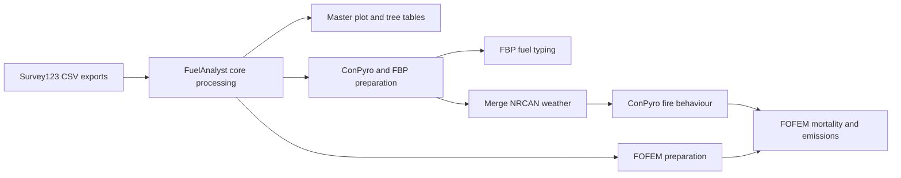

# FuelAnalyst

[](https://github.com/gagreene/FuelAnalyst/actions/workflows/tests.yml)

FuelAnalyst is a Python package for converting forest-fuel inventory data exported from ArcGIS Survey123 into analysis-ready plot, tree, fuel-load, and fire-model input tables. It was developed for forest fuel characterization and wildfire analysis in British Columbia.

The core pipeline processes five related Survey123 forms:

- Plot attributes
- Plants and regeneration
- Trees and saplings
- Canopy cover
- Woody debris and forest-floor measurements

It can also prepare inputs for the Canadian Forest Fire Behaviour Prediction (FBP) System, ConPyro, and FOFEM, and can connect plot data to gridded NRCAN weather data.

> FuelAnalyst is research software under active development. Review input schemas, units, model assumptions, and output quality before using results operationally.

## Contents

- [What FuelAnalyst produces](#what-fuelanalyst-produces)
- [Processing workflow](#processing-workflow)
- [Requirements](#requirements)
- [Installation](#installation)
- [Run the included example](#run-the-included-example)
- [Input data](#input-data)
- [Outputs](#outputs)
- [Public API](#public-api)
- [Configuration](#configuration)
- [Testing](#testing)
- [Repository layout](#repository-layout)
- [Important behavior and limitations](#important-behavior-and-limitations)
- [Contributing](#contributing)
- [License](#license)

For a shorter setup guide, see [QUICK_START.md](QUICK_START.md).

## What FuelAnalyst produces

FuelAnalyst-owned calculations include:

- Stable plot identities derived from treatment and survey fields
- Plot location, elevation, slope, aspect, and treatment attributes
- Understory vegetation and regeneration density and biomass
- Tree density, basal area, height, composition, biomass, and crown metrics
- Canopy fuel load, canopy bulk density, canopy base height, and fuel strata gap
- Canopy cover by vegetation type
- Duff, litter, and woody fuel loads
- Woody debris summaries for Canadian, U.S., modified, ConPyro, and FOFEM size classes
- Tree-level flame and fire-intensity attributes
- Prepared ConPyro, FBP fuel-typing, FOFEM mortality, and FOFEM consumption tables

External fire-behaviour and fire-effects calculations are separate downstream steps. The FuelAnalyst tests validate FuelAnalyst-owned preparation and orchestration without testing those dependency libraries themselves.

## Processing workflow



The normal sequence is:

1. Run `fuel_analyst()` on the Survey123 export folders.
2. Optionally calculate FBP fuel types.
3. Extract or supply weather records.
4. Merge weather with the prepared ConPyro table.
5. Optionally run ConPyro and FOFEM models.

## Requirements

- Python 3.10 or newer
- Git, if cloning the repository or installing optional dependencies from GitHub
- A Survey123 export matching the expected form and repeat-table structure

The base installation includes NumPy, pandas, SciPy, scikit-learn, Matplotlib, GeoPandas, Rasterio, PyProj, Shapely, python-dateutil, tqdm, and joblib.

ConPyro and FOFEM execution require optional packages. They are not required to process Survey123 data or generate model-preparation CSVs.

## Installation

### Development installation

Clone the repository and create an isolated environment:

```shell
git clone https://github.com/gagreene/FuelAnalyst.git
cd FuelAnalyst
python -m venv .venv
```

Activate it on Windows PowerShell:

```powershell
.venv\Scripts\Activate.ps1
```

Or on macOS/Linux:

```shell
source .venv/bin/activate
```

Install the core package:

```shell
python -m pip install --upgrade pip
python -m pip install -e .
```

### Test dependencies

```shell
python -m pip install -e ".[test]"
```

### Optional fire-model dependencies

Install ConPyro and flame-component support:

```shell
python -m pip install -e ".[conpyro]"
```

Install pyFOFEM support:

```shell
python -m pip install -e ".[fofem]"
```

Install both sets:

```shell
python -m pip install -e ".[conpyro,fofem]"
```

These extras install dependencies from their GitHub repositories and therefore require Git and network access. The repository also declares those projects as Git submodules for local dependency development; a recursive clone is only necessary if you intend to work directly on the checked-out dependency sources.

## Run the included example

From the repository root, run:

```shell
python -m fuel_analyst.fuel_analyst
```

The module's example routine reads `examples/data/Survey123_Data` and writes processed files beneath `examples/results/fuel_analyst`.

The same operation can be called explicitly:

```python
from pathlib import Path

from fuel_analyst import fuel_analyst

root = Path.cwd()

fuel_analyst(
    in_dir=str(root / "examples" / "data" / "Survey123_Data"),
    out_dir=str(root / "examples" / "results" / "fuel_analyst"),
    surface_fire_intensity_model="Byram",
    gen_conpyro_df=True,
    gen_fofem_tree_df=True,
    gen_fofem_consume_df=True,
)
```

This generates model input tables but does not execute ConPyro or FOFEM.

## Input data

### Required directory layout

FuelAnalyst recognizes the following directory and file names:

```text
Survey123_Data/
|-- 1_Plot_Attributes/
|   `-- survey_0.csv
|-- 2_Plants_Regeneration/
|   |-- survey_0.csv
|   `-- regeneration_1.csv
|-- 3_Trees/
|   |-- survey_0.csv
|   |-- sapling_1.csv
|   `-- tree_plot_2.csv
|-- 4_Canopy_Cover/
|   |-- survey_0.csv
|   `-- canopy_cover_1.csv
`-- 5_Woody_Debris/
    |-- survey_0.csv
    |-- spp_comp_manual_1.csv
    |-- t1_woody_2.csv
    `-- t2_woody_3.csv
```

The included [example dataset](examples/data/Survey123_Data) is the best schema reference for a complete run. The spreadsheet in [docs/reference](docs/reference) describes result fields.

### Common identity fields

Parent survey tables use these fields to construct a plot identity:

- `_date`
- `treatment_area`
- `treatment_unit`
- `treatment_type`
- `plot_id`

The generated identity is:

```text
treatment_area_treatment_unit_treatment_type_plot_id_year
```

Accepted `_date` formats are:

- `MM/DD/YYYY HH:MM` using 24-hour time
- `MM/DD/YYYY HH:MM:SS AM/PM` using 12-hour time

If multiple records produce the same identity within a year, FuelAnalyst keeps the record with the latest parsed `_date`. Unparseable values raise a `ValueError` rather than silently choosing a record.

### Form selection

The Plot Attributes `form_select` value determines whether the plants, trees, cover, and woody components are expected for each plot. Missing component folders are skipped, with a warning when a plot selected that form.

All four component-form folders are required when `gen_conpyro_df=True` because the prepared ConPyro schema depends on attributes from each component.

### Units

FuelAnalyst calculations are primarily metric. Examples include centimetres for measured diameters, metres for heights and transects, trees per hectare, square metres per hectare, kilograms per square metre, and kilograms per cubic metre.

FOFEM preparation tables convert required fields to FOFEM-compatible U.S. units. Do not assume that every generated CSV uses the same units; consult the result-field reference before downstream analysis.

## Outputs

The output directory mirrors processed form folders and may contain these top-level files:

| File | Created when | Purpose |
| --- | --- | --- |
| `master_fuel_df.csv` | Always | One plot-level table containing selected FuelAnalyst outputs |
| `master_tree_df.csv` | Tree data are processed | Detailed tree and sapling calculations |
| `conpyro_df.csv` | `gen_conpyro_df=True` | Prepared ConPyro input attributes |
| `fbp_prep_df.csv` | `gen_conpyro_df=True` | Additional attributes required by BC FBP fuel typing |
| `fofem_tree_df.csv` | `gen_fofem_tree_df=True` | FOFEM tree-mortality input table |
| `fofem_consume_df.csv` | `gen_fofem_consume_df=True` | FOFEM consumption and emissions input table |

Processed copies of each Survey123 parent table are written under their corresponding numbered output folders. Detailed repeat-table outputs may also be generated by individual components.

Tree processing always writes `3_Trees/tree_processing_issues.csv`. Invalid
plot radii remain missing during validation, and the density of only the
affected tree records is assigned `0` so one bad plot does not stop the batch.
Use the issue report together with the `tree_density_*` fields in
`3_Trees/survey_0.csv` and `master_fuel_df.csv` to distinguish complete plots
from partial results and identify the source record and reason for each failure.

## Public API

FuelAnalyst exposes five lazily imported functions from the package root:

| Function | Purpose |
| --- | --- |
| `fuel_analyst()` | Process Survey123 forms and create master/model-preparation tables |
| `process_fbp_fuel_type()` | Assign BC FBP fuel types and update a ConPyro table |
| `extract_weather_data()` | Sample NRCAN weather rasters for plot locations |
| `merge_weather_data()` | Join or cross-join weather records to plot data |
| `run_conpyro()` | Execute configured ConPyro and optional FOFEM workflows |

### Core Survey123 processing

```python
from fuel_analyst import fuel_analyst

fuel_analyst(
    in_dir="path/to/Survey123_Data",
    out_dir="path/to/results/fuel_analyst",
    surface_fire_intensity_model="Byram",  # "Byram" or "Thomas"
    gen_conpyro_df=True,
    gen_fofem_tree_df=True,
    gen_fofem_consume_df=True,
)
```

Configuration arguments may be left as `None` to use package defaults.

### FBP fuel typing

```python
from fuel_analyst import process_fbp_fuel_type

process_fbp_fuel_type(
    master_fuel_df_path="results/fuel_analyst/master_fuel_df.csv",
    fbp_prep_df_path="results/fuel_analyst/fbp_prep_df.csv",
    conpyro_df_path="results/fuel_analyst/conpyro_df.csv",
    out_dir="results/fbp_fuel_typing",
    season="growing",  # "growing" or "dormant"
)
```

This writes a file such as `conpyro_df_fbp.csv`. Existing non-null fuel-type assignments in the ConPyro table are preserved.

### Weather extraction

`extract_weather_data()` samples gridded NRCAN weather rasters for CSV or spatial plot inputs and writes CSV and shapefile outputs. It supports explicit `MMDD` season bounds or BC Wildfire Service season dates based on plot ecodivisions.

Common weather variables include `temp`, `pcp`, `rh`, `ws`, `wd`, `ffmc`, `dmc`, `dc`, `bui`, `isi`, and `fwi`. The weather directory must contain the corresponding variable directories and dated raster files expected by `extract_nrcan_wx.py`.

### Merge weather with plot data

```python
from fuel_analyst import merge_weather_data

merge_weather_data(
    plot_data_path="results/fbp_fuel_typing/conpyro_df_fbp.csv",
    plot_merge_col_name="unique_id",
    wx_data_path="results/weather/wx_data.csv",
    wx_merge_col_name="unique_id",
    wx_merge_vars=None,
    out_path="results/weather/conpyro_df_wx.csv",
    add_season=True,
    refine_fbp_seasonally=True,
    summer_start=615,
    fall_start=915,
)
```

Set `wx_merge_col_name=None` to create a Cartesian product in which every weather row is applied to every plot. Use this only when the weather table intentionally represents shared scenarios rather than plot-specific observations.

### Run ConPyro and FOFEM

```python
from fuel_analyst import run_conpyro

run_conpyro(
    out_dir="results/conpyro",
    in_conpyro_csv_path="results/weather/conpyro_df_wx.csv",
    in_tree_csv_path="results/fuel_analyst/master_tree_df.csv",
    in_fofem_consume_csv_path="results/fuel_analyst/fofem_consume_df.csv",
)
```

The default modelling configuration runs ConPyro, FOFEM mortality, and pyFOFEM emissions. Install both optional dependency groups before using this default. ConPyro input must already include required weather fields such as `ws`, `wd`, `ffmc`, `dmc`, and `bui`; some model choices additionally require `temp`, `rh`, `wx_date`, `time`, or model-selection columns.

## Configuration

Default dictionaries are defined in:

- `fuel_analyst.fuel_analyst.default_stand_summary_dict`
- `fuel_analyst.fuel_analyst.default_woody_debris_dict`
- `fuel_analyst.fuel_analyst.default_conpyro_dict`
- `fuel_analyst.fuel_analyst.default_fofem_mortality_dict`
- `fuel_analyst.fuel_analyst.default_fofem_consume_dict`
- `fuel_analyst.run_conpyro.default_fire_modelling_dict`

Use a deep copy before changing nested settings:

```python
from copy import deepcopy

from fuel_analyst.fuel_analyst import default_woody_debris_dict, fuel_analyst

woody_config = deepcopy(default_woody_debris_dict)
woody_config["woody_debris_classes"]["modified"]["process_classes"] = False

fuel_analyst(
    in_dir="path/to/Survey123_Data",
    out_dir="path/to/results",
    surface_fire_intensity_model="Byram",
    woody_debris_params=woody_config,
)
```

Important configuration areas include:

- Stand-summary attributes, classes, permutations, metrics, and units
- Woody-debris protocols, diameter cutoffs, transect lengths, and requested outputs
- ConPyro stand attributes and woody-debris mappings
- FOFEM canopy fuels, woody classes, region, season, moisture regime, and soil heating
- Fire-model switches, worker count, model selections, weather overrides, outputs, and emissions backend

Treat configuration schema as part of the scientific model. Change one setting at a time and retain the configuration used to create analysis outputs.

## Testing

Install test dependencies and run all FuelAnalyst tests:

```shell
python -m pip install -e ".[test]"
python -m pytest -vv
```

Run a specific tier:

```shell
python -m pytest tests/unit -vv
python -m pytest tests/integration -vv
python -m pytest tests/regression -vv
```

Skip tests marked as slow:

```shell
python -m pytest -m "not slow" -vv
```

The suite is organized into:

- Unit tests for FuelAnalyst calculations and transformations
- Integration tests for interactions among FuelAnalyst components
- Regression tests for confirmed defects and compatibility behavior

GitHub Actions runs the complete suite on pull requests. See [tests/README.md](tests/README.md) for fixture and generated-result conventions.

## Repository layout

```text
FuelAnalyst/
|-- .github/workflows/       Pull-request test workflow
|-- dependencies/            Optional model dependencies as Git submodules
|-- docs/                    Codebase and result-field references
|-- examples/
|   |-- data/                Checked-in Survey123 example inputs
|   `-- results/             Generated example outputs, ignored by Git
|-- src/fuel_analyst/
|   |-- components/          FuelAnalyst processing components
|   |-- supporting_data/     Packaged species, plant, and ecodivision data
|   |-- fuel_analyst.py      Core orchestrator and preparation defaults
|   |-- extract_nrcan_wx.py  NRCAN weather extraction
|   |-- fbp_fuel_type.py     BC FBP fuel typing
|   |-- merge_wx_data.py     Plot/weather merge
|   `-- run_conpyro.py       Fire-model orchestration
|-- tests/                   Unit, integration, and regression suites
|-- pyproject.toml           Package metadata and dependencies
|-- QUICK_START.md           Short installation and first-run guide
`-- README.md                Project documentation
```

## Important behavior and limitations

- FuelAnalyst expects the documented Survey123 folder and repeat-table names.
- Plot identity includes the survey year. A repeat visit to the same treatment plot within one year replaces the earlier parent record for that form.
- Parent forms are deduplicated independently. Review warnings about IDs present in one form but absent from another.
- Component outputs depend on `form_select`; plots that did not select a form will not have that form's derived attributes.
- `gen_conpyro_df=True` requires all component-form directories.
- Many stand means are basal-area weighted rather than simple arithmetic averages.
- Internal calculations are primarily SI, while FOFEM preparation includes required U.S.-unit conversions.
- Weather extraction requires a locally available NRCAN raster archive; those large raster datasets are not included.
- The FOFEM GUI backend depends on the external USFS Windows application. The default emissions backend is the optional `pyfofem` package.
- External models have their own assumptions, validation scope, and licenses. Consult their documentation before interpreting model results.
- Generated results are intentionally ignored by Git. Stable test fixtures belong under `tests/test_data`.

## Contributing

Before submitting a change:

1. Create a focused branch.
2. Install the test extra.
3. Add or update tests for FuelAnalyst-owned behavior.
4. Run `python -m pytest -vv`.
5. Keep generated analysis files out of the commit.
6. Describe scientific assumptions, unit changes, schema changes, and regression risks in the pull request.

Avoid writing tests that merely retest ConPyro, pyFOFEM, flame-components, pandas, GeoPandas, or other dependencies. Fake optional dependencies when the goal is to verify FuelAnalyst wrapper behavior.

## License

The project metadata declares the package under the MIT License. Third-party dependencies and vendored or submodule code retain their own licenses.
