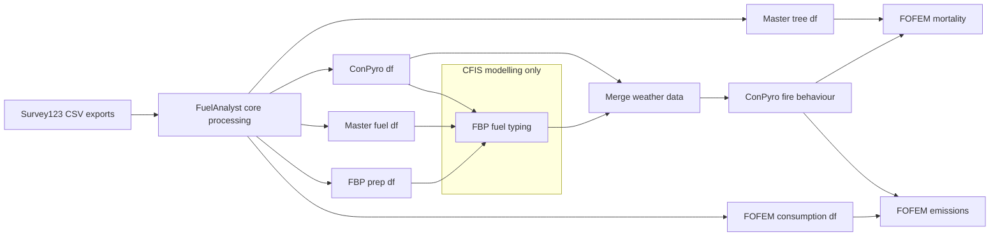

# FuelAnalyst

[](https://github.com/gagreene/FuelAnalyst/actions/workflows/tests.yml)

FuelAnalyst is a Python package for converting forest-fuel inventory data exported from ArcGIS Survey123 into analysis-ready plot, tree, fuel-load, and fire-model input tables. It was developed for forest fuel characterization and wildfire analysis in Canada and the Northwestern United States.

The core pipeline processes five related Survey123 forms:

- Plot attributes
- Plants and regeneration
- Trees and saplings
- Canopy cover
- Woody debris and forest-floor measurements

FuelAnalyst also:
- Prepares inputs for the Canadian Forest Fire Behaviour Prediction (FBP) System, ConPyro, and FOFEM, and can connect plot data to gridded NRCAN weather data.
- Models fire behaviour and fire effects with ConPyro and FOFEM, including tree mortality and smoke emissions.

> FuelAnalyst is research software under active development. Review input schemas, units, model assumptions, and output quality before using results operationally.

## Contents

- [What FuelAnalyst does](#what-fuelanalyst-does)
  - [What FuelAnalyst produces](#what-fuelanalyst-produces)
  - [General Processing workflow](#general-processing-workflow)
- [How FuelAnalyst is structured](#how-fuelanalyst-is-structured)
  - [Repository layout](#repository-layout)
- [How to install FuelAnalyst](#how-to-install-fuelanalyst)
  - [Requirements](#requirements)
  - [Installation](#installation)
  - [Optional fire-model dependencies](#optional-fire-model-dependencies)
  - [PhotoLoad model-development dependencies](#photoload-model-development-dependencies)
- [How to use FuelAnalyst](#how-to-use-fuelanalyst)
  - [Input data](#input-data)
  - [Run the included example](#run-the-included-example)
  - [Outputs](#outputs)
  - [Units and column-name abbreviations](#units-and-column-name-abbreviations)
  - [Public API](#public-api)
  - [Configuration](#configuration)
  - [Stand summary permutations](#stand-summary-permutations)
  - [Important behavior and limitations](#important-behavior-and-limitations)
- [How to maintain/contribute to FuelAnalyst](#how-to-maintaincontribute-to-fuelanalyst)
  - [Testing](#testing)
  - [Contributing](#contributing)
- [License](#license)

For a shorter setup guide, see [QUICK_START.md](QUICK_START.md).

## What FuelAnalyst does

### What FuelAnalyst produces

FuelAnalyst-owned calculations include:

- Stable plot identities derived from treatment and survey fields
- Plot location, elevation, slope, aspect, and treatment attributes
- Understory vegetation and regeneration density and biomass
- Tree density, basal area, height, composition, biomass, and crown metrics
- Canopy fuel load, canopy bulk density, canopy base height, and fuel strata gap
- Canopy cover by vegetation type
- Duff, litter, and woody fuel loads
- Woody debris summaries for Canadian, U.S., modified, ConPyro, and FOFEM size classes
- Tree-level flame and fire-intensity attributes
- Prepared ConPyro, FBP fuel-typing, FOFEM mortality, and FOFEM consumption tables

External fire-behaviour and fire-effects calculations are separate downstream steps. The FuelAnalyst tests validate FuelAnalyst-owned preparation and orchestration without testing those dependency libraries themselves.

### General Processing workflow



The normal sequence is:

1. Run `fuel_analyst()` on the Survey123 export folders.
2. Optionally calculate FBP fuel types if using CFIS to model fire behaviour.
3. Extract or supply weather records.
4. Merge weather with the prepared ConPyro table.
5. Run ConPyro and/or FOFEM models.

For a detailed breakdown of the flow between modules and conditional output files, see
[data flow and outputs in the codebase reference](docs/CODEBASE.md#data-flow-and-outputs).

## How FuelAnalyst is structured

For module responsibilities, data flow, and runtime contracts, see the
[codebase reference](docs/CODEBASE.md).

### Repository layout

```text
FuelAnalyst/
|-- .github/workflows/       Release-tag test workflow
|-- dependencies/            BC fuel-typing submodule (source for the vendored bcwft2018)
|-- docs/                    Codebase, result-field, and contribution references
|-- examples/
|   |-- data/                Checked-in Survey123 example inputs
|   `-- results/             Generated example outputs, ignored by Git
|-- models/photoload/        Reproducible PhotoLoad model-development workflow
|-- src/fuel_analyst/
|   |-- components/          FuelAnalyst processing components
|   |   |-- canopy_cover.py          Canopy-cover summaries
|   |   |-- conpyro_attributes.py    ConPyro input attributes
|   |   |-- error_handling.py        Run-scoped issue reporting
|   |   |-- fofem_attributes.py      FOFEM input preparation
|   |   |-- fofem_emissions.py       pyFOFEM emissions
|   |   |-- fofem_gui_emissions.py   FOFEM batch backend
|   |   |-- fofem_mortality.py       pyFOFEM tree mortality
|   |   |-- fofem_units.py           FOFEM unit handling
|   |   |-- fwis_moisture_content.py FWI-based fuel moisture
|   |   |-- helper.py                Shared data helpers
|   |   |-- plants_regen.py          Plants and regeneration
|   |   |-- plot_attributes.py       Plot attributes
|   |   |-- trees.py                 Trees, saplings, and stand metrics
|   |   `-- woody_debris.py          Woody and forest-floor fuels
|   |-- supporting_data/     Packaged species, plant, and ecodivision data
|   |-- tools/               Optional supporting scripts
|   |   |-- extract_nrcan_wx.py  NRCAN weather extraction
|   |   |-- fbp_fuel_type.py     BC FBP fuel typing
|   |   `-- merge_wx_data.py     Plot/weather merge
|   |-- fuel_analyst.py      Core orchestrator and preparation defaults
|   `-- run_conpyro.py       Fire-model orchestration
|-- tests/                   Unit, integration, and regression suites
|-- pyproject.toml           Package metadata and dependencies
|-- QUICK_START.md           Short installation and first-run guide
`-- README.md                Project documentation
```

## How to install FuelAnalyst

### Requirements

- Python 3.11 through 3.14
- Git, if cloning the repository
- A Survey123 export matching the expected form and repeat-table structure

The base installation includes NumPy, pandas, SciPy, scikit-learn, Matplotlib, GeoPandas, Rasterio, PyProj, Shapely, python-dateutil, tqdm, joblib, and flame-components. ConPyro is vendored in the package.

FOFEM execution requires the optional `fofem` extra. It is not required to process Survey123 data or generate model-preparation CSVs.

### Installation

#### Development installation

Clone the repository and create an isolated environment:

```shell
git clone https://github.com/gagreene/FuelAnalyst.git
cd FuelAnalyst
python -m venv .venv
```

Activate it on Windows PowerShell:

```powershell
.venv\Scripts\Activate.ps1
```

Or on macOS/Linux:

```shell
source .venv/bin/activate
```

Install the core package:

```shell
python -m pip install --upgrade pip
python -m pip install -e .
```

#### Test dependencies

```shell
python -m pip install -e ".[test,photoload,fofem]"
```

The full suite collects PhotoLoad tests, so its image-analysis dependencies
must be installed even when the change does not modify PhotoLoad.

#### Contributor setup with uv (locked environment)

Contributors can reproduce the exact tested environment from `uv.lock` with
[uv](https://docs.astral.sh/uv/). This is optional: the pip commands above keep working, and uv is
never a runtime dependency of FuelAnalyst.

```shell
uv sync --locked --extra test --extra photoload --extra fofem --group dev
uv run --no-sync pytest -vv
```

- Name every extra you need: uv installs none by default. Add `--group notebook` for the tutorial
  notebook tools.
- `uv sync` is exact. It removes packages that are not in the lock, so do not run it in an
  environment that holds packages you installed by hand and want to keep.
- Use `uv run --no-sync` after the sync, so uv does not re-sync without your extras.
- `uv.lock` is generated. Change dependencies in `pyproject.toml`, then run `uv lock` (see
  [Dependency changes and `uv.lock`](docs/CONTRIBUTION_PROCEDURES.md#dependency-changes-and-uvlock)).
- The locked environment needs **macOS 15 or newer on Apple Silicon** (the locked `rasterio` for
  Python 3.12 and newer ships only macOS 15 wheels). Intel macOS is not supported. Windows and
  Linux (x86_64) are covered for Python 3.11 through 3.14. Installing FuelAnalyst with pip is not
  affected by these limits.

#### Optional fire-model dependencies

ConPyro is vendored in the package (`src/fuel_analyst/_vendor/conpyro`), and `run_conpyro()` also uses
`flame-components>=0.1.1,<0.2`, which installs with the core package, so `run_conpyro()` needs no
separate ConPyro install.

Install pyFOFEM support:

```shell
python -m pip install -e ".[fofem]"
```

The `fofem` extra installs the bounded
`pyfofem-fire-effects>=0.1.1,<0.2` distribution from PyPI (no Git checkout needed) for the
default `model_select='pyfofem'` emissions backend, which works on Windows, Linux, and macOS.

The `model_select='fof_gui'` backend runs the official USFS FOFEM 6.9.4 batch application
(`runfofem.exe`) instead. It runs on Windows x64 and on Linux x64 through Wine
(validated with Wine 9.0 on Ubuntu 24.04). For Windows, install its
separate, optional runtime package with:

```shell
python -m pip install ./packages/fofem694-runtime
```

After the Windows runtime wheel is published to PyPI, it can instead be installed with:

```shell
python -m pip install fuel-analyst-fofem694-runtime
```

`fuel-analyst-fofem694-runtime` is a platform-specific wheel (`py3-none-win_amd64`) that
carries the official executable and its two reference CSVs; it is never pulled in as a
dependency of the main `fuel-analyst` package on any platform, so a Linux/macOS install (or a
Windows install that never selects `fof_gui`) is unaffected. `runfofem.exe` also requires the
[Microsoft Visual C++ Redistributable (x64)](https://learn.microsoft.com/en-us/cpp/windows/latest-supported-vc-redist)
to be installed separately on the host - it is not bundled in either wheel. Without it,
`runfofem.exe` fails to start and FuelAnalyst reports one clear error naming the missing
runtime rather than a raw subprocess failure.

On Linux, install Wine and winetricks, then provision a 64-bit Wine prefix:

```shell
export WINEPREFIX="$HOME/.wine-fofem694"
export WINEARCH=win64
winetricks -q vcrun2022
export FUEL_ANALYST_FOFEM_DIR="$(pwd)/src/fuel_analyst/supporting_data/fofem_694"
```

**Prefer the latest `winetricks` script over your distro's packaged version** for the
`vcrun2022` step above (`curl -fsSL -o winetricks https://raw.githubusercontent.com/Winetricks/winetricks/master/src/winetricks && chmod +x winetricks && ./winetricks -q vcrun2022`).
Microsoft serves the Visual C++ Redistributable from a stable URL that it updates in place,
so `winetricks`' pinned SHA-256 hash for it goes stale between `winetricks` releases, and
distro packaging lags further still - verified directly on both Ubuntu 24.04 and 26.04, whose
packaged `winetricks` both reported a hash mismatch that the current upstream script did not.
`tests/manual/fofem694_linux_wine_smoke.sh` does this automatically by default.

Run FuelAnalyst with these environment variables and `wine` on PATH. Use the
source-checkout bundle above or an external FOFEM 6.9.4 bundle containing
`runfofem.exe`, `Emission_Factors.csv`, and `fof_spp.csv`; the Windows runtime wheel
cannot be installed on Linux. FuelAnalyst invokes Wine explicitly, so no
`binfmt_misc` registration or executable permission on the EXE is required. Validated
end to end (FuelAnalyst's real opt-in test suite against the actual bundled EXE) on
Ubuntu 24.04.5 LTS with Wine 9.0 and Ubuntu 26.04.1 LTS with Wine 10.0.

`_get_fofem_dir()` resolves the runtime directory in order: the `FUEL_ANALYST_FOFEM_DIR`
environment variable (an external FOFEM 6.9.4 installation, for overriding either of the
paths below); the installed `fuel-analyst-fofem694-runtime` package; then, for a Git source
checkout only, the bundled `src/fuel_analyst/supporting_data/fofem_694` directory. See
[the codebase reference](docs/CODEBASE.md#package-and-repository-layout) for the full
resolution order and provenance details. The repository
retains one Git submodule, `dependencies/BC_CFFBPS_FuelTyping_Tool`, as the source for the vendored
`bcwft2018.py`; a recursive clone is only necessary to refresh that vendored copy. ConPyro is vendored
from its upstream repository the same way (`update_vendors.sh`, `CONPYRO_SRC`).

#### PhotoLoad model-development dependencies

The reproducible PhotoLoad image-analysis workflow is separate from the core
Survey123 pipeline:

```shell
python -m pip install -e ".[photoload]"
```

See [models/photoload/README.md](models/photoload/README.md) for its source-data,
calibration, and output contracts.

## How to use FuelAnalyst

### Input data

#### Required directory layout

FuelAnalyst recognizes the following directory and file names:

```text
Survey123_Data/
|-- 1_Plot_Attributes/
|   `-- survey_0.csv
|-- 2_Plants_Regeneration/
|   |-- survey_0.csv
|   `-- regeneration_1.csv
|-- 3_Trees/
|   |-- survey_0.csv
|   |-- sapling_1.csv
|   `-- tree_plot_2.csv
|-- 4_Canopy_Cover/
|   |-- survey_0.csv
|   `-- canopy_cover_1.csv
`-- 5_Woody_Debris/
    |-- survey_0.csv
    |-- spp_comp_manual_1.csv
    |-- t1_woody_2.csv
    `-- t2_woody_3.csv
```

The included [example dataset](examples/data/Survey123_Data) is the best schema reference for a complete run. The spreadsheet in [docs/reference](docs/reference) describes result fields.

#### Common identity fields

Parent survey tables use these fields to construct a plot identity:

- `_date`
- `treatment_area`
- `treatment_unit`
- `treatment_type`
- `plot_id`

The generated identity is:

```text
treatment_area_treatment_unit_treatment_type_plot_id_year
```

Accepted `_date` formats are:

- `MM/DD/YYYY HH:MM` using 24-hour time
- `MM/DD/YYYY HH:MM:SS AM/PM` using 12-hour time

If multiple records produce the same identity within a year, FuelAnalyst keeps the record with the latest parsed `_date`. Unparseable values raise a `ValueError` rather than silently choosing a record.

Parent forms are deduplicated independently. Review warnings about plot IDs
present in one form but absent from another.

#### Form selection

The Plot Attributes `form_select` value determines whether the plants, trees, cover, and woody components are expected for each plot. Missing component folders are skipped, with a warning when a plot selected that form.

All four component-form folders are required when `gen_conpyro_df=True` because the prepared ConPyro schema depends on attributes from each component.

### Run the included example

From the repository root, run:

```shell
python -m fuel_analyst.fuel_analyst
```

The module's example routine reads `examples/data/Survey123_Data` and writes processed files beneath `examples/results/fuel_analyst`.

The same operation can be called explicitly:

```python
from pathlib import Path

from fuel_analyst import fuel_analyst

root = Path.cwd()

fuel_analyst(
    in_dir=str(root / "examples" / "data" / "Survey123_Data"),
    out_dir=str(root / "examples" / "results" / "fuel_analyst"),
    surface_fire_intensity_model="Byram",
    gen_conpyro_df=True,
    gen_fofem_gui_app_tree_df=True,
    gen_fofem_consume_df=True,
)
```

This generates model input tables but does not execute ConPyro or FOFEM. The FOFEM consumption
table's output units and filename (`fofem_consume_si_df.csv` or `fofem_consume_imperial_df.csv`)
are set by `fofem_consume_params`'s `fofem_processing_units` key (default `'SI'`); see
[Units](#units) and [Configuration](#configuration).


### Run the tutorial

For a guided walkthrough of the example data, FBP fuel typing, weather
merging, and ConPyro/FOFEM, start with the
[FuelAnalyst tutorial](examples/tutorial/README.md). Its notebook and setup
instructions use the same checked-in example data.

### Outputs

The output directory mirrors processed form folders and may contain these top-level files:

| File | Created when | Purpose |
| --- | --- | --- |
| `master_fuel_df.csv` | Every completed run | One plot-level table containing selected FuelAnalyst outputs |
| `fuelanalyst_errors.csv` | Every completed run | Collected data-quality issues by plot and reporting source |
| `master_tree_df.csv` | Tree data are processed | Detailed tree and sapling calculations (all trees, live and dead; live-stand fields are 0 for dead trees) |
| `conpyro_df.csv` | `gen_conpyro_df=True` | Prepared ConPyro input attributes |
| `fbp_prep_df.csv` | `gen_conpyro_df=True` | Additional attributes required by BC FBP fuel typing |
| `fofem_gui_app_tree_mortality_df.csv` | `gen_fofem_gui_app_tree_df=True` | Tree-mortality input formatted for the standalone FOFEM GUI application |
| `fofem_consume_si_df.csv` or `fofem_consume_imperial_df.csv` | `gen_fofem_consume_df=True` | FOFEM consumption and emissions input table; filename encodes `fofem_processing_units` (default SI) |

Processed copies of each Survey123 parent table are written under their corresponding numbered output folders. Detailed repeat-table outputs may also be generated by individual components.

Many stand means are basal-area weighted rather than simple arithmetic means.

Every `fuel_analyst()` run that completes writes `fuelanalyst_errors.csv`
alongside `master_fuel_df.csv`. It lists every data-quality issue encountered
during the run - invalid tree-density inputs, ID mismatches between forms,
and species-composition or percent-flammable fallbacks - one row per affected
plot, one column per reporting source, with a `General Error` row for issues
not tied to any specific plot. Known sources use stable display names; unknown
sources retain their full logger names to prevent column collisions. Invalid
plot radii remain missing during tree-density
validation, and the density of only the affected tree records is assigned `0`
so one bad plot does not stop the batch; check `fuelanalyst_errors.csv`'s
Trees column for the reason.

The other logging-enabled entry points write their own completed-run reports:

- `extract_weather_data()` writes `<out_file_name>_errors.csv` beside its CSV
  and shapefile outputs.
- `run_conpyro()` writes `run_conpyro_errors.csv` in its output directory.

FuelAnalyst respects a host application's existing package or root logging
handler. If none is configured, it installs a run-scoped fallback console
handler; a lone `logging.NullHandler` does not suppress that fallback.

#### Units

FuelAnalyst calculations are primarily metric. Examples include centimetres for measured diameters, metres for heights and transects, trees per hectare, square metres per hectare, kilograms per square metre, and kilograms per cubic metre.

`fofem_gui_app_tree_mortality_df.csv` (the standalone FOFEM GUI's tree-mortality input) is always
written in the FOFEM GUI application's own required Imperial units, since that legacy `.TRE`
import format has no metric mode; its column names are FOFEM's own field names, not FuelAnalyst's
naming convention. The FOFEM consumption table (`fofem_consume_si_df.csv` or
`fofem_consume_imperial_df.csv`) and the final FOFEM mortality and emissions result tables written
by `run_conpyro()` default to SI but can be configured to Imperial; see
[Configuration](#configuration) for the `fofem_processing_units`/`emissions_units` settings that
control this. The FOFEM consumption table's own column names and order are fixed regardless of
units - only its values and filename change; the final result tables carry an explicit unit
suffix on every physical column instead. Do not assume every generated CSV uses the same units;
consult the result-field reference and the tables below before downstream analysis.

##### Units and column-name abbreviations

Physical result columns separate the variable name from its unit with an underscore
(`PM25F_gpm2`), using `p` inside an abbreviation to mean "per" (`kgpm2`, not `kg_m2`). Identifiers,
dates, categorical labels, equation codes, and boolean/binary flags never carry a unit suffix.
`_pct` denotes a 0-100 scale value; `_prop` denotes a 0-1 scale value.

The tables below list every unit abbreviation FuelAnalyst's first-party code actually emits or
accepts in a column name; abbreviations not listed are not currently used.

###### SI units

| Suffix | Meaning | Quantity | Example column |
| --- | --- | --- | --- |
| `m` | metres | Length/depth | `fuel_bed_depth_m` |
| `cm` | centimetres | Length/depth | `stand_duff_depth_cm` |
| `m2pha` | square metres per hectare | Basal area per hectare | `stand_ba_m2pha_broadleaf_sum` |
| `m3pha` | cubic metres per hectare | Volume per hectare (intermediate; not carried into `master_fuel_df.csv`) | `woody_volume_m3pha` |
| `kgpm3` | kilograms per cubic metre | Bulk density | `stand_cbd_kgpm3_live` |
| `kgpm2` | kilograms per square metre | Fuel load | `stand_foliage_fofem_kgpm2_sum` |
| `tpha` | trees per hectare | Tree density | `stand_dens_tpha_sum` |
| `gpm2` | grams per square metre | FOFEM SI smoke-emission mass | `PM25F_gpm2` |
| `mps` | metres per second | Speed | `instand_ws_mps` |
| `kWpm` | kilowatts per metre | Fireline intensity | `stand_fire_intensity_kWpm_mean` |
| `degC` | degrees Celsius | Temperature (FOFEM soil-heating results; always Celsius, not converted by `emissions_units`) | `Lay0_degC` |
| `sec` | seconds | Duration | `flame_res_time_sec` |
| `min` | minutes | Duration | `flame_res_time_min` |
| `pct` | percent (0-100 scale) | Various | `plot_slope_pct` |
| `prop` | proportion (0-1 scale) | Various | `prob_mortality_crnsch_prop` |

###### Imperial units

| Suffix | Meaning | Quantity | Example column |
| --- | --- | --- | --- |
| `in` | inches | Depth | `DufDepPre_in` |
| `tpac` | US short tons per acre (not metric tonnes) | Fuel load | `LitPre_tpac` |
| `lbpac` | pounds per acre | FOFEM Imperial smoke-emission mass | `PM25F_lbpac` |
| `pct` | percent (0-100 scale) | Various | shared with SI |
| `prop` | proportion (0-1 scale) | Various | shared with SI |
| `sec` | seconds | Duration | shared with SI (unit-system-independent) |

Only two output contracts use Imperial values at all: the standalone FOFEM GUI's mortality
preparation file (always Imperial, native FOFEM field names, not this suffix convention) and the
configurable FOFEM consumption/emissions tables described above. No other Imperial length, area,
or speed abbreviation (`ft`, `ac`, `tpa`, `mph`, `Btu`, `degF`, etc.) is currently emitted or
accepted anywhere in first-party FuelAnalyst code.

### Public API

FuelAnalyst exposes five lazily imported functions from the package root:

| Function | Purpose |
| --- | --- |
| `fuel_analyst()` | Process Survey123 forms and create master/model-preparation tables |
| `process_fbp_fuel_type()` | Assign BC FBP fuel types and update a ConPyro table |
| `extract_weather_data()` | Sample NRCAN weather rasters for plot locations |
| `merge_weather_data()` | Join or cross-join weather records to plot data |
| `run_conpyro()` | Execute configured ConPyro and optional FOFEM workflows |

For the responsibilities and relationships of the underlying modules, see
[core modules in the codebase reference](docs/CODEBASE.md#core-modules).

#### Core Survey123 processing

```python
from fuel_analyst import fuel_analyst

fuel_analyst(
    in_dir="path/to/Survey123_Data",
    out_dir="path/to/results/fuel_analyst",
    surface_fire_intensity_model="Byram",  # "Byram" or "Thomas"
    gen_conpyro_df=True,
    gen_fofem_gui_app_tree_df=True,
    gen_fofem_consume_df=True,
)
```

Configuration arguments may be left as `None` to use package defaults.

#### FBP fuel typing

```python
from fuel_analyst import process_fbp_fuel_type

process_fbp_fuel_type(
    master_fuel_df_path="results/fuel_analyst/master_fuel_df.csv",
    fbp_prep_df_path="results/fuel_analyst/fbp_prep_df.csv",
    conpyro_df_path="results/fuel_analyst/conpyro_df.csv",
    out_dir="results/fbp_fuel_typing",
    season="growing",  # "growing" or "dormant"
)
```

This writes a file such as `conpyro_df_fbp.csv`. Existing non-null fuel-type assignments in the ConPyro table are preserved.

#### Weather extraction

`extract_weather_data()` samples gridded NRCAN weather rasters for CSV or spatial plot inputs and writes CSV, shapefile, and `<out_file_name>_errors.csv` outputs. It supports explicit `MMDD` season bounds or BC Wildfire Service season dates based on plot ecodivisions.

Common weather variables include `temp`, `pcp`, `rh`, `ws`, `wd`, `ffmc`, `dmc`, `dc`, `bui`, `isi`, and `fwi`. The weather directory must contain the corresponding variable directories and dated raster files expected by `extract_nrcan_wx.py`.

Weather extraction requires a local NRCAN raster archive; those large raster
datasets are not included in the repository.

#### Merge weather with plot data

```python
from fuel_analyst import merge_weather_data

merge_weather_data(
    plot_data_path="results/fbp_fuel_typing/conpyro_df_fbp.csv",
    plot_merge_col_name="unique_id",
    wx_data_path="results/weather/wx_data.csv",
    wx_merge_col_name="unique_id",
    wx_merge_vars=None,
    out_path="results/weather/conpyro_df_wx.csv",
    add_season=True,
    refine_fbp_seasonally=True,
    summer_start=615,
    fall_start=915,
)
```

Set `wx_merge_col_name=None` to create a Cartesian product in which every weather row is applied to every plot. Use this only when the weather table intentionally represents shared scenarios rather than plot-specific observations.

#### Run ConPyro and FOFEM

```python
from fuel_analyst import run_conpyro

run_conpyro(
    out_dir="results/conpyro",
    in_conpyro_csv_path="results/weather/conpyro_df_wx.csv",
    in_tree_csv_path="results/fuel_analyst/master_tree_df.csv",
    in_fofem_consume_csv_path="results/fuel_analyst/fofem_consume_si_df.csv",
)
```

The default modelling configuration runs ConPyro, FOFEM mortality, and pyFOFEM emissions. Install the `fofem` extra before using this default. ConPyro input must already include required weather fields such as `ws`, `wd`, `ffmc`, `dmc`, and `bui`; some model choices additionally require `temp`, `rh`, `wx_date`, `time`, or model-selection columns.

`in_fofem_consume_csv_path` must be one of `fuel_analyst()`'s two unit-bearing filenames, and
must match `default_fire_modelling_dict['fofem_emissions']['emissions_units']` (default `'SI'`);
`run_conpyro()` validates this before running either FOFEM emissions backend and raises a clear
error on a mismatch rather than silently misinterpreting the file.

Every completed `run_conpyro()` call also writes `run_conpyro_errors.csv`.

### Configuration

Default dictionaries are defined in:

- `fuel_analyst.fuel_analyst.default_stand_summary_dict`
- `fuel_analyst.fuel_analyst.default_woody_debris_dict`
- `fuel_analyst.fuel_analyst.default_conpyro_dict`
- `fuel_analyst.fuel_analyst.default_fofem_consume_dict` (includes `fofem_processing_units`, default `'SI'`)
- `fuel_analyst.run_conpyro.default_fire_modelling_dict` (includes `fofem_emissions.emissions_units`, default `'SI'`)

The [stand summary configuration reference](docs/CODEBASE.md#stand-summary-configuration)
explains how these entries are merged and which metrics are fixed.

Use a deep copy before changing nested settings:

```python
from copy import deepcopy

from fuel_analyst.fuel_analyst import default_woody_debris_dict, fuel_analyst

woody_config = deepcopy(default_woody_debris_dict)
woody_config["woody_debris_classes"]["modified"]["process_classes"] = False

fuel_analyst(
    in_dir="path/to/Survey123_Data",
    out_dir="path/to/results",
    surface_fire_intensity_model="Byram",
    woody_debris_params=woody_config,
)
```

Important configuration areas include:

- Stand-summary attributes, classes, permutations, metrics, and units
- Woody-debris protocols, diameter cutoffs, transect lengths, and requested outputs
- ConPyro stand attributes and woody-debris mappings
- FOFEM canopy fuels, woody classes, region, season, moisture regime, and soil heating
- Fire-model switches, worker count, model selections, weather overrides, outputs, and emissions backend

Treat configuration schema as part of the scientific model. Change one setting at a time and retain the configuration used to create analysis outputs.

#### Valid `att_source` values

Each stand-summary entry reads one per-tree column from the master tree table.
`att_source` names that attribute; if it is omitted, the entry's dictionary key is
used. The output column name is built from the dictionary key, not from
`att_source`, so two entries may summarize the same attribute under different
names. `_calc_stand_attributes()` in
[`trees.py`](src/fuel_analyst/components/trees.py) adds a suffix by attribute group:

| `att_source` | Tree column read | Notes |
| --- | --- | --- |
| `dens`, `ba` | `tree_dens_ha`, `tree_ba_ha` | Per-hectare density and basal area. |
| `cfl`, `foliage`, `branches`, `wood`, `bark` | `tree_<att>_cnbe_ha` | Crown fuel loads per hectare from the CNBE biomass equations. |
| `ht`, `cbh`, `dcbh`, `fsg`, `flame_length`, `fire_intensity` | `tree_<att>_wtd` for `sum` and `mean`; `tree_<att>` for `min` and `max` | Basal-area-weighted; `mean` is the BA-weighted stand mean. |
| `cbd` | `tree_cfl_cnbe_ha` | Special case: ignores `metrics` and returns canopy fuel load divided by the BA-weighted crown depth. Its output name has no metric suffix. |
| `foliage_fofem`, `branches_fofem` | `tree_<att>` | Used by `default_fofem_consume_dict`; these entries omit `att_source`, so the key is used. |

For `dens`, `ba`, `cfl`, `foliage`, `branches`, `wood`, `bark`, `foliage_fofem`, and
`branches_fofem`, `metrics` is fixed to `['sum']`, and for `cbd` it is fixed to `[]`. If a
dictionary requests different metrics, FuelAnalyst replaces them with the fixed value and records a
warning in `fuelanalyst_errors.csv`. This also applies to the ConPyro and FOFEM entries, which
are configured through `conpyro_params` and `fofem_consume_params`: a same-named key in
`stand_summary_params` is replaced when those entries are merged in. The BA-weighted
attributes (`ht`, `cbh`, `dcbh`, `fsg`, `flame_length`, `fire_intensity`) accept `min`, `max`,
and `mean`. The six ConPyro height, canopy base height, and foliage-ground
(`conpyro_ht_*`, `conpyro_cbh_*`, `conpyro_fsg`) entries each produce a single column, so
they accept exactly one of `min`, `max`, or `mean`; no metric, several different metrics, or
an unknown metric is replaced with `['mean']` and a warning is recorded. A metric listed more
than once counts once, so `['max', 'max']` is read as `['max']` without a warning.

Any other value must match an existing `tree_<value>` column in the master tree
table. Otherwise pandas raises a `KeyError` when the trees are grouped. Which
trees contribute to each value is set by `summary` and `summary_permutation`,
described next.

#### Stand summary permutations

In the `default_stand_summary_dict`, the `summary` list chooses tree groups. `summary_permutation` controls which
groups become separate output summaries. A joined name such as `live_conifer`
means **live AND conifer**. In `'combined'` mode, both statuses together mean
any status, and both tree types together mean any type. These settings are used by
[`_calc_stand_attributes()`](src/fuel_analyst/components/trees.py) and the
default dictionaries in [`fuel_analyst.py`](src/fuel_analyst/fuel_analyst.py).

As an example of how the permutation types work, consider a plot with four trees:

| Tree | Status | Type |
| --- | --- | --- |
| 1 | Live | Conifer |
| 2 | Live | Broadleaf |
| 3 | Dead | Conifer |
| 4 | Dead | Broadleaf |

Tree IDs 1–4 let the examples show which records each summary selects.
`'all'` creates every valid individual group and cross-group pair, `'exact'`
creates one output per input item, and `'combined'` simplifies complete
status or type pairs before joining the remaining filters with AND. The table
covers all 15 nonempty subsets of the four non-`total` groups. Names in the
output columns are the summary suffixes;
the full output name also contains the attribute and metric, such as
`stand_dens_tpha_live_conifer_sum`.

| `summary`<br>input list | `'all'`<br>outputs → matching trees | `'exact'`<br>outputs → matching trees | `'combined'`<br>output → matching trees |
| --- | --- | --- | --- |
| `live` | `live` → 1, 2 | `live` → 1, 2 | `live` → 1, 2 |
| `dead` | `dead` → 3, 4 | `dead` → 3, 4 | `dead` → 3, 4 |
| `conifer` | `conifer` → 1, 3 | `conifer` → 1, 3 | `conifer` → 1, 3 |
| `broadleaf` | `broadleaf` → 2, 4 | `broadleaf` → 2, 4 | `broadleaf` → 2, 4 |
| `live, dead` | `live` → 1, 2; `dead` → 3, 4 | `live` → 1, 2; `dead` → 3, 4 | `total` → 1, 2, 3, 4 |
| `live, conifer` | `live` → 1, 2; `conifer` → 1, 3; `live_conifer` → 1 | `live` → 1, 2; `conifer` → 1, 3 | `live_conifer` → 1 |
| `live, broadleaf` | `live` → 1, 2; `broadleaf` → 2, 4; `live_broadleaf` → 2 | `live` → 1, 2; `broadleaf` → 2, 4 | `live_broadleaf` → 2 |
| `dead, conifer` | `dead` → 3, 4; `conifer` → 1, 3; `dead_conifer` → 3 | `dead` → 3, 4; `conifer` → 1, 3 | `dead_conifer` → 3 |
| `dead, broadleaf` | `dead` → 3, 4; `broadleaf` → 2, 4; `dead_broadleaf` → 4 | `dead` → 3, 4; `broadleaf` → 2, 4 | `dead_broadleaf` → 4 |
| `conifer, broadleaf` | `conifer` → 1, 3; `broadleaf` → 2, 4 | `conifer` → 1, 3; `broadleaf` → 2, 4 | `total` → 1, 2, 3, 4 |
| `live, dead, conifer` | `live` → 1, 2; `dead` → 3, 4; `conifer` → 1, 3; `live_conifer` → 1; `dead_conifer` → 3 | `live` → 1, 2; `dead` → 3, 4; `conifer` → 1, 3 | `conifer` → 1, 3 |
| `live, dead, broadleaf` | `live` → 1, 2; `dead` → 3, 4; `broadleaf` → 2, 4; `live_broadleaf` → 2; `dead_broadleaf` → 4 | `live` → 1, 2; `dead` → 3, 4; `broadleaf` → 2, 4 | `broadleaf` → 2, 4 |
| `live, conifer, broadleaf` | `live` → 1, 2; `conifer` → 1, 3; `broadleaf` → 2, 4; `live_conifer` → 1; `live_broadleaf` → 2 | `live` → 1, 2; `conifer` → 1, 3; `broadleaf` → 2, 4 | `live` → 1, 2 |
| `dead, conifer, broadleaf` | `dead` → 3, 4; `conifer` → 1, 3; `broadleaf` → 2, 4; `dead_conifer` → 3; `dead_broadleaf` → 4 | `dead` → 3, 4; `conifer` → 1, 3; `broadleaf` → 2, 4 | `dead` → 3, 4 |
| `live, dead, conifer, broadleaf` | `live` → 1, 2; `dead` → 3, 4; `conifer` → 1, 3; `broadleaf` → 2, 4; `live_conifer` → 1; `live_broadleaf` → 2; `dead_conifer` → 3; `dead_broadleaf` → 4 | `live` → 1, 2; `dead` → 3, 4; `conifer` → 1, 3; `broadleaf` → 2, 4 | `total` → 1, 2, 3, 4 |

The table assumes the listed input order. Where two filters remain, the
output suffix follows that order; for example, `['conifer', 'live']` produces
`conifer_live` in `'combined'` mode. Several ConPyro defaults use
`['live', 'conifer']` with `'combined'` to summarize live conifers in one
output column.

##### Adding `total`

`total` alone produces `total` → 1, 2, 3, 4 in both `'all'` and `'exact'`.
Its full output name omits `_total` (for example, `stand_dens_tpha_sum`).
Adding `total` to any table row adds `total` → 1, 2, 3, 4 in `'all'` and
`'exact'`.
In contrast, `'combined'` removes `total` before joining the remaining groups,
so adding it to any table row leaves that row's combined result unchanged.
If `total` is the *only* item in a `'combined'` list, FuelAnalyst records a
Trees configuration error in `fuelanalyst_errors.csv` and raises `ValueError`.
If you wish to include a summary for `total`, use `'all'` or `'exact'` instead
of `'combined'`.

The default tree-density input is
`['total', 'live', 'dead', 'conifer', 'broadleaf']`. With `'all'`, it produces
the eight valid outputs shown by the last row plus `total`. With `'exact'`,
it produces those five individual groups. With `'combined'`, `total` is
removed and the four remaining groups simplify to `total` → 1, 2, 3, 4.

##### Complete status and type groups

`'combined'` treats `live` plus `dead` as all statuses, and `conifer` plus
`broadleaf` as all tree types. Supplying
`['live', 'conifer', 'dead', 'conifer']` creates
`conifer` → 1, 3, and supplying
`['live', 'broadleaf', 'dead', 'broadleaf']` creates
`broadleaf` → 2, 4. Supplying all four groups creates `total` → 1, 2, 3, 4.
The repeated type names in these examples are removed during simplification.
`['total']` remains invalid for `'combined'` by itself; specify at least one
status or type group to obtain a combined summary.

### Important behavior and limitations

A completed run can include plot-level input warnings and fallbacks. Inspect
`fuelanalyst_errors.csv` and the other error reports before interpreting its
outputs. External fire models have their own assumptions, validation scope,
and licenses; consult their documentation when interpreting model results.

See [runtime contracts and gotchas](docs/CODEBASE.md#runtime-contracts-and-gotchas)
for the input, form selection, and downstream model details behind these limits.

## How to maintain/contribute to FuelAnalyst

### Testing

Install test dependencies and run all FuelAnalyst tests:

```shell
python -m pip install -e ".[test,photoload,fofem]"
python -m pytest -vv
```

Or, in the locked uv environment described under Installation:

```shell
uv sync --locked --extra test --extra photoload --extra fofem --group dev
uv run --no-sync pytest -vv
```

Run a specific tier:

```shell
python -m pytest tests/unit -vv
python -m pytest tests/integration -vv
python -m pytest tests/regression -vv
```

Skip tests marked as slow:

```shell
python -m pytest -m "not slow" -vv
```

The suite is organized into:

- Unit tests for FuelAnalyst calculations and transformations
- Integration tests for interactions among FuelAnalyst components
- Regression tests for confirmed defects and compatibility behavior

The GitHub Actions test workflow is configured for version-tag and manual runs. Run the full suite locally before each PR merge. See [tests/README.md](tests/README.md) for fixture and generated-result conventions.

### Contributing

See [Contribution procedures](docs/CONTRIBUTION_PROCEDURES.md) for the
repository's commit, pull-request, and test rules.

Versioned routing uses `MAJOR.MINOR.PATCH`: major and minor changes target
`pre_release`, while patches target `master`. The repository owner reviews and
merges `pre_release` into `master` through a PR.

Before submitting a change:

1. Create a focused branch.
2. Install the test extra.
3. Add or update tests for FuelAnalyst-owned behavior.
4. Run `python -m pytest -vv`.
5. Keep generated analysis files out of the commit.
6. Describe scientific assumptions, unit changes, schema changes, and regression risks in the pull request.

Generated results are intentionally ignored by Git. Put stable test fixtures
under `tests/test_data`.

Avoid writing tests that merely retest ConPyro, pyFOFEM, flame-components, pandas, GeoPandas, or other dependencies. Fake optional dependencies when the goal is to verify FuelAnalyst wrapper behavior.

## License

The project metadata declares the package under the MIT License. Third-party dependencies and vendored or submodule code retain their own licenses.
