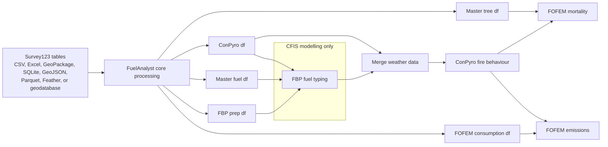
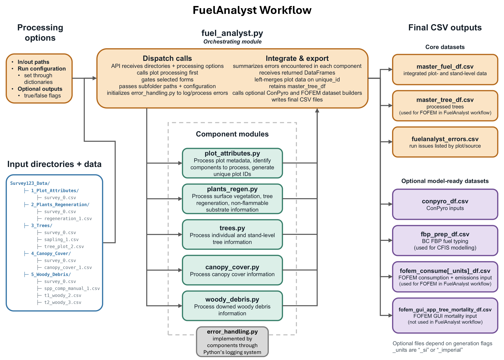
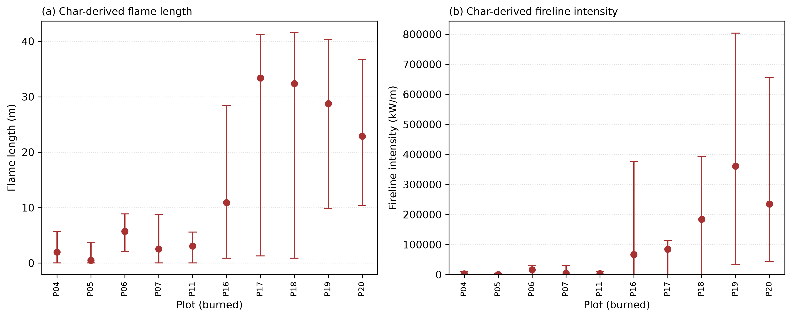
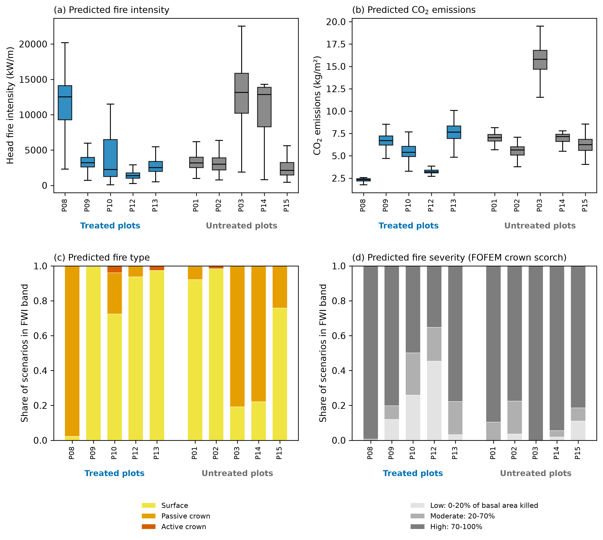

# FuelAnalyst

[](https://github.com/gagreene/FuelAnalyst/actions/workflows/tests.yml)

FuelAnalyst is a Python package for converting forest-fuel inventory data exported from ArcGIS Survey123 into analysis-ready plot, tree, fuel-load, and fire-model input tables. It was developed for forest fuel characterization and wildfire analysis in Canada and the Northwestern United States.

The core pipeline processes five related Survey123 forms:

- Plot attributes
- Plants and regeneration
- Trees and saplings
- Canopy cover
- Woody debris and forest-floor measurements

FuelAnalyst also:
- Prepares inputs for the Canadian Forest Fire Behaviour Prediction (FBP) System, ConPyro, and FOFEM, and can connect plot data to gridded NRCAN weather data.
- Models fire behaviour and fire effects with ConPyro and FOFEM, including tree mortality and smoke emissions.

> FuelAnalyst is research software under active development. Review input schemas, units, model assumptions, and output quality before using results operationally.

## Contents

- [What FuelAnalyst does](#what-fuelanalyst-does)
  - [What FuelAnalyst produces](#what-fuelanalyst-produces)
  - [General Processing workflow](#general-processing-workflow)
- [How FuelAnalyst is structured](#how-fuelanalyst-is-structured)
  - [Calculation methods](#calculation-methods)
  - [Repository layout](#repository-layout)
- [How to install FuelAnalyst](#how-to-install-fuelanalyst)
  - [Requirements](#requirements)
  - [Installation](#installation)
  - [Optional fire-model dependencies](#optional-fire-model-dependencies)
  - [PhotoLoad model-development dependencies](#photoload-model-development-dependencies)
- [How to use FuelAnalyst](#how-to-use-fuelanalyst)
  - [Input data](#input-data)
  - [Run the included example](#run-the-included-example)
  - [Example results](#example-results)
  - [Outputs](#outputs)
  - [Units and column-name abbreviations](#units-and-column-name-abbreviations)
  - [Public API](#public-api)
  - [Configuration](#configuration)
  - [Woody debris, ConPyro, and FOFEM consumption settings](#woody-debris-conpyro-and-fofem-consumption-settings)
  - [Stand summary permutations](#stand-summary-permutations)
  - [Important behavior and limitations](#important-behavior-and-limitations)
- [How to maintain/contribute to FuelAnalyst](#how-to-maintaincontribute-to-fuelanalyst)
  - [Testing](#testing)
  - [Contributing](#contributing)
- [License](#license)

For a shorter setup guide, see [QUICK_START.md](QUICK_START.md).

## What FuelAnalyst does

### What FuelAnalyst produces

FuelAnalyst-owned calculations include:

- Stable plot identities derived from treatment and survey fields
- Plot location, elevation, slope, aspect, and treatment attributes
- Understory vegetation and regeneration density and biomass
- Tree density, basal area, height, composition, biomass, and crown metrics
- Canopy fuel load, canopy bulk density, canopy base height, and fuel strata gap
- Canopy cover by vegetation type
- Duff, litter, and woody fuel loads
- Woody debris summaries for Canadian, U.S., modified, ConPyro, and FOFEM size classes
- Tree-level flame and fire-intensity attributes
- Prepared ConPyro, FBP fuel-typing, FOFEM mortality, and FOFEM consumption tables

External fire-behaviour and fire-effects calculations are separate downstream steps. The FuelAnalyst tests validate FuelAnalyst-owned preparation and orchestration without testing those dependency libraries themselves.

### General Processing workflow



The normal sequence is:

1. Run `fuel_analyst()` on the Survey123 export folders.
2. Optionally calculate FBP fuel types if using CFIS to model fire behaviour. CFIS uses them only when every plot
   has one, and `run_conpyro()` warns about each plot without one.
3. Extract or supply weather records.
4. Merge weather with the prepared ConPyro table.
5. Run ConPyro and/or FOFEM models.

For a detailed breakdown of the flow between modules and conditional output files, see
[data flow and outputs in the codebase reference](docs/CODEBASE.md#data-flow-and-outputs).

## How FuelAnalyst is structured

For module responsibilities, data flow, and runtime contracts, see the
[codebase reference](docs/CODEBASE.md).

### Calculation methods

FuelAnalyst runs five component modules (one for each Survey123 form), merges their results into plot-level and
tree-level tables, and then prepares the inputs of the fire models. The summary below names the method of each
component. The equations, parameters, and every output variable are in the
[technical reference](docs/TECHNICAL_REFERENCE.md), which also lists every setting and default.



**FuelAnalyst workflow.** Input data and processing options (left) are passed
to the orchestrating `fuel_analyst.py` module (center), which runs the selected component modules and generates core
datasets and optional model-ready datasets (right) for fire behaviour and fire effects modelling. API, application
programming interface; FBP, Canadian Forest Fire Behaviour Prediction System.

- **Plot attributes** read the primary survey table (location, plot configuration, treatment, and the flags that
  say which other forms hold data) and build a `unique_id` for each plot from treatment area, unit, type, plot ID,
  and survey year. When several observations share these values, the most recent one is kept.
  See [Section 3.1](docs/TECHNICAL_REFERENCE.md#31-plot-attributes).
- **Plants and regeneration** convert the recorded percent cover and height of up to five plant species per plot
  to biomass with species-specific equations derived from the PhotoLoad reference photographs (Keane and
  Dickinson 2007). Each species is assigned to one of nine equations and to a functional group
  (`plant_photoload.csv`), and each plot gets a dominant substrate class. See
  [Section 3.2](docs/TECHNICAL_REFERENCE.md#32-surface-vegetation).
- **Trees** compute density expansion factors, impute missing heights with the Temesgen Model 2
  height-diameter relationship, and calculate wood, bark, branch, and foliage biomass with the Canadian National
  Biomass Equations (CNBE). Dead trees lose biomass by decay class, and crown fuels, tree-level flame length and
  fireline intensity (from bark char height), and basal-area-weighted stand summaries follow. See
  [Section 3.3](docs/TECHNICAL_REFERENCE.md#33-trees-and-stand-structure).
- **Canopy cover** turns line-intercept observations along two transects into total, conifer, and broadleaf cover
  (points marked as excluded are left out of the denominator). See
  [Section 3.4](docs/TECHNICAL_REFERENCE.md#34-canopy-cover).
- **Woody debris** applies the planar intercept method with Van Wagner's line intersect estimator to three
  concurrent protocols (Canadian, US, and modified diameter classes), derives the quadratic mean diameter of tallied
  classes by regression (with a Delisle and Woodard polynomial fallback), corrects for slope, and calculates duff and
  litter loads from species-specific bulk density and measured depth. See
  [Section 3.5](docs/TECHNICAL_REFERENCE.md#35-woody-debris).
- **Model-ready inputs** (`conpyro_df.csv`, the FOFEM consumption and tree mortality tables) map the calculated
  values onto the fixed column structure of ConPyro and FOFEM. See
  [Section 3.6](docs/TECHNICAL_REFERENCE.md#36-fire-model-input-variables).
- **Fire behaviour and effects** (`run_conpyro()`) run ConPyro or CFIS crown fire models, flame components, FOFEM
  tree mortality, and FOFEM emissions for every plot and weather scenario. See the
  [fire modelling workflow](docs/TECHNICAL_REFERENCE.md#4-conpyrofofem-modelling-workflow).

### Repository layout

```text
FuelAnalyst/
|-- .github/workflows/       Release-tag/manual test workflow and the PR "No AI attribution" check
|-- packages/                Optional Windows FOFEM 6.9.4 runtime wheel
|-- scripts/                 Maintenance utilities (vendor refresh, attribution check, git hook)
|-- docs/                    Technical reference, codebase reference, contribution procedures, release notes, and Survey123 forms
|-- examples/
|   |-- data/                Checked-in Survey123 example inputs
|   `-- results/             Generated example outputs, ignored by Git
|-- models/photoload/        Reproducible PhotoLoad model-development workflow
|-- src/fuel_analyst/
|   |-- components/          FuelAnalyst processing components
|   |   |-- _default_configs.py     Shared default configuration dictionaries
|   |   |-- canopy_cover.py          Canopy-cover summaries
|   |   |-- conpyro_attributes.py    ConPyro input attributes
|   |   |-- error_handling.py        Run-scoped issue reporting
|   |   |-- fofem_attributes.py      FOFEM input preparation
|   |   |-- fofem_emissions.py       pyFOFEM emissions
|   |   |-- fofem_gui_emissions.py   FOFEM batch backend
|   |   |-- fofem_mortality.py       pyFOFEM tree mortality
|   |   |-- fofem_units.py           FOFEM unit handling
|   |   |-- fwis_moisture_content.py FWI-based fuel moisture
|   |   |-- helper.py                Shared data helpers
|   |   |-- plants_regen.py          Plants and regeneration
|   |   |-- plot_attributes.py       Plot attributes
|   |   |-- table_reader.py          Survey123 input readers (eight formats)
|   |   |-- trees.py                 Trees, saplings, and stand metrics
|   |   `-- woody_debris.py          Woody and forest-floor fuels
|   |-- _vendor/             Vendored BCWFT2018 module and ConPyro package
|   |-- supporting_data/     Packaged species, plant, and ecodivision data
|   |-- tools/               Optional supporting scripts
|   |   |-- extract_nrcan_wx.py  NRCAN weather extraction
|   |   |-- fbp_fuel_type.py     BC FBP fuel typing
|   |   `-- merge_wx_data.py     Plot/weather merge
|   |-- fuel_analyst.py      Core orchestrator and default re-exports
|   `-- run_conpyro.py       Fire-model orchestration
|-- tests/                   Unit, integration, and regression suites
|-- pyproject.toml           Package metadata and dependencies
|-- QUICK_START.md           Short installation and first-run guide
|-- LICENSE.txt              MIT license
`-- README.md                Project documentation
```

## How to install FuelAnalyst

### Requirements

- Python 3.11 through 3.14
- Git, if cloning the repository
- A Survey123 export matching the expected form and repeat-table structure

The base installation includes NumPy, pandas, SciPy, GeoPandas, Rasterio, PyProj, Shapely, python-dateutil, tqdm, openpyxl, pyogrio, and flame-components. ConPyro is vendored in the package. Matplotlib is not a base dependency: the `photoload` extra installs it, and the tutorial notebook needs it (see its setup guide).

FOFEM execution requires the optional `fofem` extra. It is not required to process Survey123 data or generate model-preparation CSVs.

### Installation

#### Development installation

Clone the repository and create an isolated environment:

```shell
git clone https://github.com/gagreene/FuelAnalyst.git
cd FuelAnalyst
python -m venv .venv
```

Activate it on Windows PowerShell:

```powershell
.venv\Scripts\Activate.ps1
```

Or on macOS/Linux:

```shell
source .venv/bin/activate
```

Install the core package:

```shell
python -m pip install --upgrade pip
python -m pip install -e .
```

#### Test dependencies

```shell
python -m pip install -e ".[test,photoload,fofem]"
```

The `test` extra includes `pyarrow`, so the Parquet and Feather input tests run. Install the `parquet` extra on its own
(`python -m pip install -e ".[parquet]"`) to read Parquet or Feather tables without the test tools.

The full suite collects PhotoLoad tests, so its image-analysis dependencies
must be installed even when the change does not modify PhotoLoad.

#### Contributor setup with uv (locked environment)

Contributors can reproduce the exact tested environment from `uv.lock` with
[uv](https://docs.astral.sh/uv/). This is optional: the pip commands above keep working, and uv is
never a runtime dependency of FuelAnalyst.

```shell
uv sync --locked --extra test --extra photoload --extra fofem --group dev
uv run --no-sync pytest -vv
```

- Name every extra you need: uv installs none by default. Add `--group notebook` for the tutorial
  notebook tools.
- `uv sync` is exact. It removes packages that are not in the lock, so do not run it in an
  environment that holds packages you installed by hand and want to keep.
- Use `uv run --no-sync` after the sync, so uv does not re-sync without your extras.
- `uv.lock` is generated. Change dependencies in `pyproject.toml`, then run `uv lock` (see
  [Dependency changes and `uv.lock`](docs/CONTRIBUTION_PROCEDURES.md#dependency-changes-and-uvlock)).
- The locked environment needs **macOS 15 or newer on Apple Silicon** (the locked `rasterio` for
  Python 3.12 and newer ships only macOS 15 wheels). Intel macOS is not supported. Windows and
  Linux (x86_64) are covered for Python 3.11 through 3.14. Installing FuelAnalyst with pip is not
  affected by these limits.

#### Optional fire-model dependencies

ConPyro is vendored in the package (`src/fuel_analyst/_vendor/conpyro`), and `run_conpyro()` also uses
`flame-components>=0.1.1,<0.2`, which installs with the core package, so `run_conpyro()` needs no
separate ConPyro install.

Install pyFOFEM support:

```shell
python -m pip install -e ".[fofem]"
```

The `fofem` extra installs the bounded
`pyfofem-fire-effects>=0.1.2,<0.2` distribution from PyPI (no Git checkout needed) for the
default `model_select='pyfofem'` emissions backend, which works on Windows, Linux, and macOS.

The `model_select='fof_gui'` backend runs the official USFS FOFEM 6.9.4 batch application
(`runfofem.exe`) instead. It runs on Windows x64 and on Linux x64 through Wine
(validated with Wine 9.0 on Ubuntu 24.04). For Windows, install its
separate, optional runtime package with:

```shell
python -m pip install ./packages/fofem694-runtime
```

After the Windows runtime wheel is published to PyPI, it can instead be installed with:

```shell
python -m pip install fuel-analyst-fofem694-runtime
```

`fuel-analyst-fofem694-runtime` is a platform-specific wheel (`py3-none-win_amd64`) that
carries the official executable and its two reference CSVs; it is never pulled in as a
dependency of the main `fuel-analyst` package on any platform, so a Linux/macOS install (or a
Windows install that never selects `fof_gui`) is unaffected. `runfofem.exe` also requires the
[Microsoft Visual C++ Redistributable (x64)](https://learn.microsoft.com/en-us/cpp/windows/latest-supported-vc-redist)
to be installed separately on the host - it is not bundled in either wheel. Without it,
`runfofem.exe` fails to start and FuelAnalyst reports one clear error naming the missing
runtime rather than a raw subprocess failure.

On Linux, install Wine and winetricks, then provision a 64-bit Wine prefix:

```shell
export WINEPREFIX="$HOME/.wine-fofem694"
export WINEARCH=win64
winetricks -q vcrun2022
export FUEL_ANALYST_FOFEM_DIR="$(pwd)/src/fuel_analyst/supporting_data/fofem_694"
```

**Prefer the latest `winetricks` script over your distro's packaged version** for the
`vcrun2022` step above (`curl -fsSL -o winetricks https://raw.githubusercontent.com/Winetricks/winetricks/master/src/winetricks && chmod +x winetricks && ./winetricks -q vcrun2022`).
Microsoft serves the Visual C++ Redistributable from a stable URL that it updates in place,
so `winetricks`' pinned SHA-256 hash for it goes stale between `winetricks` releases, and
distro packaging lags further still - verified directly on both Ubuntu 24.04 and 26.04, whose
packaged `winetricks` both reported a hash mismatch that the current upstream script did not.
`tests/manual/fofem694_linux_wine_smoke.sh` does this automatically by default.

Run FuelAnalyst with these environment variables and `wine` on PATH. Use the
source-checkout bundle above or an external FOFEM 6.9.4 bundle containing
`runfofem.exe`, `Emission_Factors.csv`, and `fof_spp.csv`; the Windows runtime wheel
cannot be installed on Linux. FuelAnalyst invokes Wine explicitly, so no
`binfmt_misc` registration or executable permission on the EXE is required. Validated
end to end (FuelAnalyst's real opt-in test suite against the actual bundled EXE) on
Ubuntu 24.04.5 LTS with Wine 9.0 and Ubuntu 26.04.1 LTS with Wine 10.0.

`_get_fofem_dir()` resolves the runtime directory in order: the `FUEL_ANALYST_FOFEM_DIR`
environment variable (an external FOFEM 6.9.4 installation, for overriding either of the
paths below); the installed `fuel-analyst-fofem694-runtime` package; then, for a Git source
checkout only, the bundled `src/fuel_analyst/supporting_data/fofem_694` directory. See
[the codebase reference](docs/CODEBASE.md#package-and-repository-layout) for the full
resolution order and provenance details. The repository has no Git submodules. BC fuel typing
(`bcwft2018.py`) and ConPyro are vendored from their upstream repositories the same way: the
maintainer runs `bash scripts/update_vendors.sh`, which clones each upstream default branch from
GitHub and regenerates the vendored files, so users never need access to those repositories.

#### PhotoLoad model-development dependencies

The reproducible PhotoLoad image-analysis workflow is separate from the core
Survey123 pipeline:

```shell
python -m pip install -e ".[photoload]"
```

See [models/photoload/README.md](models/photoload/README.md) for its source-data,
calibration, and output contracts.

## How to use FuelAnalyst

### Input data

#### Required directory layout

FuelAnalyst recognizes the following directory and file names:

```text
Survey123_Data/
|-- 1_Plot_Attributes/
|   `-- survey_0.csv
|-- 2_Plants_Regeneration/
|   |-- survey_0.csv
|   `-- regeneration_1.csv
|-- 3_Trees/
|   |-- survey_0.csv
|   |-- sapling_1.csv
|   `-- tree_plot_2.csv
|-- 4_Canopy_Cover/
|   |-- survey_0.csv
|   `-- canopy_cover_1.csv
`-- 5_Woody_Debris/
    |-- survey_0.csv
    |-- spp_comp_manual_1.csv
    |-- t1_woody_2.csv
    `-- t2_woody_3.csv
```

#### Supported file formats

Each form folder can hold its tables in any of the formats below. FuelAnalyst detects the format of each form, so no setting is
needed. The first three are the downloads ArcGIS Survey123 and ArcGIS Online offer (CSV, Excel, and file geodatabase); the others suit
data that were cleaned in QGIS, ArcGIS Pro, Python, or R.

| Format | What the form folder holds | Table names |
|--------|----------------------------|-------------|
| CSV | One `.csv` file per table, as in the layout above | the file name: `survey_0`, `tree_plot_2` |
| Parquet | One `.parquet` file per table | the file name, like CSV |
| Feather | One `.feather` (or `.arrow`) file per table | the file name, like CSV |
| GeoJSON | One `.geojson` file per table: the parent table (`survey_0`) as point features, repeat tables as features without geometry | the file name, like CSV |
| Excel | One workbook (`.xlsx` or `.xlsm`, any file name) | one sheet per table |
| GeoPackage | One `.gpkg` file | one layer per table |
| SQLite | One `.sqlite`, `.sqlite3`, or `.db` file with plain tables | one table per table |
| File geodatabase | One unzipped `.gdb` folder (in the form folder or one folder below it) | one layer per table |

How tables are matched in the containers (Excel, GeoPackage, SQLite, geodatabase): by the full name first (`survey_0`), then by the
name without the table number (`survey`, as ArcGIS geodatabases name their layers), ignoring case. So a geodatabase layer `tree_plot`
and an Excel sheet `tree_plot_2` both hold the table `tree_plot_2`.

Rules that apply to every format:

- **One format per form is enough, and forms can differ.** A run can read, for example, the plot form from Excel and the trees form
  from a geodatabase.
- **If one form folder holds several formats** (unusual, but handled), exactly one is used, chosen in this order: CSV, Parquet,
  Feather, GeoJSON, Excel, GeoPackage, SQLite, geodatabase. The run prints a note naming the formats it found and the one it used. A
  `.sqlite` or `.db` file that holds GeoPackage tables is read as a GeoPackage. Keep one file of a kind per form: a table found in two
  workbooks, two GeoPackages, two SQLite files, or two geodatabases is an error that names both files, and so is a table file that
  exists twice in the same family (for example `survey_0.feather` and `survey_0.arrow`). File extensions are matched ignoring case.
- **Downloads must be unzipped.** A form folder that holds only a zipped download raises an error that says to unzip it.
- **Only the container changes.** The tables must still use the Survey123 field names (`ObjectID`, `GlobalID`, `ParentGlobalID`,
  `_date`, `x`, `y`, and so on), whatever the format. Excel and Parquet or Feather files, and SQLite tables, need `x` and `y` columns
  where the CSV has them (the plot form).
- **GeoJSON** coordinates are WGS84 degrees by definition. Keep the parent table as point features, give repeat tables features with
  `null` geometry, and store `ObjectID` as a property (otherwise the feature's id is used); the other fields are properties.
- **From a geodatabase or GeoPackage:** the object ID becomes `ObjectID` (an `ObjectID` field wins over the row ID, which QGIS and
  ArcGIS Pro renumber when you edit), `globalid` and `parentglobalid` become `GlobalID` and `ParentGlobalID` (lower case, without
  braces), and point geometry becomes `x` and `y` in WGS84 degrees unless the layer already has those fields. A layer in another
  coordinate system (for example a projected one such as BC Albers) is reprojected to EPSG:4326; a layer with no coordinate system
  is accepted only if its coordinates are valid longitudes and latitudes, and otherwise raises an error asking you to define one.
- **Dates** in Excel, Parquet, Feather, GeoPackage, and geodatabase files are read as dates rather than text, and SQLite and GeoJSON
  date text (ISO such as `2026-09-21 19:00:00`, or the CSV formats) is parsed. Time zones are dropped (UTC clock time is kept; timestamps
  with different offsets, such as daylight-saving and standard time, are converted to UTC).
- **Outputs and their file names are the same for every input format** (the result tables are always written as CSV), so existing
  workflows do not change.
- **Packages:** `openpyxl` (Excel) and `pyogrio` (GeoPackage and geodatabase) install with FuelAnalyst; SQLite uses Python's built-in
  `sqlite3`. Parquet and Feather need `pyarrow`, an optional extra: `python -m pip install "fuel-analyst[parquet]"` (or
  `pip install pyarrow`). Without it, reading a Parquet or Feather table says how to install it.

To see each layout, run `python examples/generate_multiformat_example_datasets.py`. It writes the example dataset in every format
to the git-ignored `examples/results/survey123_formats/`, one complete input folder per format (`csv/`, `excel/`, `gdb/`, `gpkg/`,
`sqlite/`, `geojson/`, `parquet/`, `feather/`) that you can pass as `in_dir`, plus an `all_formats/` bundle with every format in each form folder.
It reads the committed CSV examples in `examples/data/Survey123_Data` and never changes them. Choose formats with `--formats` (for
example `--formats gpkg sqlite`), skip the bundle with `--no-bundle`, and pick the output folder with `--out`.

The included [example dataset](examples/data/Survey123_Data) is the best schema reference for a complete run. The spreadsheet in [docs/reference](docs/reference) describes result fields.

#### Common identity fields

Parent survey tables use these fields to construct a plot identity:

- `_date`
- `treatment_area`
- `treatment_unit`
- `treatment_type`
- `plot_id`

The generated identity is:

```text
treatment_area_treatment_unit_treatment_type_plot_id_year
```

Accepted `_date` formats are:

- `MM/DD/YYYY HH:MM` using 24-hour time
- `MM/DD/YYYY HH:MM:SS AM/PM` using 12-hour time

If multiple records produce the same identity within a year, FuelAnalyst keeps the record with the latest parsed `_date`. Unparseable values raise a `ValueError` rather than silently choosing a record.

Parent forms are deduplicated independently. Review warnings about plot IDs
present in one form but absent from another.

#### Form selection

The Plot Attributes `form_select` value determines whether the plants, trees, cover, and woody components are expected for each plot. Missing component folders are skipped, with a warning when a plot selected that form.

`gen_conpyro_df=True` requires Plants and Regeneration, Canopy Cover, and Woody Debris. FOFEM consumption preparation requires Plants and Regeneration and Woody Debris. A missing Trees folder is ignored for plots with Trees unticked in `form_select`; ticked plots have unresolved tree observations and are omitted from both model tables, which may be empty with normal headers. Missing Trees alone does not abort these exports. The FOFEM GUI tree-mortality export still requires Trees.

### Run the included example

From the repository root, run:

```shell
python -m fuel_analyst.fuel_analyst
```

The module's example routine reads `examples/data/Survey123_Data` and writes processed files beneath `examples/results/fuel_analyst`.

The same operation can be called explicitly:

```python
from pathlib import Path

from fuel_analyst import fuel_analyst

root = Path.cwd()

fuel_analyst(
    in_dir=str(root / "examples" / "data" / "Survey123_Data"),
    out_dir=str(root / "examples" / "results" / "fuel_analyst"),
    surface_fire_intensity_model="Byram",
    gen_conpyro_df=True,
    gen_fofem_gui_app_tree_df=True,
    gen_fofem_consume_df=True,
)
```

This generates model input tables but does not execute ConPyro or FOFEM. The FOFEM consumption
table's output units and filename (`fofem_consume_si_df.csv` or `fofem_consume_imperial_df.csv`)
are set by `fofem_consume_params`'s `fofem_processing_units` key (default `'SI'`); see
[Units](#units) and [Configuration](#configuration).


### Example results

The example dataset has twenty plots: ten burned and ten unburned (five treated and five untreated). The two figures
below show results from the included example. The
[tutorial notebook](examples/tutorial/FuelAnalyst_Tutorial.ipynb) rebuilds them in its last section.



**Estimated flame length and fireline intensity for the ten burned plots.** Values are back-calculated from
measured bark char height, independent of any weather-driven fire behaviour model.



**Predicted fire behaviour and fire effects for the ten unburned plots across each plot's 85th to 95th
percentile Fire Weather Index band.** Conifer Pyrometrics and FOFEM predictions are compared between treated (blue) and
untreated (grey) plots. (a) Head fire intensity. (b) Total CO2 emissions, flaming plus smoldering (kg/m2), are shown as
box plots of each plot's scenarios; boxes span the interquartile range, lines mark the median, and whiskers extend to
1.5 times the interquartile range. (c) The share of scenarios in each fire type per plot. (d) The share of scenarios in
each fire severity class per plot, defined by the proportion of basal area killed according to the FOFEM crown scorch
mortality model.

### Run the tutorial

For a guided walkthrough of the example data, FBP fuel typing, weather
merging, and ConPyro/FOFEM, start with the
[FuelAnalyst tutorial](examples/tutorial/README.md). Its notebook and setup
instructions use the same checked-in example data.

### Outputs

The output directory mirrors processed form folders and may contain these top-level files:

| File | Created when | Purpose |
| --- | --- | --- |
| `master_fuel_df.csv` | Every completed run | One plot-level table containing selected FuelAnalyst outputs |
| `fuelanalyst_errors.csv` | Every completed run | Collected data-quality issues by plot and reporting source |
| `master_tree_df.csv` | Tree data are processed | Detailed tree and sapling calculations (all trees, live and dead; live-stand fields are 0 for dead trees) |
| `conpyro_df.csv` | `gen_conpyro_df=True` | Prepared ConPyro input attributes |
| `fbp_prep_df.csv` | `gen_conpyro_df=True` | Additional attributes required by BC FBP fuel typing |
| `fofem_gui_app_tree_mortality_df.csv` | `gen_fofem_gui_app_tree_df=True` | Tree-mortality input formatted for the standalone FOFEM GUI application |
| `fofem_consume_si_df.csv` or `fofem_consume_imperial_df.csv` | `gen_fofem_consume_df=True` | FOFEM consumption and emissions input table; filename encodes `fofem_processing_units` (default SI) |

Processed copies of each Survey123 parent table are written under their corresponding numbered output folders. Detailed repeat-table outputs may also be generated by individual components.

Many stand means are basal-area weighted rather than simple arithmetic means. Every output variable, with the
equation that produces it, is described in the [technical reference](docs/TECHNICAL_REFERENCE.md#3-fuelanalyst-variable-descriptions).

Every `fuel_analyst()` run that completes writes `fuelanalyst_errors.csv`
alongside `master_fuel_df.csv`. It lists every data-quality issue encountered
during the run - invalid tree-density inputs, ID mismatches between forms,
species-composition or percent-flammable fallbacks, and species that are not in
the species tables - one row per affected plot, one column per reporting source, with a `General Error` row for issues
not tied to any specific plot. Known sources use stable display names; unknown
sources retain their full logger names to prevent column collisions. Invalid
plot radii remain missing during tree-density
validation, and the density of only the affected tree records is assigned `0`
so one bad plot does not stop the batch; check `fuelanalyst_errors.csv`'s
Trees column for the reason. A plant species that is not in `plant_photoload.csv` (or is recorded as `OTHER` with
no alternate code and no functional group) adds no biomass and is reported in the Plants and Regeneration column. A
species recorded as `OTHER` that is not in the table but has a functional group is estimated as the average of the
table species of that group at its cover and height, and is reported as an estimate. A plot that records a
tree or sapling species that is not in `tree_parameters.csv` is left out of the tree calculations: its tree
columns remain missing; when Trees is ticked, it has no row in `conpyro_df.csv` or the FOFEM
consumption file. With Trees unticked, model preparation ignores tree data and uses the substrate. A species code in `SPECIES_CD_1` to `SPECIES_CD_6` that is not in `tree_parameters.csv` leaves
that plot's stand type empty (ConPyro Attributes column).

The other logging-enabled entry points write their own completed-run reports:

- `extract_weather_data()` writes `<out_file_name>_errors.csv` beside its CSV
  and shapefile outputs.
- `run_conpyro()` writes `run_conpyro_errors.csv` in its output directory.

FuelAnalyst respects a host application's existing package or root logging
handler. If none is configured, it installs a run-scoped fallback console
handler; a lone `logging.NullHandler` does not suppress that fallback.

#### Units

FuelAnalyst calculations are primarily metric. Examples include centimetres for measured diameters, metres for heights and transects, trees per hectare, square metres per hectare, kilograms per square metre, and kilograms per cubic metre.

`fofem_gui_app_tree_mortality_df.csv` (the standalone FOFEM GUI's tree-mortality input) is always
written in the FOFEM GUI application's own required Imperial units, since that legacy `.TRE`
import format has no metric mode; its column names are FOFEM's own field names, not FuelAnalyst's
naming convention. The FOFEM consumption table (`fofem_consume_si_df.csv` or
`fofem_consume_imperial_df.csv`) and the final FOFEM mortality and emissions result tables written
by `run_conpyro()` default to SI but can be configured to Imperial; see
[Configuration](#configuration) for the `fofem_processing_units`/`emissions_units` settings that
control this. The FOFEM consumption table's own column names and order are fixed regardless of
units - only its values and filename change; the final result tables carry an explicit unit
suffix on every physical column instead. Do not assume every generated CSV uses the same units;
consult the result-field reference and the tables below before downstream analysis.

##### Units and column-name abbreviations

Physical result columns separate the variable name from its unit with an underscore
(`PM25F_gpm2`), using `p` inside an abbreviation to mean "per" (`kgpm2`, not `kg_m2`). Identifiers,
dates, categorical labels, equation codes, and boolean/binary flags never carry a unit suffix.
`_pct` denotes a 0-100 scale value; `_prop` denotes a 0-1 scale value.

The tables below list every unit abbreviation FuelAnalyst's first-party code actually emits or
accepts in a column name; abbreviations not listed are not currently used.

###### SI units

| Suffix | Meaning | Quantity | Example column |
| --- | --- | --- | --- |
| `m` | metres | Length/depth | `fuel_bed_depth_m` |
| `cm` | centimetres | Length/depth | `stand_duff_depth_cm` |
| `m2pha` | square metres per hectare | Basal area per hectare | `stand_ba_m2pha_broadleaf_sum` |
| `m3pha` | cubic metres per hectare | Volume per hectare (intermediate; not carried into `master_fuel_df.csv`) | `woody_volume_m3pha` |
| `kgpm3` | kilograms per cubic metre | Bulk density | `stand_cbd_kgpm3_live` |
| `kgpm2` | kilograms per square metre | Fuel load | `stand_foliage_fofem_kgpm2_sum` |
| `tpha` | trees per hectare | Tree density | `stand_dens_tpha_sum` |
| `gpm2` | grams per square metre | FOFEM SI smoke-emission mass | `PM25F_gpm2` |
| `mps` | metres per second | Speed | `instand_ws_mps` |
| `kWpm` | kilowatts per metre | Fireline intensity | `stand_fire_intensity_kWpm_mean` |
| `degC` | degrees Celsius | Temperature (FOFEM soil-heating results; always Celsius, not converted by `emissions_units`) | `Lay0_degC` |
| `sec` | seconds | Duration | `flame_res_time_sec` |
| `min` | minutes | Duration | `flame_res_time_min` |
| `pct` | percent (0-100 scale) | Various | `plot_slope_pct` |
| `prop` | proportion (0-1 scale) | Various | `prob_mortality_crnsch_prop` |

###### Imperial units

| Suffix | Meaning | Quantity | Example column |
| --- | --- | --- | --- |
| `in` | inches | Depth | `DufDepPre_in` |
| `tpac` | US short tons per acre (not metric tonnes) | Fuel load | `LitPre_tpac` |
| `lbpac` | pounds per acre | FOFEM Imperial smoke-emission mass | `PM25F_lbpac` |
| `pct` | percent (0-100 scale) | Various | shared with SI |
| `prop` | proportion (0-1 scale) | Various | shared with SI |
| `sec` | seconds | Duration | shared with SI (unit-system-independent) |

Only two output contracts use Imperial values at all: the standalone FOFEM GUI's mortality
preparation file (always Imperial, native FOFEM field names, not this suffix convention) and the
configurable FOFEM consumption/emissions tables described above. No other Imperial length, area,
or speed abbreviation (`ft`, `ac`, `tpa`, `mph`, `Btu`, `degF`, etc.) is currently emitted or
accepted anywhere in first-party FuelAnalyst code.

### Public API

FuelAnalyst exposes five lazily imported functions from the package root:

| Function | Purpose |
| --- | --- |
| `fuel_analyst()` | Process Survey123 forms and create master/model-preparation tables |
| `process_fbp_fuel_type()` | Assign BC FBP fuel types and update a ConPyro table |
| `extract_weather_data()` | Sample NRCAN weather rasters for plot locations |
| `merge_weather_data()` | Join or cross-join weather records to plot data |
| `run_conpyro()` | Execute configured ConPyro and optional FOFEM workflows |

For the responsibilities and relationships of the underlying modules, see
[core modules in the codebase reference](docs/CODEBASE.md#core-modules).

#### Core Survey123 processing

```python
from fuel_analyst import fuel_analyst

fuel_analyst(
    in_dir="path/to/Survey123_Data",
    out_dir="path/to/results/fuel_analyst",
    surface_fire_intensity_model="Byram",  # "Byram" or "Thomas"
    gen_conpyro_df=True,
    gen_fofem_gui_app_tree_df=True,
    gen_fofem_consume_df=True,
)
```

Configuration arguments may be left as `None` to use package defaults.

#### FBP fuel typing

```python
from fuel_analyst import process_fbp_fuel_type

process_fbp_fuel_type(
    master_fuel_df_path="results/fuel_analyst/master_fuel_df.csv",
    fbp_prep_df_path="results/fuel_analyst/fbp_prep_df.csv",
    conpyro_df_path="results/fuel_analyst/conpyro_df.csv",
    out_dir="results/fbp_fuel_typing",
    season="growing",  # "growing" or "dormant"
)
```

This writes a file such as `conpyro_df_fbp.csv`. Existing non-null fuel-type assignments in the ConPyro table are preserved.

#### Weather extraction

`extract_weather_data()` samples gridded NRCAN weather rasters for CSV or spatial plot inputs and writes CSV, shapefile, and `<out_file_name>_errors.csv` outputs. It supports explicit `MMDD` season bounds or BC Wildfire Service season dates based on plot ecodivisions.

Common weather variables include `temp`, `pcp`, `rh`, `ws`, `wd`, `ffmc`, `dmc`, `dc`, `bui`, `isi`, and `fwi`. The weather directory must contain the corresponding variable directories and dated raster files expected by `extract_nrcan_wx.py`.

Weather extraction requires a local NRCAN raster archive; those large raster
datasets are not included in the repository.

#### Merge weather with plot data

```python
from fuel_analyst import merge_weather_data

merge_weather_data(
    plot_data_path="results/fbp_fuel_typing/conpyro_df_fbp.csv",
    plot_merge_col_name="unique_id",
    wx_data_path="results/weather/wx_data.csv",
    wx_merge_col_name="unique_id",
    wx_merge_vars=None,
    out_path="results/weather/conpyro_df_wx.csv",
    add_season=True,
    refine_fbp_seasonally=True,
    summer_start=615,
    fall_start=915,
)
```

Set `wx_merge_col_name=None` to create a Cartesian product in which every weather row is applied to every plot. Use this only when the weather table intentionally represents shared scenarios rather than plot-specific observations.

#### Run ConPyro and FOFEM

```python
from fuel_analyst import run_conpyro

run_conpyro(
    out_dir="results/conpyro",
    in_conpyro_csv_path="results/weather/conpyro_df_wx.csv",
    in_tree_csv_path="results/fuel_analyst/master_tree_df.csv",
    in_fofem_consume_csv_path="results/fuel_analyst/fofem_consume_si_df.csv",
)
```

The default modelling configuration runs ConPyro, FOFEM mortality, and pyFOFEM emissions. Install the `fofem` extra before using this default. ConPyro input must already include required weather fields such as `ws`, `wd`, `ffmc`, `dmc`, and `bui`; some model choices additionally require `temp`, `rh`, `wx_date`, `time`, or model-selection columns.

`in_fofem_consume_csv_path` must be one of `fuel_analyst()`'s two unit-bearing filenames, and
must match `default_fire_modelling_dict['fofem_emissions']['emissions_units']` (default `'SI'`);
`run_conpyro()` validates this before running either FOFEM emissions backend and raises a clear
error on a mismatch rather than silently misinterpreting the file.

Every completed `run_conpyro()` call also writes `run_conpyro_errors.csv`, with one column per reporting source.
A CFIS run (`cfo_model` 10) on plots without an FBP fuel type, and each plot left out of the run because its
`stand_density` or `stand_type` is empty, is logged per plot in its ConPyro Fire Behavior column; the run continues. Any numeric `stand_type=0` is treated as nonfuel and retained with a missing SROS model; missing density is filled with `L`. Substrate-only BY is the main generated case. Unresolved tree status on Trees-ticked plots is omitted upstream and never receives stand zero.

The refreshed engine produces surface-only fire metrics for valid forest scenarios with zero canopy bulk density.
Explicit non-burning scenarios (`fire_type=0`) retain zero fire metrics and missing flame quantities. FOFEM skips
these scenarios, logs the skip, and leaves their fire effects unmodelled. An unrecognized, nonempty stand label can
be interpreted as non-fuel by ConPyro, so check stand codes when interpreting zero results.

Surface models are assigned while preparing `conpyro_df.csv`, using
`default_conpyro_dict['sros_model'] = {'forest': 13, 'grass_herbs': 31, 'shrubs': 31}`.
`form_select` is the Trees switch for model preparation. With Trees unticked, tree data are ignored and the plot
uses its grass/herb, shrub, or BY substrate; a missing Trees folder is neither an error nor an unknown-tree exclusion.
With Trees ticked, valid observed live trees, including counted saplings, select `forest`. Surface modelling is also
allowed when no live trees are established by one unique Trees parent with all three presence flags explicitly `N`,
or by fully surveyed dead-only/zero-live observations covering every sampling class. Missing counts, including
unknown sapling counts, cannot establish absence. Ambiguous or missing parents, empty records without absence flags,
unlisted-species exclusions, and invalid protocols without all-N confirmation omit ticked plots from `conpyro_df.csv`
and FOFEM consumption. One eligibility reason is logged per plot across both exports. All-N absence remains eligible
despite sampling/protocol exclusions. Available measured stand summaries, including dead density, biomass, and snags,
remain in master outputs even when the plot is ineligible for modelling or model exports are disabled.
Grass/herbs select `grass_herbs` and low/tall shrubs select `shrubs`. Model 31 (O1b) remains a temporary grass proxy for shrubs.
Substrate-only `BY` plots (Trees unticked or observed no-live-tree conditions) with positive `pc_flammable` instead use fixed `sros_model=1`, `stand_type=10`,
and `surface_fuel_type='forest_floor'`. This is a surface-only modelling domain, not recorded grass cover.
The runner explicitly supplies calculated duff/litter/woody consumption; BUI affects consumption and intensity,
while spread uses FFMC-derived moisture. Actual grass/herb and shrub consumption handling is unchanged.
Substrate-only BY plots with zero flammability use `stand_type=0`, no SROS model, and
`surface_fuel_type='nonfuel'`, with INFO. Missing/invalid flammability on substrate-only BY plots uses
`surface_fuel_type='nonfuel_error'` with the same non-burning processing fallback and a specific ERROR;
these outputs do not establish measured nonfuel conditions. Unresolved tree status on Trees-ticked plots is omitted, never converted to
`nonfuel_error`. FBP substrate and typing are unchanged.
Regenerate ConPyro inputs and weather merges to apply this classification. If every plot is dropped, the run reports one clear General message.

Missing or invalid BY duff/litter/woody loads or weather BUI produce a plot-specific WARNING with affected and total scenario counts;
consumption remains missing rather than becoming zero. See the
[modelling reference](docs/TECHNICAL_REFERENCE.md#surface-model-assignment-and-grass-inputs) for input limits and fallback details.

Terrain adjustment of FFMC now defaults to `False`; terrain effects on wind remain enabled.
To reproduce the former default, set `model_terrain_effects_on_ffmc=True` under `conpyro.input_params`.
Review or regenerate affected cached fire-model results and paper figures/tables when adopting this change.

`run_conpyro()` now defaults to `sros_model='use_csv'` and
`default_fire_modelling_dict['conpyro']['input_params']['grass_curing']=60` (percent, passed as `gcf`).
An explicit scalar SROS setting still overrides all rows. Older weather-merged inputs without `sros_model`
must be regenerated, or used with an explicit model selection. The standalone demo refreshes its plot inputs
against committed weather automatically. See the
[ConPyro modelling reference](docs/TECHNICAL_REFERENCE.md#42-conpyro-fire-behaviour-modelling) for fuel-load mappings and limitations.

### Configuration

Default dictionaries are defined in:

- `fuel_analyst.fuel_analyst.default_stand_summary_dict`
- `fuel_analyst.fuel_analyst.default_woody_debris_dict`
- `fuel_analyst.fuel_analyst.default_conpyro_dict`
- `fuel_analyst.fuel_analyst.default_fofem_consume_dict` (includes `fofem_processing_units`, default `'SI'`)
- `fuel_analyst.run_conpyro.default_fire_modelling_dict` (includes `fofem_emissions.emissions_units`, default `'SI'`)

The [stand summary configuration reference](docs/CODEBASE.md#stand-summary-configuration)
explains how these entries are merged and which metrics are fixed.

Use a deep copy before changing nested settings:

```python
from copy import deepcopy

from fuel_analyst.fuel_analyst import default_woody_debris_dict, fuel_analyst

woody_config = deepcopy(default_woody_debris_dict)
woody_config["woody_debris_classes"]["modified"]["process_classes"] = False

fuel_analyst(
    in_dir="path/to/Survey123_Data",
    out_dir="path/to/results",
    surface_fire_intensity_model="Byram",
    woody_debris_params=woody_config,
)
```

Important configuration areas include:

- Stand-summary attributes, classes, permutations, metrics, and units
- Woody-debris protocols, diameter cutoffs, transect lengths, and requested outputs
- ConPyro stand attributes and woody-debris mappings
- FOFEM canopy fuels, woody classes, region, season, moisture regime, and soil heating
- Fire-model switches, worker count, model selections, weather overrides, outputs, and emissions backend

Treat configuration schema as part of the scientific model. Change one setting at a time and retain the configuration used to create analysis outputs.

#### Tree presence

Set the Trees parent flags `tree_large_present`, `tree_small_present` and `sapling_present` to `N` for confirmed absence. FuelAnalyst skips records for those classes and reports any conflict. All three `N` flags produce zero density, basal-area and biomass sums; height/CBH summaries remain missing. Blank or missing flags preserve legacy handling. See [Tree presence flags](docs/TECHNICAL_REFERENCE.md#tree-presence-flags) for missing-repeat and mixed-protocol behavior.

#### Tree sampling thresholds

`tree_sampling_params` controls which plot radius supplies the expansion factor. It is independent of `stand_summary_params` DBH output classes. All default dictionary definitions live in `components/_default_configs.py`. The public default remains available as `default_tree_sampling_dict` in `fuel_analyst.fuel_analyst`.

```python
from copy import deepcopy
from fuel_analyst.fuel_analyst import default_tree_sampling_dict, fuel_analyst

tree_sampling = deepcopy(default_tree_sampling_dict)
tree_sampling['protocol_column'] = 'sampling_protocol'
tree_sampling['protocol_overrides'] = {
    'CWC': {},  # Register the label and inherit the default 5 / 12.5 cm cutoffs.
    'NFI': {'large_tree_min': 9.0},
}
fuel_analyst(
    in_dir='data/Survey123_Data', out_dir='results',
    surface_fire_intensity_model='Byram', tree_sampling_params=tree_sampling,
)
```

By default, `dbh_thresholds_cm` is `{'small_tree_min': 5.0, 'large_tree_min': 12.5}`, `protocol_column` is `None`, and `protocol_overrides` is empty. For one protocol, set the base thresholds and leave protocol selection disabled. With overrides enabled, the named column must be present in the Trees parent table (`3_Trees/survey_0`). The Trees form now supplies hidden `sampling_protocol` metadata defaulting to `CWC`; older exports may need this column added, and imported non-CWC records need their actual protocol label. Every label used by an eligible plot must be explicitly registered, including the base label as `{}`. Labels are case-sensitive and are not trimmed: `NFI ` and `nfi` do not match a registered `NFI` label. Unknown labels never silently inherit the base.

Measured trees below the small cutoff use `sapling_plot_radius`; those at or above it but below the large cutoff use `smtree_plot_radius`; those at or above the large cutoff use `lgtree_plot_radius`. **Records from `sapling_1` always use the sapling radius**, because that is where their counts were collected, regardless of measured or imputed DBH. This corrects prior results when sapling DBH crossed a cutoff and radii differed.

Factors are still calculated from radii. For an NFI design, supply 11.28 m for large trees and 3.99 m for both smaller radius fields; changing cutoffs does not change radii or impose height-inclusion rules. The pipeline rounds measured DBH to 0.1 cm before comparison. Threshold precision is retained, so 9.05 has an effective cutoff of 9.1 cm on that grid.

The configured protocol column is preserved as literal text during input reading and format normalization. Labels such as `001`, `NA`, `NULL` and `NaN` retain their spelling; case and whitespace are not changed. This applies only to the configured column: other fields retain their normal numeric and missing-value inference. Empty cells and genuine missing values still fail protocol validation for eligible plots. A value already stored as a numeric cell cannot recover leading zeros that are no longer in the source.

Malformed dictionaries stop the run and write an error report. A missing column or invalid protocol label is a per-plot data error: affected tree-derived results remain missing, the Trees error names the plot, and other plots continue. Unused, species-excluded and ambiguous parents do not require labels. Model exporters omit Trees-ticked plots with unresolved tree status instead of substituting zero canopy fuel. Trees-unticked plots use substrate only; all-N absence remains eligible even with sampling/protocol exclusions. See [Tree sampling configuration](docs/TECHNICAL_REFERENCE.md#226-tree-sampling-configuration) for validation details.

#### Woody debris, ConPyro, and FOFEM consumption settings

Besides the stand summary dictionary, three dictionaries have fixed top-level keys: `fuel_analyst()` needs every key,
so change a deep copy of the default instead of passing a partial dictionary. The tables list each key and its default.
Every setting, option, and effect is in the [technical reference](docs/TECHNICAL_REFERENCE.md#2-configuration-dictionaries).

**Woody debris** (`woody_debris_params`, [Section 2.3](docs/TECHNICAL_REFERENCE.md#23-woody-debris-dictionary))

| Key | Default | Controls |
| --- | --- | --- |
| `protocol_transect_params` | `size_classes` `[0.5, 7, 30, inf]` cm, `transect_lengths` `[4, 10, 20, 30]` m | Transect length assigned to each individually measured piece by its diameter |
| `woody_debris_classes` | Three protocols, `canadian`, `us`, and `modified`, each with `process_classes: True` | Per protocol: `class_extension`, `diameter_cutoffs` (Canadian `[0.5, 1, 3, 5, 7]` cm, US `[0.635, 2.54, 7.62]` cm, modified `[0.5, 1, 2, 3, 4, 5, 6, 7]` cm), `transect_lengths`, and `output_request` (the output classes written as `woody_kgpm2_*` columns) |
| `measure_vs_tally_qmd_comparison` | `True` | Writes a second set of `compare_woody_` columns that use measured piece diameters instead of tallied counts; `False` omits them |

**ConPyro** (`conpyro_params`, [Section 2.4](docs/TECHNICAL_REFERENCE.md#24-conpyro-dictionary)); used only when `gen_conpyro_df=True`

| Key | Default | Controls |
| --- | --- | --- |
| `stand_attributes` | 11 entries with fixed ConPyro column names (canopy fuel load, bulk density, dead branch fuel load, heights, canopy base height, and fuel strata gap, by overstory and midstory) | The source attribute, summary, and metric of each ConPyro stand column. The height, canopy base height, and fuel strata gap entries accept one metric (`min`, `max`, or `mean`, default `mean`). `conpyro_fsg` reads `cbh` of live conifers unless `att_source` is `fsg` |
| `vegetative_fuel_loads` | `herbaceous`: grass and herb/forb, `grass`: grass, `shrub`: shrubs | Which plant fuel fields are summed into each load. An empty list sets the load to 0. Only the herbaceous load is passed to ConPyro |
| `sros_model` | `forest: 13`, `grass_herbs: 31`, `shrubs: 31` | Surface model by observed live-tree presence and dominant substrate; shrubs use the O1b proxy. Flammable treeless BY uses fixed model 1 outside this mapping |
| `canopy_cover_attribute` | `"cc"` | Canopy cover estimate passed to ConPyro: `"cc"` (total), `"cc_cnfr"` (conifer), or `"cc_brdlf"` (broadleaf); it also sets the stand density class |
| `woody_debris_classes` | One `conpyro` protocol with a single `lt7cm` output | Woody fuel load of pieces up to 7 cm. Fixed: the ConPyro input reads `woody_kgpm2_conpyro_lt7cm_7` |

**FOFEM consumption** (`fofem_consume_params`, [Section 2.5](docs/TECHNICAL_REFERENCE.md#25-fofem-consumption-dictionary)); used only when `gen_fofem_consume_df=True`

| Key | Default | Controls |
| --- | --- | --- |
| `canopy_fuels` | Foliage and branches (fixed) | Crown foliage and branch loads from the CNBE biomass of conifers and dead broadleaves |
| `woody_debris_classes` | US protocol `fofem`, sound and rotten fractions (fixed) | Woody fuel fields `wfl1Hour` to `wfl20plusR`. Do not change the names: the consumption file reads them |
| `region` | `"InteriorWest"` | FOFEM region, written to the file unchanged (`"InteriorWest"`, `"PacificWest"`, `"NorthEast"`, or `"SouthEast"`) |
| `season` | `"Summer"` | FOFEM season, written unchanged (`"Spring"`, `"Summer"`, `"Fall"`, or `"Winter"`) |
| `moisture_regime` | `"Very Dry"` | Duff, 10-hour, 1000-hour, and soil moisture contents: `"Wet"`, `"Moderate"`, `"Dry"`, or `"Very Dry"`. Any other value becomes `"Very Dry"` without a warning |
| `soil_heating` | `use_soil_heating: False` | Whether `SoilFamily` is read from the plot table (`True`, which needs a `SoilFamily` column in the input) or set to `"NA"` |
| `fofem_processing_units` | `"SI"` | Unit system of the consumption file: `"SI"` or `"Imperial"`. It must match `emissions_units` of `run_conpyro()` |

#### Valid `att_source` values

Each stand-summary entry reads one per-tree column from the master tree table.
`att_source` names that attribute; if it is omitted, the entry's dictionary key is
used. The output column name is built from the dictionary key, not from
`att_source`, so two entries may summarize the same attribute under different
names. `_calc_stand_attributes()` in
[`trees.py`](src/fuel_analyst/components/trees.py) adds a suffix by attribute group:

| `att_source` | Tree column read | Notes |
| --- | --- | --- |
| `dens`, `ba` | `tree_dens_ha`, `tree_ba_ha` | Per-hectare density and basal area. |
| `cfl`, `foliage`, `branches`, `wood`, `bark` | `tree_<att>_cnbe_ha` | Crown fuel loads per hectare from the CNBE biomass equations. |
| `ht`, `cbh`, `dcbh`, `fsg`, `flame_length`, `fire_intensity` | `tree_<att>_wtd` for `sum` and `mean`; `tree_<att>` for `min` and `max` | Basal-area-weighted; `mean` is the BA-weighted stand mean, taken over the trees that have a value (a plot where no tree has a value gets a missing mean, not 0). `flame_length` and `fire_intensity` are calculated only for burned plots (`treatment_type` is `burned`): unburned plots are missing, and a valid tree of a burned plot with no bark char height is recorded as 0. |
| `cbd` | `tree_cfl_cnbe_ha` | Special case: ignores `metrics` and returns canopy fuel load divided by the BA-weighted crown depth. Its output name has no metric suffix. |
| `foliage_fofem`, `branches_fofem` | `tree_<att>` | Used by `default_fofem_consume_dict`; these entries omit `att_source`, so the key is used. |

For `dens`, `ba`, `cfl`, `foliage`, `branches`, `wood`, `bark`, `foliage_fofem`, and
`branches_fofem`, `metrics` is fixed to `['sum']`, and for `cbd` it is fixed to `[]`. If a
dictionary requests different metrics, FuelAnalyst replaces them with the fixed value and records a
warning in `fuelanalyst_errors.csv`. This also applies to the ConPyro and FOFEM entries, which
are configured through `conpyro_params` and `fofem_consume_params`: a same-named key in
`stand_summary_params` is replaced when those entries are merged in. The BA-weighted
attributes (`ht`, `cbh`, `dcbh`, `fsg`, `flame_length`, `fire_intensity`) accept `min`, `max`,
and `mean`. The six ConPyro height, canopy base height, and fuel strata gap
(`conpyro_ht_*`, `conpyro_cbh_*`, `conpyro_fsg`) entries each produce a single column, so
they accept exactly one of `min`, `max`, or `mean`; no metric, several different metrics, or
an unknown metric is replaced with `['mean']` and a warning is recorded. A metric listed more
than once counts once, so `['max', 'max']` is read as `['max']` without a warning. By default,
`conpyro_fsg` is filled with the crown base height of live conifers (`att_source: 'cbh'`,
`summary: ['live', 'conifer']`), the same value as `conpyro_cbh_ovrstry`; set `att_source` to
`'fsg'` to use the tree-level fuel strata gap instead.

Any other value must match an existing `tree_<value>` column in the master tree
table. Otherwise pandas raises a `KeyError` when the trees are grouped. Which
trees contribute to each value is set by `summary` and `summary_permutation`,
described next.

#### Stand summary permutations

In the `default_stand_summary_dict`, the `summary` list chooses tree groups. `summary_permutation` controls which
groups become separate output summaries. A joined name such as `live_conifer`
means **live AND conifer**. In `'combined'` mode, both statuses together mean
any status, and both tree types together mean any type. These settings are used by
[`_calc_stand_attributes()`](src/fuel_analyst/components/trees.py) and the
default dictionaries in [`fuel_analyst.py`](src/fuel_analyst/fuel_analyst.py).

As an example of how the permutation types work, consider a plot with four trees:

| Tree | Status | Type |
| --- | --- | --- |
| 1 | Live | Conifer |
| 2 | Live | Broadleaf |
| 3 | Dead | Conifer |
| 4 | Dead | Broadleaf |

Tree IDs 1–4 let the examples show which records each summary selects.
`'all'` creates every valid individual group and cross-group pair, `'exact'`
creates one output per input item, and `'combined'` simplifies complete
status or type pairs before joining the remaining filters with AND. The table
covers all 15 nonempty subsets of the four non-`total` groups. Names in the
output columns are the summary suffixes;
the full output name also contains the attribute and metric, such as
`stand_dens_tpha_live_conifer_sum`.

| `summary`<br>input list | `'all'`<br>outputs → matching trees | `'exact'`<br>outputs → matching trees | `'combined'`<br>output → matching trees |
| --- | --- | --- | --- |
| `live` | `live` → 1, 2 | `live` → 1, 2 | `live` → 1, 2 |
| `dead` | `dead` → 3, 4 | `dead` → 3, 4 | `dead` → 3, 4 |
| `conifer` | `conifer` → 1, 3 | `conifer` → 1, 3 | `conifer` → 1, 3 |
| `broadleaf` | `broadleaf` → 2, 4 | `broadleaf` → 2, 4 | `broadleaf` → 2, 4 |
| `live, dead` | `live` → 1, 2; `dead` → 3, 4 | `live` → 1, 2; `dead` → 3, 4 | `total` → 1, 2, 3, 4 |
| `live, conifer` | `live` → 1, 2; `conifer` → 1, 3; `live_conifer` → 1 | `live` → 1, 2; `conifer` → 1, 3 | `live_conifer` → 1 |
| `live, broadleaf` | `live` → 1, 2; `broadleaf` → 2, 4; `live_broadleaf` → 2 | `live` → 1, 2; `broadleaf` → 2, 4 | `live_broadleaf` → 2 |
| `dead, conifer` | `dead` → 3, 4; `conifer` → 1, 3; `dead_conifer` → 3 | `dead` → 3, 4; `conifer` → 1, 3 | `dead_conifer` → 3 |
| `dead, broadleaf` | `dead` → 3, 4; `broadleaf` → 2, 4; `dead_broadleaf` → 4 | `dead` → 3, 4; `broadleaf` → 2, 4 | `dead_broadleaf` → 4 |
| `conifer, broadleaf` | `conifer` → 1, 3; `broadleaf` → 2, 4 | `conifer` → 1, 3; `broadleaf` → 2, 4 | `total` → 1, 2, 3, 4 |
| `live, dead, conifer` | `live` → 1, 2; `dead` → 3, 4; `conifer` → 1, 3; `live_conifer` → 1; `dead_conifer` → 3 | `live` → 1, 2; `dead` → 3, 4; `conifer` → 1, 3 | `conifer` → 1, 3 |
| `live, dead, broadleaf` | `live` → 1, 2; `dead` → 3, 4; `broadleaf` → 2, 4; `live_broadleaf` → 2; `dead_broadleaf` → 4 | `live` → 1, 2; `dead` → 3, 4; `broadleaf` → 2, 4 | `broadleaf` → 2, 4 |
| `live, conifer, broadleaf` | `live` → 1, 2; `conifer` → 1, 3; `broadleaf` → 2, 4; `live_conifer` → 1; `live_broadleaf` → 2 | `live` → 1, 2; `conifer` → 1, 3; `broadleaf` → 2, 4 | `live` → 1, 2 |
| `dead, conifer, broadleaf` | `dead` → 3, 4; `conifer` → 1, 3; `broadleaf` → 2, 4; `dead_conifer` → 3; `dead_broadleaf` → 4 | `dead` → 3, 4; `conifer` → 1, 3; `broadleaf` → 2, 4 | `dead` → 3, 4 |
| `live, dead, conifer, broadleaf` | `live` → 1, 2; `dead` → 3, 4; `conifer` → 1, 3; `broadleaf` → 2, 4; `live_conifer` → 1; `live_broadleaf` → 2; `dead_conifer` → 3; `dead_broadleaf` → 4 | `live` → 1, 2; `dead` → 3, 4; `conifer` → 1, 3; `broadleaf` → 2, 4 | `total` → 1, 2, 3, 4 |

The table assumes the listed input order. Where two filters remain, the
output suffix follows that order; for example, `['conifer', 'live']` produces
`conifer_live` in `'combined'` mode. Several ConPyro defaults use
`['live', 'conifer']` with `'combined'` to summarize live conifers in one
output column.

##### Adding `total`

`total` alone produces `total` → 1, 2, 3, 4 in both `'all'` and `'exact'`.
Its full output name omits `_total` (for example, `stand_dens_tpha_sum`).
Adding `total` to any table row adds `total` → 1, 2, 3, 4 in `'all'` and
`'exact'`.
In contrast, `'combined'` removes `total` before joining the remaining groups,
so adding it to any table row leaves that row's combined result unchanged.
If `total` is the *only* item in a `'combined'` list, FuelAnalyst records a
Trees configuration error in `fuelanalyst_errors.csv` and raises `ValueError`.
If you wish to include a summary for `total`, use `'all'` or `'exact'` instead
of `'combined'`.

The default tree-density input is
`['total', 'live', 'dead', 'conifer', 'broadleaf']`. With `'all'`, it produces
the eight valid outputs shown by the last row plus `total`. With `'exact'`,
it produces those five individual groups. With `'combined'`, `total` is
removed and the four remaining groups simplify to `total` → 1, 2, 3, 4.

##### Complete status and type groups

`'combined'` treats `live` plus `dead` as all statuses, and `conifer` plus
`broadleaf` as all tree types. Supplying
`['live', 'conifer', 'dead', 'conifer']` creates
`conifer` → 1, 3, and supplying
`['live', 'broadleaf', 'dead', 'broadleaf']` creates
`broadleaf` → 2, 4. Supplying all four groups creates `total` → 1, 2, 3, 4.
The repeated type names in these examples are removed during simplification.
`['total']` remains invalid for `'combined'` by itself; specify at least one
status or type group to obtain a combined summary.

### Important behavior and limitations

A completed run can include plot-level input warnings, fallbacks, and plots that are left out of a calculation
(their results are empty, not zero). Inspect `fuelanalyst_errors.csv` and the other error reports before
interpreting its outputs. External fire models have their own assumptions, validation scope,
and licenses; consult their documentation when interpreting model results.

See [runtime contracts and gotchas](docs/CODEBASE.md#runtime-contracts-and-gotchas)
for the input, form selection, and downstream model details behind these limits.

## How to maintain/contribute to FuelAnalyst

### Testing

Install test dependencies and run all FuelAnalyst tests:

```shell
python -m pip install -e ".[test,photoload,fofem]"
python -m pytest -vv
```

Or, in the locked uv environment described under Installation:

```shell
uv sync --locked --extra test --extra photoload --extra fofem --group dev
uv run --no-sync pytest -vv
```

Run a specific tier:

```shell
python -m pytest tests/unit -vv
python -m pytest tests/integration -vv
python -m pytest tests/regression -vv
```

Skip tests marked as slow:

```shell
python -m pytest -m "not slow" -vv
```

The suite is organized into:

- Unit tests for FuelAnalyst calculations and transformations
- Integration tests for interactions among FuelAnalyst components
- Regression tests for confirmed defects and compatibility behavior

The GitHub Actions test workflow is configured for version-tag and manual runs; pull requests run only the "No AI attribution" check. Run the full suite locally before each PR merge. See [tests/README.md](tests/README.md) for fixture and generated-result conventions.

### Contributing

See [Contribution procedures](docs/CONTRIBUTION_PROCEDURES.md) for the
repository's commit, pull-request, and test rules.

Every pull request targets `pre_release`, the integration branch for the next
release. `master` holds released code only: the repository owner promotes
`pre_release` into `master` through a PR, chooses the version at that moment, and
tags it. An urgent fix to released code uses a `hotfix/` branch from `master` and
is merged back into `pre_release`.

Before submitting a change:

1. Create a focused branch.
2. Install the test extra.
3. Add or update tests for FuelAnalyst-owned behavior.
4. Run `python -m pytest -vv`.
5. Keep generated analysis files out of the commit.
6. Describe scientific assumptions, unit changes, schema changes, and regression risks in the pull request.

Generated results are intentionally ignored by Git. Put stable test fixtures
under `tests/test_data`.

Avoid writing tests that merely retest ConPyro, pyFOFEM, flame-components, pandas, GeoPandas, or other dependencies. Fake optional dependencies when the goal is to verify FuelAnalyst wrapper behavior.

#### Updating the species tables

Species-specific values live in two tables in `src/fuel_analyst/supporting_data/`, keyed on the species codes recorded
in the field (codes are case-sensitive):

- `plant_photoload.csv` assigns each recorded plant species to a PhotoLoad biomass equation (`pl_code`) and to a
  functional group (the group at the start of `label`).
- `tree_parameters.csv` holds each tree species' type (`TreeType`, the only record of whether a species is a
  conifer) and its height-diameter, biomass, FOFEM, ConPyro stand type, and specific gravity values.

A code that is missing from a table does not stop a run. `fuel_analyst()` reports it for each affected plot in
`fuelanalyst_errors.csv`: a missing plant species adds no biomass (an `OTHER` species with a functional group is estimated from the group
average instead), and a plot with a missing tree species is left out
of the tree calculations and, when Trees is ticked, the model inputs. With Trees unticked, model preparation uses the substrate. To add a species:

1. Add one row to the table, with every value the code reads. Take the coefficients, or the PhotoLoad series, from a
   published source or from the closest listed species in growth form.
2. Add the species to the Survey123 forms. Copy `plant_photoload.csv` unchanged to the media folder of the Plants and
   Regen form. For a tree species, add it to the `list_tree_species` choices of every form that uses it and to
   `Tree_Types.csv` in the Trees form. Update the manual-entry forms, then republish the forms.
3. Pass the full test suite (add a test for a new tree species), and state the species, the source of each
   coefficient or series, and the reason in the pull request.

[Updating plant_photoload.csv and tree_parameters.csv](docs/CONTRIBUTION_PROCEDURES.md#updating-plant_photoloadcsv-and-tree_parameterscsv)
lists the columns to fill and the checks for each table. It also covers changes to existing values, which need a line
in `docs/RELEASE_NOTES.md`.

## License

FuelAnalyst is released under the MIT License (see [LICENSE.txt](LICENSE.txt)), and the project metadata declares the package under it. Third-party dependencies and vendored code retain their own licenses.
