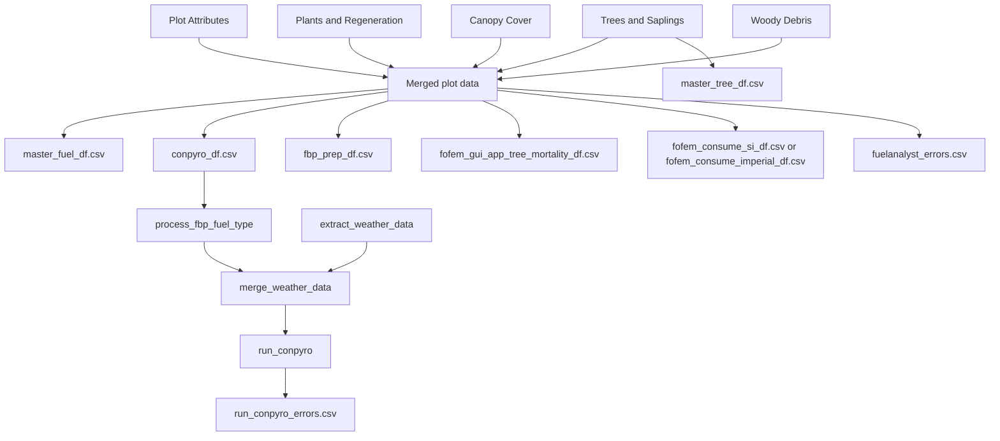

# FuelAnalyst codebase reference

This document describes the current package architecture and its important runtime
contracts. For installation and user workflows, start with the
[main README](../README.md) or [quick start](../QUICK_START.md).

## Purpose

FuelAnalyst converts related ArcGIS Survey123 forest-fuel inventories into
analysis-ready plot, tree, fuel-load, and model-preparation tables. It also
provides workflows for BC FBP fuel typing, NRCAN weather extraction and merging,
and optional ConPyro and FOFEM execution.

The core pipeline calculates:

- stable plot identities and plot attributes;
- plant, regeneration, canopy-cover, tree, sapling, forest-floor, and woody-fuel
  attributes;
- tree density, basal area, biomass, crown fuels, fuel strata gap, and fire
  attributes;
- ConPyro, FBP, FOFEM mortality, and FOFEM consumption preparation tables; and
- one centralized data-quality report for each completed pipeline run.

## Package and repository layout

```text
FuelAnalyst/
|-- pyproject.toml                 Package metadata, dependencies, and pytest config
|-- src/fuel_analyst/
|   |-- __init__.py                Lazily loaded public API
|   |-- fuel_analyst.py            Survey123 orchestrator and preparation defaults
|   |-- tools/                     Optional supporting scripts
|   |   |-- extract_nrcan_wx.py    NRCAN raster extraction
|   |   |-- fbp_fuel_type.py       BC FBP fuel typing
|   |   |-- merge_wx_data.py       Plot/weather merge
|   |-- run_conpyro.py             ConPyro and FOFEM orchestration
|   |-- _vendor/                   Vendored BCWFT2018 implementation
|   |-- components/
|   |   |-- error_handling.py      Run-scoped logging and CSV reports
|   |   |-- plot_attributes.py
|   |   |-- plants_regen.py
|   |   |-- trees.py
|   |   |-- canopy_cover.py
|   |   |-- woody_debris.py
|   |   |-- conpyro_attributes.py
|   |   |-- fofem_attributes.py
|   |   |-- fofem_emissions.py
|   |   |-- fofem_mortality.py
|   |   |-- fofem_gui_emissions.py
|   |   |-- fwis_moisture_content.py
|   |   `-- helper.py
|   `-- supporting_data/           Packaged CSV and ecodivision data
|-- models/photoload/              Reproducible PhotoLoad model-development workflow
|-- dependencies/                  Optional dependency checkouts/submodules
|-- examples/                      Checked-in inputs and ignored generated outputs
|-- tests/                         Unit, integration, regression, and test data
`-- docs/                          Architecture, references, designs, and plans
```

FuelAnalyst uses a standard `src` package layout and is installable with
`python -m pip install -e .`. Optional dependency groups are declared in
`pyproject.toml`: `conpyro`, `fofem`, `photoload`, `test`, `dev`, and `all`.
The package supports Python 3.11 through 3.14, tested on Windows, Linux, and
macOS. The `conpyro` extra installs the bounded `flame-components>=0.1.1,<0.2`
distribution from PyPI; ConPyro itself is currently installed from its GitHub
repository.

## Public API

`fuel_analyst.__init__` lazily exposes five callables:

| Function | Responsibility |
| --- | --- |
| `fuel_analyst()` | Process Survey123 forms and write master/model-preparation tables |
| `process_fbp_fuel_type()` | Assign BCWFT2018 fuel types to a ConPyro table |
| `extract_weather_data()` | Extract NRCAN raster values for plot locations |
| `merge_weather_data()` | Join plot-specific weather or apply shared weather scenarios |
| `run_conpyro()` | Run configured ConPyro, FOFEM mortality, and emissions workflows |

The `if __name__ == '__main__'` blocks are repository examples, not installed
console-script entry points.

## Core modules

### `fuel_analyst.py`

The main orchestrator owns the default stand-summary, woody-debris, ConPyro,
FOFEM-mortality, and FOFEM-consumption dictionaries. It processes Plot
Attributes first, processes the four selected component forms, checks form IDs
in both directions, left-merges component results, and writes the requested
tables. Model-specific stand and woody settings are added to per-run copies of
the defaults so one invocation does not pollute later runs.

### `components/trees.py`

Processes `survey_0.csv`, `sapling_1.csv`, and `tree_plot_2.csv`. It calculates
density expansion factors, CNBE biomass, modeled heights, crown fuels, fuel
strata gap, tree fire attributes, basal-area-weighted stand summaries, and
species composition. It returns the processed plot table, its output-column
list, and `master_tree_df`. `master_tree_df` includes both live and dead
trees, distinguished by a `status` column; `dens_live_ha`/`ba_live_ha` are 0
for dead trees, while `dens_ha`/`ba_ha` hold real totals for every tree.

### `components/woody_debris.py`

Processes the Survey123 woody transects with configurable Canadian, U.S.,
modified, ConPyro, and FOFEM diameter schemes. It also calculates forest-floor
duff/litter attributes and logs species-composition fallbacks through the
central error handler. Related transect, tally, QMD, volume, biomass, and final
output columns are calculated in dependency-ordered batches and concatenated at
logical boundaries so wide plot tables remain consolidated.

### `components/conpyro_attributes.py`

Builds `conpyro_df` and `fbp_prep_df` from the merged plot data. Source columns
may use `conpyro_` names internally, while the emitted ConPyro table uses the
schema expected by the downstream model, such as `stand_type`, `stand_density`,
and canopy/fuel attributes. Stand classifications and vegetation fuel-load
columns are attached in batches because the incoming merged plot table can
already be very wide.

### `components/fofem_attributes.py`

Builds `fofem_tree_df` for mortality and `fofem_consume_df` for consumption and
emissions. `fofem_tree_df`'s schema uses FOFEM's own required Imperial units
unconditionally (the FOFEM GUI's `.TRE` import format has no metric mode).
`fofem_consume_df`'s column names/order are fixed regardless of units, but its
values default to SI and can be configured to Imperial via
`fofem_consume_params['fofem_processing_units']`; see `fofem_units.py` and the
README's Units section.

### `components/error_handling.py`

Provides `get_logger()`, `start_run()`, `write_report()`, and the `run_guard`
decorator. The three pipeline entry points—`fuel_analyst()`,
`extract_weather_data()`, and `run_conpyro()`—start a run-scoped collector and
guarantee cleanup if execution raises. Completed runs write a wide CSV with one
row per affected plot, dynamic reporting-source columns, and a reserved
`General Error` row for records without a usable plot ID. Known sources use
stable display names such as `Trees`, `FOFEM Mortality`, and `NRCAN Weather`;
unknown sources use their full logger name so similarly named modules cannot
collide in one report column.

The collector respects logging already configured by an embedding application.
It installs a fallback console handler only when the package logger and its
propagation ancestors have no non-null output handler; a lone `NullHandler`
does not suppress fallback output.

### `tools/extract_nrcan_wx.py`

Loads CSV or spatial plot locations, samples locally available NRCAN raster
archives, optionally uses BC Wildfire Service ecodivision season dates, and can
calculate per-plot percentiles. It writes `<out_file_name>.csv`, shapefile
sidecars, and `<out_file_name>_errors.csv`.

### `run_conpyro.py`

Runs ConPyro per row with a configurable worker count, calculates flame
components, and optionally runs FOFEM mortality and emissions using `pyfofem`
or the Windows FOFEM GUI backend. A completed run writes
`run_conpyro_errors.csv` in addition to its selected model outputs.

### `components/fwis_moisture_content.py`

Contains stateless conversions from FWI-system codes to moisture-content
percentages using the documented Van Wagner equations.

### `components/helper.py`

Contains CSV utilities, missing-column checks, alphanumeric sorting, repository
example lookup, and `unique_id` generation. Repository example lookup is for
the development `__main__` routines; normal installed API calls do not depend
on the repository layout.

## Data flow and outputs



`master_fuel_df.csv` and `fuelanalyst_errors.csv` are written by every completed
`fuel_analyst()` run. Other core outputs are conditional:

- `master_tree_df.csv` requires processed tree data;
- `conpyro_df.csv` and `fbp_prep_df.csv` require `gen_conpyro_df=True`;
- `fofem_gui_app_tree_mortality_df.csv` requires `gen_fofem_gui_app_tree_df=True`; and
- `fofem_consume_si_df.csv`/`fofem_consume_imperial_df.csv` requires `gen_fofem_consume_df=True`
  (filename set by `fofem_consume_params['fofem_processing_units']`, default SI).

The centralized report omits plots with no collected issues. Form columns and
identity columns are dynamic. Multiple messages in one cell are numbered and
include their logging severity.

## Runtime contracts and gotchas

### Input names and identities

- Parent/repeat folder and CSV names follow the exact Survey123 layout shown in
  the README and checked-in example data.
- The authoritative Survey123 form definitions live in
  `docs/survey123/survey123_forms/` (one folder per form); paper/manual-entry
  equivalents are in `docs/survey123/manual_entry_forms/`, and field sampling
  protocols are in `docs/survey123/sampling_protocols/`.
- `_date` accepts `MM/DD/YYYY HH:MM` or `MM/DD/YYYY HH:MM:SS AM/PM`.
  Unparseable dates raise `ValueError` with representative bad values.
- `unique_id` is
  `treatment_area_treatment_unit_treatment_type_plot_id_year`.
- Within each parent form, duplicate annual identities retain the record with
  the latest parsed timestamp. Parent forms are deduplicated independently.
- The orchestrator detects IDs missing from either side of a form merge. Its
  set-backed check is linear in the combined input size, preserves first-seen
  order, and logs each repeated ID once.

### Optional forms and model preparation

Missing component folders are skipped. If any plot selected the missing form,
FuelAnalyst logs a warning for each affected plot; a missing unselected form is
silent. The three generation flags are stricter and raise `FileNotFoundError`
naming the missing form(s) before any processing starts, rather than a raw
`KeyError`/`AttributeError` mid-pipeline: `gen_conpyro_df=True` requires all
four component-form folders; `gen_fofem_gui_app_tree_df=True` requires Trees
(it is built entirely from `master_tree_df`); `gen_fofem_consume_df=True`
requires Trees, Plants and Regeneration, and Woody Debris (crown foliage/
branches, herb/shrub loads and substrate codes, and litter/duff/coarse woody
loads respectively) but not Canopy Cover.

`keep_columns` remains additive: skipped or unselected components do not add
their result columns to `master_fuel_df.csv`.

### Column-attaching helpers and reprocessing safety

Any function that adds computed columns to a wide plot DataFrame must tolerate
being called on a DataFrame that already carries its own output columns (a
reprocessed or re-merged table), not only a fresh one. This class of bug is
easy to reintroduce because it only shows up when the input already contains
the function's own outputs, which fresh-input unit tests don't exercise by
default — when adding or reviewing a column-generating function, add a test
that feeds its own prior output back in.

Two distinct safe patterns exist, for two distinct operations. They are not
interchangeable:

- **Attaching newly computed columns** (`_calc_*` helpers building a dict of
  Series): use `helper.attach_columns()`. A plain `pd.concat` duplicates the
  column label instead of overwriting it, and can crash downstream code that
  selects that label expecting a single Series (`ValueError: cannot reindex
  on an axis with duplicate labels`). `attach_columns()` replaces a
  pre-existing same-named column in its original position.
- **Renaming an existing column to a new name** (e.g. prefixing
  `woody_count_x` to `compare_woody_count_x`): a plain `.rename()` over a
  substring match re-matches its own already-renamed output on a second pass
  (e.g. `compare_x` becoming `compare_compare_x`) — exclude the destination
  prefix from the source match. Do **not** implement this by routing through
  `attach_columns()`: dropping the source column first and reattaching under
  the new name moves it to the end of the DataFrame when no conflicting
  column already exists, which changes column order for the real, single-pass
  pipeline (the common case) purely to preserve position in a reprocessing
  scenario production doesn't produce. Instead, drop only a conflicting
  pre-existing destination column, then `.rename()` in place — see
  `_prefix_compare_columns()` in `woody_debris.py`. This preserves real-run
  column order exactly while still preventing duplicates if reprocessing ever
  does leave a stale destination behind. Note that this only guards a stable
  configuration re-run on its own output; it does not detect columns
  orphaned by a *changed* configuration (e.g. a removed diameter cutoff or
  woody class) between two calls on the same DataFrame — `woody_debris_params`
  is a single static configuration in production and never varies between
  calls on the same table, so this is an accepted, documented scope
  boundary rather than a gap to close with fragile name-parsing heuristics.

### Tree calculations

- Many height, crown, flame, and fire-intensity means are basal-area weighted,
  not arithmetic means.
- CBD is derived from crown fuel load and crown depth and therefore follows a
  separate aggregation path from attributes with direct per-hectare columns.
- The conifer and broadleaf dead-decay thresholds are 6 and 5 respectively and
  are centralized as module constants used by height and biomass logic.
- Dead sapling CBH is missing by design; live-only crown/FSG aggregations exclude
  those records.
- Survey value `tree_bark_char_high == 444` means full-height char. The code
  replaces it with tree height before deriving flame length and crown-fire
  intensity, so `444` is not treated as a physical height.

### Canopy cover

Missing canopy cover (`cc`) is handled inconsistently and without any
warning, and the two downstream paths default in opposite directions:

- `conpyro_attributes.py` fills `canopy_cover` with `0` (`.fillna(0)`) before
  building ConPyro/wind-speed inputs, so a plot with unmeasured cover is
  modeled as fully open — cascading into `instand_ws_mps`, `flame_length_m`,
  and `flame_ht_m` in `run_conpyro.py`. `_calc_stand_density()` in the same
  file classifies density from the *raw*, still-NaN value first, so
  `conpyro_density_class` ends up `None` while `canopy_cover` on the same row
  is separately filled to `0` — the two derived fields disagree.
- `fbp_fuel_type.py` never fills `cc`; NaN comparisons (`cc < 10`, etc.) are
  always `False`, so a missing value falls through to the fuel-typing
  `else` branches (`BCLCS_LEVEL_2 = 'T'`, `BCLCS_LEVEL_5 = 'DE'`) —
  misclassified as a dense treed stand, the opposite default from the
  ConPyro path. The vendored `bcwft2018.py` engine's `CROWN_CLOSURE is None`
  fallback branches never trigger for a NaN float, so it also falls through
  to numeric-comparison branches silently.
- `canopy_cover.py` never logs; `error_handling.py` already registers a
  `'Canopy Cover'` report source, but nothing in that component uses it.
  `fofem_mortality.py`'s `_log_and_drop_incomplete_rows()` is the only place
  that checks, logs, and drops rows for NaN `canopy_cover`, but by the time
  data reaches it, `canopy_cover` has usually already been silently
  0-filled upstream, so it rarely fires for this field in practice.

### Units

FuelAnalyst calculations are primarily SI. `gen_fofem_gui_app_tree_df()`'s FOFEM
GUI mortality preparation is unconditionally Imperial (the `.TRE` import format
has no metric mode): tree density is converted from per hectare to per acre,
DBH from centimetres to inches, height from metres to feet (`× 3.28084`).
`gen_fofem_consumption_df()`'s FOFEM consumption/emissions preparation defaults
to SI but is configurable to Imperial via `fofem_processing_units`; the
`fofem_consume_si_df.csv`/`fofem_consume_imperial_df.csv` filename encodes which
one a given file contains, since the column schema itself is fixed either way.
`run_conpyro()`'s FOFEM mortality and emissions result tables carry an explicit
unit suffix (`_m2pha`, `_kgpm2`/`_tpac`, `_cm`/`_in`, `_gpm2`/`_lbpac`, etc.) on
every physical column instead; see `fofem_units.py` and the README's Units
section for the full suffix reference.

### Weather and downstream models

`run_conpyro()` expects weather to have been supplied or merged already. It
validates the always-required `ws`, `wd`, `ffmc`, `dmc`, and `bui` columns,
requires `temp` and `rh` for CFIS (`cfo_model == 10`), and validates fields whose
configuration value is `"use_csv"`. Missing requirements raise a descriptive
`ValueError` before model execution.

The default fire-model configuration enables ConPyro, FOFEM mortality, and
pyFOFEM emissions. Consequently, the default call also requires tree and FOFEM
consumption input paths plus the `conpyro` and `fofem` optional dependencies.

`examples/data/weather/conpyro_df_wx.csv` is a checked-in, real weather-merged
demo input (2005-2024 NRCAN weather for the 20 example plots), tracked via Git
LFS. `examples/run_fuel_analyst_conpyro_demo.py` is the primary standalone
demo — `fuel_analyst()` then `run_conpyro()` (default `cfo_model`) against
committed data alone, no NRCAN archive access needed.
`examples/run_fuel_analyst_cfis_demo.py` is the same, but for the CFIS
(`cfo_model=10`) crown-fire model, which additionally requires a real FBP
fuel type (`examples/data/fbp_fuel_typing/fbp_prep_df.csv`, user-filled
BEC/VRI fields) and a literal `time`. The narrower, advanced
`examples/weather_pipeline/run_weather_conpyro_pipeline.py` regenerates the
committed weather-merged file itself (`--stage weather`/`--stage merge`)
against fresh/real NRCAN weather.

### Run-scoped reporting

The run guard restores FuelAnalyst logger handlers and the previous logging
level on both success and failure. An exception raised before `write_report()`
means no completed-run error CSV is produced, but it does not leave a collector
or fallback handler attached for the next invocation.

## Tests and historical documents

The active suite is split across `tests/unit`, `tests/integration`, and
`tests/regression`; see [the test guide](../tests/README.md). Files under
`docs/superpowers/plans`, `docs/superpowers/specs`, and `development` document
the intent and sequence of earlier changes. Treat embedded code snippets and
planned filenames in those historical records as snapshots; this file, the
README, tests, and production code define the current behavior.
