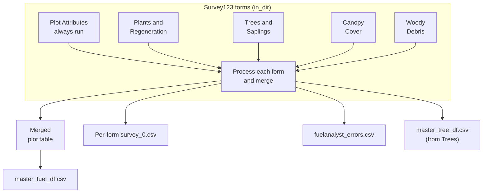
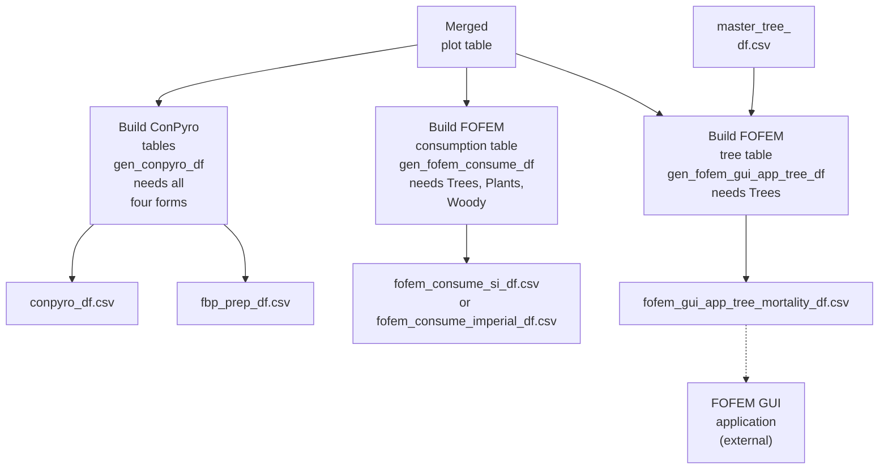
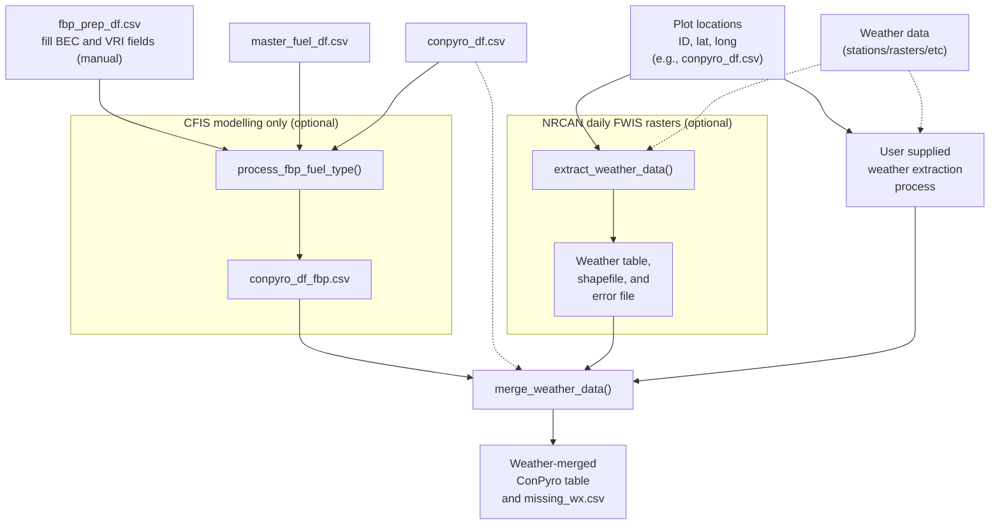
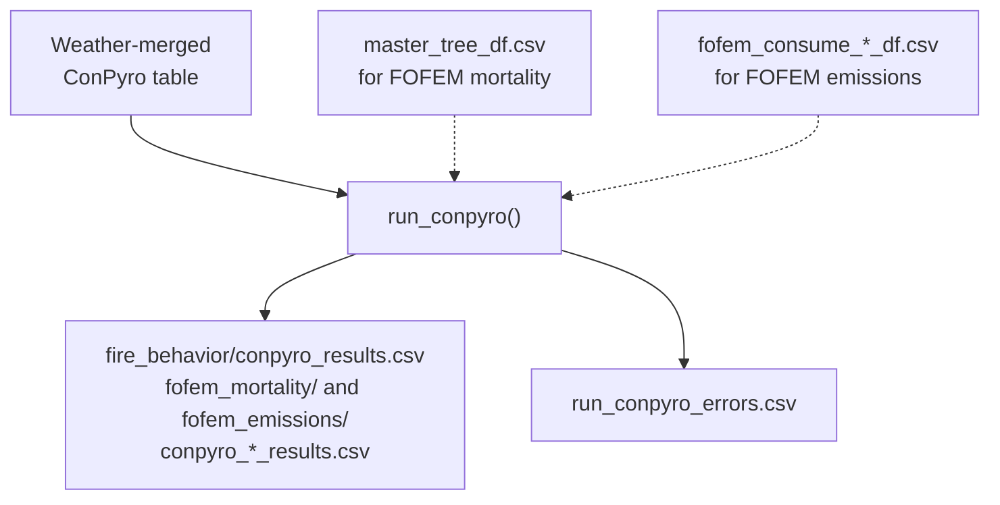

# FuelAnalyst codebase reference

This document describes the current package architecture and its important runtime
contracts. For installation and user workflows, start with the
[main README](../README.md) or [quick start](../QUICK_START.md).

## Purpose

FuelAnalyst converts related ArcGIS Survey123 forest-fuel inventories into
analysis-ready plot, tree, fuel-load, and model-preparation tables. It also
provides workflows for BC FBP fuel typing, NRCAN weather extraction and merging,
and optional ConPyro and FOFEM execution.

The core pipeline calculates:

- stable plot identities and plot attributes;
- plant, regeneration, canopy-cover, tree, sapling, forest-floor, and woody-fuel
  attributes;
- tree density, basal area, biomass, crown fuels, fuel strata gap, and fire
  attributes;
- ConPyro, FBP, FOFEM mortality, and FOFEM consumption preparation tables; and
- one centralized data-quality report for each completed pipeline run.

## Package and repository layout

```text
FuelAnalyst/
|-- .github/workflows/tests.yml   Release-tag and manual test workflow
|-- pyproject.toml                 Package metadata, dependencies, and pytest config
|-- packages/fofem694-runtime/    Optional Windows FOFEM 6.9.4 runtime wheel
|-- src/fuel_analyst/
|   |-- __init__.py                Lazily loaded public API
|   |-- fuel_analyst.py            Survey123 orchestrator and preparation defaults
|   |-- tools/                     Optional supporting scripts
|   |   |-- extract_nrcan_wx.py    NRCAN raster extraction
|   |   |-- fbp_fuel_type.py       BC FBP fuel typing
|   |   |-- merge_wx_data.py       Plot/weather merge
|   |-- run_conpyro.py             ConPyro and FOFEM orchestration
|   |-- _vendor/                   Vendored BCWFT2018 implementation
|   |-- components/
|   |   |-- error_handling.py      Run-scoped logging and CSV reports
|   |   |-- plot_attributes.py
|   |   |-- plants_regen.py
|   |   |-- trees.py
|   |   |-- canopy_cover.py
|   |   |-- woody_debris.py
|   |   |-- conpyro_attributes.py
|   |   |-- fofem_attributes.py
|   |   |-- fofem_emissions.py
|   |   |-- fofem_mortality.py
|   |   |-- fofem_gui_emissions.py
|   |   |-- fofem_units.py
|   |   |-- fwis_moisture_content.py
|   |   `-- helper.py
|   `-- supporting_data/           Packaged CSV and ecodivision data
|-- models/photoload/              Reproducible PhotoLoad model-development workflow
|-- examples/
|   |-- data/                     Checked-in example inputs
|   |-- tutorial/                 Notebook and editor setup guide
|   `-- results/                  Ignored generated outputs
|-- tests/                         Unit, integration, regression, and test data
`-- docs/                          Architecture, references, designs, and plans
```

FuelAnalyst uses a standard `src` package layout and is installable with
`python -m pip install -e .`. Installable extras are declared in
`pyproject.toml`: `fofem`, `photoload`, `test`, and `all`; contributor-only PEP 735
dependency groups are `dev` and `notebook`. `pyproject.toml` plus the generated `uv.lock` are the
sources of truth for the development environment (uv is not a runtime dependency).
The package supports Python 3.11 through 3.14, tested on Windows, Linux, and
macOS. ConPyro (`src/fuel_analyst/_vendor/conpyro`) and BCWFT2018 (`_vendor/bcwft2018.py`) are
vendored: generated copies of their upstream repositories, refreshed with `scripts/update_vendors.sh`
(it shallow-clones each upstream default branch; `CONPYRO_SRC`/`BC_SRC` select a local clone instead), and the bounded
`flame-components>=0.1.1,<0.2` distribution from PyPI is a core dependency. The `fofem` extra installs the bounded `pyfofem-fire-effects>=0.1.2,<0.2`
distribution from PyPI (imports as `pyfofem`, matching the prior GitHub checkout's
import name) and needs no Git checkout for the Python-backed `model_select='pyfofem'`
emissions path (mortality automation is pyfofem-only; the official FOFEM app is never
invoked for mortality - see below). The `model_select='fof_gui'` batch backend
(`fofem_gui_emissions.py`) invokes the official USFS FOFEM 6.9.4 `runfofem.exe` directly
on Windows x64 or explicitly through `wine` on Linux x64, and no longer depends
on the `pyfofem` package at all.

Linux execution requires Wine on PATH and an appropriate 64-bit Wine prefix,
normally provisioned with `winetricks -q vcrun2022` - prefer fetching the latest
`winetricks` script directly (see README.md) rather than a distro-packaged copy,
since Microsoft's Visual C++ Redistributable download is served from a stable URL
it updates in place, and `winetricks`' pinned hash for it (and distro packaging
even more so) lags behind: verified directly, both Ubuntu 24.04's and 26.04's
packaged `winetricks` reported a hash mismatch that current upstream master did
not. `_run_runfofem()` preserves `WINEPREFIX`, prepends `wine` to the command on
Linux, and sets Windows creation flags only on Windows. It requires neither
execute permission on the EXE nor a `binfmt_misc` handler. Consumption, soil, and
mortality hand-off integration tests passed on both Ubuntu 24.04.5 (Wine 9.0) and
Ubuntu 26.04.1 (Wine 10.0), the latter with an active `binfmt_misc` Wine handler
present but unused, confirming the explicit `wine` invocation is host-independent.
The optional runtime wheel remains Windows-only; Linux uses the source bundle or
an external bundle selected by `FUEL_ANALYST_FOFEM_DIR`.

`_get_fofem_dir()` resolves the runtime directory in this order, validating `runfofem.exe`
and both required CSVs at each tier (not just the directory's existence) and raising a clear,
immediate `FileNotFoundError` naming the gap before any row is processed if none resolve:
1. `FUEL_ANALYST_FOFEM_DIR` env var - an external FOFEM 6.9.4 installation, for any install
   type.
2. The installed `fuel-analyst-fofem694-runtime` package (`packages/fofem694-runtime/`) -
   `import fuel_analyst_fofem694_runtime; .get_runtime_dir()`, resolved via
   `importlib.resources.files()` so it works regardless of install location. This is a
   separate, optional, Windows-only wheel (`py3-none-win_amd64`, forced via that project's own
   `setup.cfg`'s `[bdist_wheel] plat_name`), distinct from the main `fuel-analyst` wheel
   (`py3-none-any`) and from the `fofem` extra above. Install it from a checkout with
   `pip install ./packages/fofem694-runtime`, or use
   `pip install fuel-analyst-fofem694-runtime` after its wheel is published. It bundles
   `runfofem.exe`, `Emission_Factors.csv`, `fof_spp.csv`, the upstream
   `README.txt` and `doc/` (`LICENSE`, `Runfofem_User_Guide.pdf`, preserved byte-for-byte at
   their original relative paths per upstream's own request), and a generated `PROVENANCE.md`
   - but no Microsoft Visual C++ runtime DLLs; those are a documented, separately-installed
   Windows prerequisite (see the Gotchas table), not bundled in either wheel.
3. The bundled `src/fuel_analyst/supporting_data/fofem_694` directory - a Git source checkout
   only; it carries the same 7 files, tracked in Git, and needs no override.

The tracked source bundle is updated from the pinned upstream release by
`scripts/update_fofem_694_runtime.sh`, which downloads the exact pinned ZIP URL, verifies
its SHA-256 before extracting anything, and fails loudly on upstream drift. The separate wheel
copies its seven assets from that bundle during the build, so a fresh checkout has one source
for both locations. `Emission_Factors.csv` is FuelAnalyst's own tested
copy - one trailing space removed relative to upstream's copy of this file (otherwise causes
a Python warning) - never overwritten by the update script; `fof_spp.csv` is byte-identical to
upstream's own copy. Bundling the official FOFEM binaries in a *published* PyPI wheel is a
redistribution/licensing decision that has not been made for either wheel; resolve it
explicitly before publishing to PyPI. `doc/LICENSE` states the software was developed by
federal employees as part of official duties and is public domain - a different license than
FuelAnalyst's own MIT-licensed code (root `LICENSE` file).

Tree mortality is never run through the official FOFEM application automatically:
`fofem_attributes.gen_fofem_gui_app_tree_df()` produces a `.tre`-format hand-off CSV
(`fofem_gui_app_tree_mortality_df.csv`) that the analyst submits to their own FOFEM 6.9.4
installation themselves (GUI or `runfofem.exe` run type 2); FuelAnalyst's own automated
mortality modelling (`run_conpyro()`'s `fofem_mortality` step) always uses the pyfofem CRNSCH
backend, which has no `model_select` option. The official batch mortality tool's own output
is also plot-level aggregated (Density/BA/CanopyCover Pre-Post-Killed, `MortAvg`), not the
per-tree probability pyfofem's backend produces - a different granularity, not a drop-in
alternative, which is why it isn't wired into `run_conpyro()` as a `model_select` choice.

## Public API

`fuel_analyst.__init__` lazily exposes five callables:

| Function | Responsibility |
| --- | --- |
| `fuel_analyst()` | Process Survey123 forms and write master/model-preparation tables |
| `process_fbp_fuel_type()` | Assign BCWFT2018 fuel types to a ConPyro table |
| `extract_weather_data()` | Extract NRCAN raster values for plot locations |
| `merge_weather_data()` | Join plot-specific weather or apply shared weather scenarios |
| `run_conpyro()` | Run configured ConPyro, FOFEM mortality, and emissions workflows |

The `if __name__ == '__main__'` blocks are repository examples, not installed
console-script entry points.

## Core modules

### `fuel_analyst.py`

The main orchestrator owns the default stand-summary, woody-debris, ConPyro,
and FOFEM-consumption dictionaries. It processes Plot
Attributes first, processes the four selected component forms, checks form IDs
in both directions, left-merges component results, and writes the requested
tables. Stand-summary entries are merged on an internal top-level copy, and
the nested `woody_debris_classes` dictionary is copied before ConPyro and
FOFEM classes are added. Those merges leave caller-supplied
`stand_summary_params` and `woody_debris_params` unchanged across runs.

### `components/trees.py`

Processes `survey_0.csv`, `sapling_1.csv`, and `tree_plot_2.csv`. It calculates
density expansion factors, CNBE biomass, modeled heights, crown fuels, fuel
strata gap, tree fire attributes, basal-area-weighted stand summaries, and
species composition. It returns the processed plot table, its output-column
list, and `master_tree_df`. `master_tree_df` includes both live and dead
trees, distinguished by a `status` column; `dens_live_ha`/`ba_live_ha` are 0
for dead trees, while `dens_ha`/`ba_ha` hold real totals for every tree.

### `components/woody_debris.py`

Processes the Survey123 woody transects with configurable Canadian, U.S.,
modified, ConPyro, and FOFEM diameter schemes. It also calculates forest-floor
duff/litter attributes and logs species-composition fallbacks through the
central error handler. Related transect, tally, QMD, volume, biomass, and final
output columns are calculated in dependency-ordered batches and concatenated at
logical boundaries so wide plot tables remain consolidated.

### `components/conpyro_attributes.py`

Builds `conpyro_df` and `fbp_prep_df` from the merged plot data. Source columns
may use `conpyro_` names internally, while the emitted ConPyro table uses the
schema expected by the downstream model, such as `stand_type`, `stand_density`,
and canopy/fuel attributes. Stand classifications and vegetation fuel-load
columns are attached in batches because the incoming merged plot table can
already be very wide.

### `components/fofem_attributes.py`

Builds the FOFEM GUI tree-mortality hand-off table
(`fofem_gui_app_tree_mortality_df.csv`) and the FOFEM consumption table.
The mortality hand-off uses FOFEM's required Imperial units unconditionally
(the FOFEM GUI's `.TRE` import format has no metric mode).
The consumption table's column names/order are fixed regardless of units, but its
values default to SI and can be configured to Imperial via
`fofem_consume_params['fofem_processing_units']`; see `fofem_units.py` and the
README's Units section.

### `components/error_handling.py`

Provides `get_logger()`, `start_run()`, `write_report()`, and the `run_guard`
decorator. The three pipeline entry points—`fuel_analyst()`,
`extract_weather_data()`, and `run_conpyro()`—start a run-scoped collector and
guarantee cleanup if execution raises. Completed runs write a wide CSV with one
row per affected plot, dynamic reporting-source columns, and a reserved
`General Error` row for records without a usable plot ID. Known sources use
stable display names such as `Trees`, `FOFEM Mortality`, and `NRCAN Weather`;
unknown sources use their full logger name so similarly named modules cannot
collide in one report column.

The collector respects logging already configured by an embedding application.
It installs a fallback console handler only when the package logger and its
propagation ancestors have no non-null output handler; a lone `NullHandler`
does not suppress fallback output.

### `tools/extract_nrcan_wx.py`

Loads CSV or spatial plot locations, samples locally available NRCAN raster
archives, optionally uses BC Wildfire Service ecodivision season dates, and can
calculate per-plot percentiles. It writes `<out_file_name>.csv`, shapefile
sidecars, and `<out_file_name>_errors.csv`.

### `run_conpyro.py`

Runs ConPyro per row with a configurable worker count, calculates flame
components, and optionally runs pyfofem tree mortality. Emissions use either
pyfofem or the official FOFEM 6.9.4 batch backend. A completed run writes
`run_conpyro_errors.csv` in addition to its selected model outputs.

### `components/fwis_moisture_content.py`

Contains stateless conversions from FWI-system codes to moisture-content
percentages using the documented Van Wagner equations.

### `components/helper.py`

Contains CSV utilities, missing-column checks, alphanumeric sorting, repository
example lookup, and `unique_id` generation. Repository example lookup is for
the development `__main__` routines; normal installed API calls do not depend
on the repository layout.

## Data flow and outputs

The pipeline is a set of separate calls linked by files. The first two diagrams show
what `fuel_analyst()` does internally, the third shows the optional fuel-typing and
weather steps, and the fourth shows what `run_conpyro()` reads and writes. Solid
arrows are data dependencies. Dotted arrows are optional or manual links.

### `fuel_analyst()`: forms to merged tables



### `fuel_analyst()`: optional model-preparation tables



`master_fuel_df.csv` and `fuelanalyst_errors.csv` are written by every completed
`fuel_analyst()` run. Other core outputs are conditional:

- `master_tree_df.csv` requires processed tree data;
- `conpyro_df.csv` and `fbp_prep_df.csv` require `gen_conpyro_df=True`;
- `fofem_gui_app_tree_mortality_df.csv` requires `gen_fofem_gui_app_tree_df=True`; and
- `fofem_consume_si_df.csv`/`fofem_consume_imperial_df.csv` requires `gen_fofem_consume_df=True`
  (filename set by `fofem_consume_params['fofem_processing_units']`, default SI).

The centralized report omits plots with no collected issues. Form columns and
identity columns are dynamic. Multiple messages in one cell are numbered and
include their logging severity.

### After `fuel_analyst()`: fuel typing and weather



### `run_conpyro()`: fire behaviour, mortality, and emissions



#### What the diagrams imply

- **Configuration and flags decide what is built.** The four configuration
  dictionaries (`stand_summary_params`, `woody_debris_params`, `conpyro_params`,
  and `fofem_consume_params`) control the tree, woody-debris, ConPyro, and FOFEM
  calculations, and the three `gen_*` flags decide which of the optional tables
  are written. `form_select` in Plot Attributes decides, plot by plot, which of
  the four optional forms are processed.
- **Stages communicate through files, not objects.** `process_fbp_fuel_type()`,
  `extract_weather_data()`, `merge_weather_data()`, and `run_conpyro()` each take
  file paths and write CSVs, so any stage can be rerun, replaced, or fed a table
  produced elsewhere.
- **Fuel typing is optional and needs manual input.** `process_fbp_fuel_type()`
  reads `master_fuel_df.csv`, the completed `fbp_prep_df.csv`, and `conpyro_df.csv`,
  then writes a copy of the ConPyro table with an `_fbp` suffix. The BEC and VRI
  fields in `fbp_prep_df.csv` come from external data and must be filled in
  first; missing or invalid values are reported before any plot is typed.
  `merge_weather_data()` accepts either ConPyro table.
- **The weather-extraction input is any plot-location table.** It can be any CSV
  or spatial file with a plot ID and latitude and longitude, named through the
  `plot_pts_path`, `plot_id_col_name`, `lat_col_name`, and `lon_col_name`
  arguments. `conpyro_df.csv` is a convenient choice because it already carries the
  same `unique_id` and coordinates as the table the weather is merged into. This
  has three consequences:
  - For a keyed merge, the IDs in the location file must match the merge key in
    the plot table, or those plots receive no weather.
  - A plot with no coordinates is skipped during extraction (a warning is
    logged) and later appears in `missing_wx.csv`, which the keyed merge writes
    for every plot without a weather match, even when the file is empty.
  - When weather is shared across plots (`wx_merge_col_name=None`), each weather
    row is paired with every plot and the IDs do not need to match, so the
    location file only affects what was extracted.
- **`extract_weather_data()` is one way to produce the weather table.** It reads
  NRCAN gridded rasters, so the diagram shows it as an optional example. Any
  process of your own that writes a CSV can replace it, because
  `merge_weather_data()` only reads the file, and the diagram shows it feeding the
  merge directly. Like the NRCAN route, it would normally start from the same
  plot-location table. The table needs the plot ID column
  (for a keyed merge), a `wx_date` column (used to assign seasons and to sort the
  final results), and the weather variables ConPyro needs (`ws`, `wd`, `ffmc`,
  `dmc`, and `bui`, plus `temp` and `rh` for CFIS).
- **`run_conpyro()` takes the weather-merged table plus optional side inputs.**
  FOFEM mortality reads `master_tree_df.csv` (`in_tree_csv_path`) and FOFEM
  emissions read the consumption table (`in_fofem_consume_csv_path`). Enabling a
  stage without its input raises an error, and the final
  `conpyro{_mortality}{_emissions}_results.csv` is written only when mortality or
  emissions ran. Rows with an empty `stand_density` or `stand_type`, such as plots
  with no live overstory, are dropped before ConPyro runs, so the results can have
  fewer plots than the input.
- **`fofem_gui_app_tree_mortality_df.csv` is a hand-off, not an input.** It is
  formatted for import into the external FOFEM GUI application and is not read by
  `run_conpyro()`.
- **Each entry point reports its own problems.** `fuelanalyst_errors.csv` collects
  log records from every component of one `fuel_analyst()` run, not only the merged
  table. `extract_weather_data()` writes `<out_file_name>_errors.csv`,
  `run_conpyro()` writes `run_conpyro_errors.csv`, and `missing_wx.csv` is a
  diagnostic list of unmatched plots rather than an error report.

## Runtime contracts and gotchas

### Input names and identities

- Parent/repeat folder and CSV names follow the exact Survey123 layout shown in
  the README and checked-in example data.
- The authoritative Survey123 form definitions live in
  `docs/survey123/survey123_forms/` (one folder per form); paper/manual-entry
  equivalents are in `docs/survey123/manual_entry_forms/`, and field sampling
  protocols are in `docs/survey123/sampling_protocols/`.
- `_date` accepts `MM/DD/YYYY HH:MM` or `MM/DD/YYYY HH:MM:SS AM/PM`.
  Unparseable dates raise `ValueError` with representative bad values.
- `unique_id` is
  `treatment_area_treatment_unit_treatment_type_plot_id_year`.
- Within each parent form, duplicate annual identities retain the record with
  the latest parsed timestamp. Parent forms are deduplicated independently.
- The orchestrator detects IDs missing from either side of a form merge. Its
  set-backed check is linear in the combined input size, preserves first-seen
  order, and logs each repeated ID once.

### Optional forms and model preparation

Missing component folders are skipped. If any plot selected the missing form,
FuelAnalyst logs a warning for each affected plot; a missing unselected form is
silent. The three generation flags are stricter and raise `FileNotFoundError`
naming the missing form(s) before any processing starts, rather than a raw
`KeyError`/`AttributeError` mid-pipeline: `gen_conpyro_df=True` requires all
four component-form folders; `gen_fofem_gui_app_tree_df=True` requires Trees
(it is built entirely from `master_tree_df`); `gen_fofem_consume_df=True`
requires Trees, Plants and Regeneration, and Woody Debris (crown foliage/
branches, herb/shrub loads and substrate codes, and litter/duff/coarse woody
loads respectively) but not Canopy Cover.

`keep_columns` remains additive: skipped or unselected components do not add
their result columns to `master_fuel_df.csv`.

### Column-attaching helpers and reprocessing safety

Any function that adds computed columns to a wide plot DataFrame must tolerate
being called on a DataFrame that already carries its own output columns (a
reprocessed or re-merged table), not only a fresh one. This class of bug is
easy to reintroduce because it only shows up when the input already contains
the function's own outputs, which fresh-input unit tests don't exercise by
default — when adding or reviewing a column-generating function, add a test
that feeds its own prior output back in.

Two distinct safe patterns exist, for two distinct operations. They are not
interchangeable:

- **Attaching newly computed columns** (`_calc_*` helpers building a dict of
  Series): use `helper.attach_columns()`. A plain `pd.concat` duplicates the
  column label instead of overwriting it, and can crash downstream code that
  selects that label expecting a single Series (`ValueError: cannot reindex
  on an axis with duplicate labels`). `attach_columns()` replaces a
  pre-existing same-named column in its original position.
- **Renaming an existing column to a new name** (e.g. prefixing
  `woody_count_x` to `compare_woody_count_x`): a plain `.rename()` over a
  substring match re-matches its own already-renamed output on a second pass
  (e.g. `compare_x` becoming `compare_compare_x`) — exclude the destination
  prefix from the source match. Do **not** implement this by routing through
  `attach_columns()`: dropping the source column first and reattaching under
  the new name moves it to the end of the DataFrame when no conflicting
  column already exists, which changes column order for the real, single-pass
  pipeline (the common case) purely to preserve position in a reprocessing
  scenario production doesn't produce. Instead, drop only a conflicting
  pre-existing destination column, then `.rename()` in place — see
  `_prefix_compare_columns()` in `woody_debris.py`. This preserves real-run
  column order exactly while still preventing duplicates if reprocessing ever
  does leave a stale destination behind. Note that this only guards a stable
  configuration re-run on its own output; it does not detect columns
  orphaned by a *changed* configuration (e.g. a removed diameter cutoff or
  woody class) between two calls on the same DataFrame — `woody_debris_params`
  is a single static configuration in production and never varies between
  calls on the same table, so this is an accepted, documented scope
  boundary rather than a gap to close with fragile name-parsing heuristics.

### Tree calculations

- Many height, crown, flame, and fire-intensity means are basal-area weighted,
  not arithmetic means.
- CBD is derived from crown fuel load and crown depth and therefore follows a
  separate aggregation path from attributes with direct per-hectare columns.
- The conifer and broadleaf dead-decay thresholds are 6 and 5 respectively and
  are centralized as module constants used by height and biomass logic.
- Dead sapling CBH is missing by design; live-only crown/FSG aggregations exclude
  those records.
- Survey value `tree_bark_char_high == 444` means full-height char. The code
  replaces it with tree height before deriving flame length and crown-fire
  intensity, so `444` is not treated as a physical height.

### Stand-summary configuration

`summary_permutation` supports `all`, `exact`, and `combined`. The `combined`
mode removes `total`, treats `live` plus `dead` as any status and `conifer` plus
`broadleaf` as any type, then combines remaining filters with AND. A
`total`-only combined request is rejected and reported as a Trees configuration
error before form processing. The [README configuration guide](../README.md#configuration)
shows the output groups for all nonempty status/type subsets.

`fuel_analyst()` merges ConPyro and FOFEM stand entries before applying
`_enforce_fixed_stand_summary_metrics()`. Configure those entries through
`conpyro_params` or `fofem_consume_params`; a same-named entry supplied through
`stand_summary_params` is replaced by the merge. Enforcement uses the resolved
`att_source` (or entry name when it is absent): `dens`, `ba`, `cfl`, `foliage`,
`branches`, `wood`, `bark`, `foliage_fofem`, and `branches_fofem` are sum-only;
`cbd` has an empty metrics list because its calculation is separate. The
default `cfl` entry now emits only `_sum` columns, not `_min`, `_max`, or
`_mean`. The fixed-attribute rule takes precedence over the ConPyro rule.

The six single-column ConPyro height, CBH, and FSG entries accept exactly one
of `min`, `max`, or `mean` (default `mean`). Duplicate metric names are removed
first, preserving their first occurrence. A duplicate-only valid choice is
normalized without a warning; a different fixed-metric request or an invalid
single-column choice is replaced with its default and logged through the Trees
source. On a completed run, these configuration warnings appear under
`General Error` in `fuelanalyst_errors.csv` because they are not tied to a plot.

### Fuel depth, canopy averaging, and tallied woody correction

Fuel-bed depth in `plants_regen._process_top_five_spp()` is
`sum(cover_percent * height_cm) / sum(cover_percent) / 100`, after the
existing species and zero-value normalization. A shared validity mask
requires a recorded species, positive finite cover, and finite nonnegative
height. Missing heights are excluded from both sums; measured zero heights
retain their cover weight. No usable species yields `NaN`. The intermediate
column positions and functional-group biomass calculations remain unchanged.

The FOFEM consumption builder rounds this depth to two decimals and fills
missing values with 0 m. CSV reload preserves that zero, and both
`fofem_emissions.py` and `fofem_gui_emissions.py` pass it to their emissions
routes. The pyfofem adapter's `default=0.3` fills missing values, not numeric
zero. Tree FSG uses the separate field-measured `tree_fuel_bed_ht` and is
unaffected by derived plant depth.

Canopy plot percentages are arithmetic means of usable records whose
`cc_transect` is 1 or 2. A missing or wholly excluded transect receives no
weight; valid uncovered transects contribute zero. Two valid transects
receive equal weight despite differing usable-point counts. Duplicate
eligible records each receive one weight; no deduplication occurs. The six
`CC_*_t1`/`CC_*_t2` diagnostic columns retain summed values and can disagree
with means on duplicate inputs. No usable records yields `NaN`; the existing
downstream missing-cover inconsistency described below remains.

Tallied volume already divides by slope-corrected transect length. Smallest-
class biomass and both optional QMD comparison masses therefore use
`specific_gravity * volume_m3_per_ha / 10` without another slope multiplier.
Removing the repeated biomass multiplier leaves measured-piece results and QMD
estimates unchanged. The accompanying geometry correction replaces
`sqrt(1 + arctan(slope_percent / 100)^2)` with
`sqrt(1 + (slope_percent / 100)^2)`, equivalent to `1 / cos(angle)`.
It changes corrected lengths and both measured and tallied loads on sloped
plots; flat-transect results and QMD estimation remain unchanged. Plot factors
still use pooled horizontal lengths, rather than an arithmetic mean of
per-transect correction factors. These aggregation methods differ on unequal
slopes and must not be described as identical. The exact per-transect formula
is given in [USFS GTR-NC-256, equation 3.1b](https://research.fs.usda.gov/download/treesearch/13164.pdf#page=23).

Regenerate affected results and rebuild weather/plot merges from fresh
fuel attributes before rerunning ConPyro/FOFEM. Reusing the checked-in
`conpyro_df_wx.csv` unchanged would retain its old fuel attributes.
See [release notes](RELEASE_NOTES.md) for the unreleased patch behavior.


### Canopy cover

Missing canopy cover (`cc`) is handled inconsistently and without any
warning, and the two downstream paths default in opposite directions:

- `conpyro_attributes.py` fills `canopy_cover` with `0` (`.fillna(0)`) before
  building ConPyro/wind-speed inputs, so a plot with unmeasured cover is
  modeled as fully open — cascading into `instand_ws_mps`, `flame_length_m`,
  and `flame_ht_m` in `run_conpyro.py`. `_calc_stand_density()` in the same
  file classifies density from the *raw*, still-NaN value first, so
  `conpyro_density_class` ends up `None` while `canopy_cover` on the same row
  is separately filled to `0` — the two derived fields disagree.
- `fbp_fuel_type.py` never fills `cc`; NaN comparisons (`cc < 10`, etc.) are
  always `False`, so a missing value falls through to the fuel-typing
  `else` branches (`BCLCS_LEVEL_2 = 'T'`, `BCLCS_LEVEL_5 = 'DE'`) —
  misclassified as a dense treed stand, the opposite default from the
  ConPyro path. The vendored `bcwft2018.py` engine's `CROWN_CLOSURE is None`
  fallback branches never trigger for a NaN float, so it also falls through
  to numeric-comparison branches silently.
- `canopy_cover.py` never logs; `error_handling.py` already registers a
  `'Canopy Cover'` report source, but nothing in that component uses it.
  `fofem_mortality.py`'s `_log_and_drop_incomplete_rows()` is the only place
  that checks, logs, and drops rows for NaN `canopy_cover`, but by the time
  data reaches it, `canopy_cover` has usually already been silently
  0-filled upstream, so it rarely fires for this field in practice.

### Units

FuelAnalyst calculations are primarily SI. `gen_fofem_gui_app_tree_df()`'s FOFEM
GUI mortality preparation is unconditionally Imperial (the `.TRE` import format
has no metric mode): tree density is converted from per hectare to per acre,
DBH from centimetres to inches, height from metres to feet (`× 3.28084`).
`gen_fofem_consumption_df()`'s FOFEM consumption/emissions preparation defaults
to SI but is configurable to Imperial via `fofem_processing_units`; the
`fofem_consume_si_df.csv`/`fofem_consume_imperial_df.csv` filename encodes which
one a given file contains, since the column schema itself is fixed either way.
`run_conpyro()`'s FOFEM mortality and emissions result tables carry an explicit
unit suffix (`_m2pha`, `_kgpm2`/`_tpac`, `_cm`/`_in`, `_gpm2`/`_lbpac`, etc.) on
every physical column instead; see `fofem_units.py` and the README's Units
section for the full suffix reference.

### Weather and downstream models

`run_conpyro()` expects weather to have been supplied or merged already. It
validates the always-required `ws`, `wd`, `ffmc`, `dmc`, and `bui` columns,
requires `temp` and `rh` for CFIS (`cfo_model == 10`), and validates fields whose
configuration value is `"use_csv"`. Missing requirements raise a descriptive
`ValueError` before model execution.

The default fire-model configuration enables ConPyro, FOFEM mortality, and
pyFOFEM emissions. Consequently, the default call also requires tree and FOFEM
consumption input paths plus the `fofem` optional dependency.

`examples/data/weather/conpyro_df_wx.csv` is a checked-in, real weather-merged
demo input (2005-2024 NRCAN weather for the 20 example plots), tracked via Git
LFS. `examples/run_fuel_analyst_conpyro_demo.py` is the primary standalone
demo — `fuel_analyst()` then `run_conpyro()` (default `cfo_model`) against
committed data alone, no NRCAN archive access needed.
`examples/run_fuel_analyst_cfis_demo.py` is the same, but for the CFIS
(`cfo_model=10`) crown-fire model, which additionally requires a real FBP
fuel type (`examples/data/fbp_fuel_typing/fbp_prep_df.csv`, user-filled
BEC/VRI fields) and a literal `time`. The narrower, advanced
`examples/weather_pipeline/run_weather_conpyro_pipeline.py` regenerates the
committed weather-merged file itself (`--stage weather`/`--stage merge`)
against fresh/real NRCAN weather.

### Run-scoped reporting

The run guard restores FuelAnalyst logger handlers and the previous logging
level on both success and failure. An exception raised before `write_report()`
means no completed-run error CSV is produced, but it does not leave a collector
or fallback handler attached for the next invocation.

## Tests and historical documents

The active suite is split across `tests/unit`, `tests/integration`, and
`tests/regression`; see [the test guide](../tests/README.md). Run the full
default suite locally against the latest PR commit and record the result in
the PR description, as required by the
[contribution procedures](CONTRIBUTION_PROCEDURES.md). The GitHub `Tests`
workflow runs on pushed `v*` release tags or deliberate manual dispatch, not
automatically on PRs. Files under `docs/superpowers/plans`,
`docs/superpowers/specs`, and `development` record design and implementation
work. Their code snippets and planned filenames may describe an earlier state;
this file, the README, tests, and production code define current behavior.
