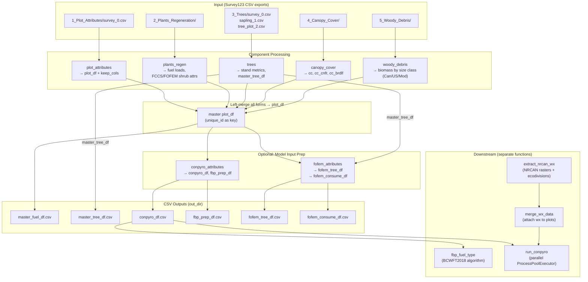

# FuelAnalyst Codebase Reference

## What This Project Does

FuelAnalyst processes raw **Survey123 field data** from forest fuel inventory plots into structured outputs for fire behaviour modelling. Given a directory of Survey123 CSV exports, it produces:

- Plot-level stand structure metrics (density, basal area, height, composition)
- Tree-level biomass via Canadian National Biomass Equations (CNBE)
- Crown fuels (CFL, CBD) and Fuel Strata Gap (FSG)
- Woody debris fuel loads (Brown's planar intercept method)
- Canopy cover and vegetation fuel loads
- Fire behaviour attributes per tree (flame length, fireline intensity)
- Formatted inputs for **ConPyro** (crown fire model) and **FOFEM** (fire effects/mortality)
- BC FBP fuel type classifications (BCWFT2018)
- NRCAN weather data extraction (spatially-aware, ecodivision-based)

---

## Repository Layout

```
FuelAnalyst/
├── src/fuel_analyst/           # Main package
│   ├── __init__.py             # Public API (lazy imports)
│   ├── fuel_analyst.py         # Core orchestrator + all default config dicts
│   ├── extract_nrcan_wx.py     # Weather extraction from NRCAN rasters
│   ├── fbp_fuel_type.py        # FBP fuel type classification
│   ├── merge_wx_data.py        # Merge weather data into plot DataFrame
│   ├── run_conpyro.py          # Run ConPyro fire model (parallel)
│   ├── components/             # Processing sub-modules
│   │   ├── helper.py
│   │   ├── plot_attributes.py
│   │   ├── plants_regen.py
│   │   ├── trees.py
│   │   ├── canopy_cover.py
│   │   ├── woody_debris.py
│   │   ├── conpyro_attributes.py
│   │   ├── fofem_attributes.py
│   │   ├── fofem_emissions.py
│   │   ├── fofem_mortality.py
│   │   ├── fofem_gui_emissions.py
│   │   └── fwis_moisture_content.py
│   └── supporting_data/
│       ├── tree_parameters.csv                          # Species allometric params (CNBE, Temesgen, FOFEM, bark)
│       ├── plant_photoload.csv                          # Plant photoload lookup
│       └── WHSE_TERRESTRIAL_ECOLOGY_ERC_ECODIVISIONS_SP.json  # BC ecodivisions (for wx extraction)
├── dependencies/               # Git submodules
│   ├── conpyro/                # Crown fire behaviour model
│   ├── pyfofem/                # Python FOFEM wrapper
│   ├── flame_components/       # Flame geometry calculations
│   └── BC_CFFBPS_FuelTyping_Tool/  # BC fuel type algorithm (bcwft2018)
├── examples/
│   ├── data/Survey123_Data/    # Example inputs (numbered form folders)
│   └── results/                # Example outputs
├── development/                # Experimental/in-progress scripts
└── docs/
    └── reference/              # Field name reference xlsx
```

---

## Key Files and Responsibilities

### `fuel_analyst.py`
**The orchestrator.** Contains the main `fuel_analyst()` function and all five default configuration dicts (`default_stand_summary_dict`, `default_woody_debris_dict`, `default_conpyro_dict`, `default_fofem_mortality_dict`, `default_fofem_consume_dict`). Dispatches to each component, merges results into a single `plot_df`, and writes all output CSVs. Also the `__main__` entry point for script execution.

### `components/trees.py`
**The most complex module.** Processes three CSVs (`survey_0.csv`, `sapling_1.csv`, `tree_plot_2.csv`) through a 15-step calculation chain. Handles density expansion factors, decay-adjusted biomass via CNBE allometrics, height imputation via Temesgen Model 2, crown fuels, FSG, fire attributes, BA-weighted stand means, and stand composition. Returns `(plot_df, keep_columns, master_tree_df)`.

### `components/woody_debris.py`
Processes Brown's planar intercept transect data into biomass per diameter class. Supports three concurrent protocols: Canadian (7 classes), US (4 classes, FOFEM-compatible), and Modified (8 classes). Also calculates forest floor (duff/litter) bulk density and depth from species-specific parameters.

### `components/conpyro_attributes.py`
Assembles the ConPyro input DataFrame from the merged `plot_df`. Uses fixed output column names (all prefixed `conpyro_`) required by the ConPyro model. Calculates stand type (conifer/broadleaf/mixed), vegetation fuel loads, and selects canopy cover attribute.

### `components/fofem_attributes.py`
Produces two formatted DataFrames:
- `fofem_tree_df` — tree mortality inputs (US units: acres, inches, feet; FOFEM species codes)
- `fofem_consumption_df` — consumption/emissions inputs (tons/acre; FOFEM cover groups, moisture regimes)

### `extract_nrcan_wx.py`
Authored by Florencia Tiribelli. Spatially extracts weather variables from NRCAN raster datasets using plot locations. BC-ecodivision-aware: uses the `WHSE_TERRESTRIAL_ECOLOGY_ERC_ECODIVISIONS_SP.json` to determine fire season date ranges per plot. Parallelised via `concurrent.futures`.

### `run_conpyro.py`
Calls the `conpyro` submodule per-plot in parallel (`ProcessPoolExecutor`, `cpu_count - 1` workers). Pre-processes in-stand wind speed using `flame_components.getMidFlameWS()` (Albini & Baughman 1979). Handles two FOFEM emissions backends: `pyfofem` (Python) or `fof_gui` (USFS GUI executable batch mode).

### `components/fwis_moisture_content.py`
Pure functions converting FWI system codes (FFMC, DMC, DC, BUI, ISI, FWI) to moisture content percentages using Van Wagner (1987) equations. Stateless — no DataFrame handling.

### `components/helper.py`
Shared utilities: CSV I/O, `unique_id` generation, repo root discovery (walks up from any `__file__` until it finds `src/fuel_analyst/` + `requirements.txt`), alphanumeric list sorting.

---

## Data Flow



---

## Implicit Assumptions and Gotchas

### Input format
- Survey123 exports **must** use the exact folder names `1_Plot_Attributes`, `2_Plants_Regeneration`, `3_Trees`, `4_Canopy_Cover`, `5_Woody_Debris`. These are hardcoded in `dir_dict` in `fuel_analyst.py`.
- Inside `3_Trees/`, the three CSVs must be named exactly `survey_0.csv`, `sapling_1.csv`, `tree_plot_2.csv`. These filenames reflect Survey123's default repeat-form naming.
- The `_date` field must be parseable as either `'%m/%d/%Y %H:%M'` or `'%m/%d/%Y %H:%M:%S %p'`. Any other format silently produces no `unique_id` and no error is raised.

### `unique_id` collisions
`unique_id` = `treatment_area_treatment_unit_treatment_type_plot_id_year`. If the same plot is re-surveyed within the same year, only the **most recent** entry is kept (sort by `_date`, keep last). This deduplication happens per-form independently — there is no check that the same logic is applied consistently across all forms.

### Form processing is optional per-plot, not per-run
The orchestrator checks `plot_df['form_select'].str.contains(form)` to decide which forms to process for each plot. But the form loop still runs even if no plots selected a given form, and each component will error if its input folder doesn't exist. The `if not os.path.exists(in_path): continue` guard prevents the crash but silently skips forms even when data may exist.

### `keep_columns` is additive and order-dependent
Each component appends to `keep_columns`. If a component is skipped (folder missing), its columns are simply absent from `master_fuel_df.csv` with no warning. ConPyro and FOFEM columns are injected into `stand_summary_params` via `dict.update()` **before** tree processing — so the ConPyro/FOFEM stand attributes are calculated inside `trees.py` even though they're configured in `fuel_analyst.py`.

### ConPyro requires all four forms
If `gen_conpyro_df=True`, the code verifies all four form folders exist and raises `FileNotFoundError` if any are missing. This is the only hard failure in the pipeline.

### `sys.path` injection
Every top-level module (and `fuel_analyst.py`) injects `../../` into `sys.path` at import time to enable `from src.fuel_analyst...` absolute imports. This means the package is **not installable** via pip in its current state — it assumes execution from the repo root or that the path injection succeeds.

### Basal-area weighting, not simple means
Height, CBH, DCBH, FSG, crown depth, flame length, and fire intensity are **basal-area weighted means**, not arithmetic means. Values are stored as `tree_{att}_wtd = value × BA/ha`, then the stand mean is recovered by dividing by total BA/ha. Calling these "means" without understanding the weighting will give wrong results if you try to replicate calculations manually.

### `cbd` is a special case throughout
CBD is computed from CFL / crown depth — it has no simple `_ha` column. Every place that handles other attributes via `metrics` has a parallel `att != 'cbd'` branch that recalculates it from `cfl_cnbe_ha` and `tree_crwn_dpth`. If you add CBD handling anywhere new, check both branches.

### Decay class asymmetry
Conifer decay classes go 1–9; broadleaf go 1–6. The threshold for "use modeled height" is **≥6 for conifers, ≥5 for broadleaves**. This appears in three separate places (`_calc_tree_missing_heights`, `_calc_tree_biomass`, the mask in `_calc_tree_fofem_attributes`). They must stay in sync.

### FOFEM outputs are in US units
`fofem_tree_df` uses acres (density ÷ 2.47105), inches (DBH ÷ 2.54), and feet (height ÷ 3.28084). `fofem_consumption_df` uses tons/acre (× 4.46089561). All other internal calculations use SI. The conversion happens only at the point of building FOFEM DataFrames.

### Sapling CBH for dead saplings
Dead saplings merged from `sapling_df` into `tree_df` have `tree_cbh = np.nan` (line ~1378 in `trees.py`). Live saplings carry `sapling_live_cbh`. If CBH-dependent calculations (FSG, crown depth) are run on saplings, dead sapling results will always be NaN.

### Bark char height sentinel value
`tree_bark_char_high == 444` is a sentinel meaning "full-height char" — triggers the Butler crown fire intensity model instead of the surface fire model. This is not documented anywhere in code comments other than the single inline comment. Any post-processing of fire intensity columns needs to be aware of this.

### `run_conpyro.py` expects pre-merged weather
`run_conpyro` requires weather columns in the input DataFrame. These come from `extract_nrcan_wx` → `merge_wx_data`. The pipeline for `run_conpyro` is therefore: `fuel_analyst` → `extract_nrcan_wx` → `merge_wx_data` → `run_conpyro`. There is no enforced ordering — if weather is missing, ConPyro will fail at runtime with column-not-found errors.

### Two authors, different conventions
`extract_nrcan_wx.py` (Florencia Tiribelli) uses `rasterio`, `geopandas`, and `concurrent.futures` with a slightly different style (more functional, less class-based) than the rest of the codebase. The `BCWS_FIRE_SEASON_DICT` uses `[start_MMDD, end_MMDD, abbreviation]` tuples as values — this structure is unique to that module.
