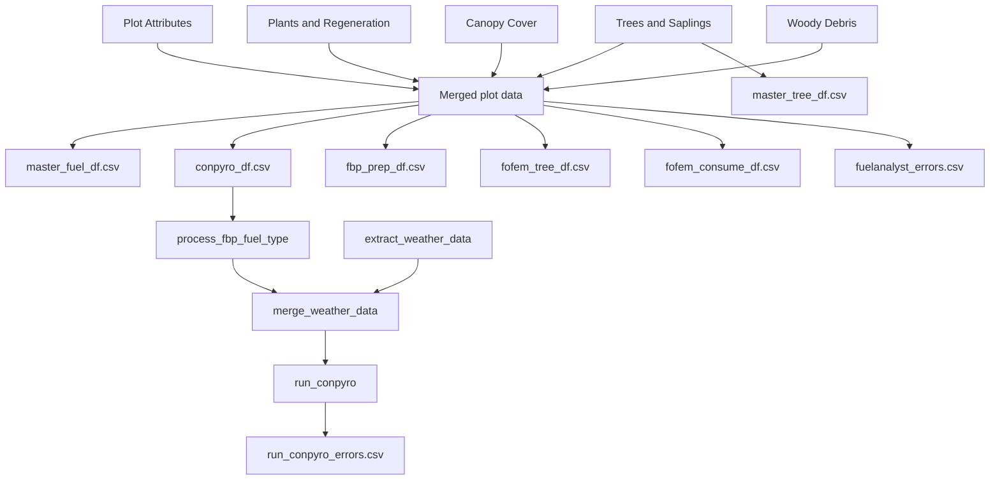

# FuelAnalyst codebase reference

This document describes the current package architecture and its important runtime
contracts. For installation and user workflows, start with the
[main README](../README.md) or [quick start](../QUICK_START.md).

## Purpose

FuelAnalyst converts related ArcGIS Survey123 forest-fuel inventories into
analysis-ready plot, tree, fuel-load, and model-preparation tables. It also
provides workflows for BC FBP fuel typing, NRCAN weather extraction and merging,
and optional ConPyro and FOFEM execution.

The core pipeline calculates:

- stable plot identities and plot attributes;
- plant, regeneration, canopy-cover, tree, sapling, forest-floor, and woody-fuel
  attributes;
- tree density, basal area, biomass, crown fuels, fuel strata gap, and fire
  attributes;
- ConPyro, FBP, FOFEM mortality, and FOFEM consumption preparation tables; and
- one centralized data-quality report for each completed pipeline run.

## Package and repository layout

```text
FuelAnalyst/
|-- pyproject.toml                 Package metadata, dependencies, and pytest config
|-- src/fuel_analyst/
|   |-- __init__.py                Lazily loaded public API
|   |-- fuel_analyst.py            Survey123 orchestrator and preparation defaults
|   |-- extract_nrcan_wx.py        NRCAN raster extraction
|   |-- fbp_fuel_type.py           BC FBP fuel typing
|   |-- merge_wx_data.py           Plot/weather merge
|   |-- run_conpyro.py             ConPyro and FOFEM orchestration
|   |-- _vendor/                   Vendored BCWFT2018 implementation
|   |-- components/
|   |   |-- error_handling.py      Run-scoped logging and CSV reports
|   |   |-- plot_attributes.py
|   |   |-- plants_regen.py
|   |   |-- trees.py
|   |   |-- canopy_cover.py
|   |   |-- woody_debris.py
|   |   |-- conpyro_attributes.py
|   |   |-- fofem_attributes.py
|   |   |-- fofem_emissions.py
|   |   |-- fofem_mortality.py
|   |   |-- fofem_gui_emissions.py
|   |   |-- fwis_moisture_content.py
|   |   `-- helper.py
|   `-- supporting_data/           Packaged CSV and ecodivision data
|-- models/photoload/              Reproducible PhotoLoad model-development workflow
|-- dependencies/                  Optional dependency checkouts/submodules
|-- examples/                      Checked-in inputs and ignored generated outputs
|-- tests/                         Unit, integration, regression, and test data
`-- docs/                          Architecture, references, designs, and plans
```

FuelAnalyst uses a standard `src` package layout and is installable with
`python -m pip install -e .`. Optional dependency groups are declared in
`pyproject.toml`: `conpyro`, `fofem`, `photoload`, `test`, `dev`, and `all`.

## Public API

`fuel_analyst.__init__` lazily exposes five callables:

| Function | Responsibility |
| --- | --- |
| `fuel_analyst()` | Process Survey123 forms and write master/model-preparation tables |
| `process_fbp_fuel_type()` | Assign BCWFT2018 fuel types to a ConPyro table |
| `extract_weather_data()` | Extract NRCAN raster values for plot locations |
| `merge_weather_data()` | Join plot-specific weather or apply shared weather scenarios |
| `run_conpyro()` | Run configured ConPyro, FOFEM mortality, and emissions workflows |

The `if __name__ == '__main__'` blocks are repository examples, not installed
console-script entry points.

## Core modules

### `fuel_analyst.py`

The main orchestrator owns the default stand-summary, woody-debris, ConPyro,
FOFEM-mortality, and FOFEM-consumption dictionaries. It processes Plot
Attributes first, processes the four selected component forms, checks form IDs
in both directions, left-merges component results, and writes the requested
tables. Model-specific stand and woody settings are added to per-run copies of
the defaults so one invocation does not pollute later runs.

### `components/trees.py`

Processes `survey_0.csv`, `sapling_1.csv`, and `tree_plot_2.csv`. It calculates
density expansion factors, CNBE biomass, modeled heights, crown fuels, fuel
strata gap, tree fire attributes, basal-area-weighted stand summaries, and
species composition. It returns the processed plot table, its output-column
list, and `master_tree_df`.

### `components/woody_debris.py`

Processes the Survey123 woody transects with configurable Canadian, U.S.,
modified, ConPyro, and FOFEM diameter schemes. It also calculates forest-floor
duff/litter attributes and logs species-composition fallbacks through the
central error handler.

### `components/conpyro_attributes.py`

Builds `conpyro_df` and `fbp_prep_df` from the merged plot data. Source columns
may use `conpyro_` names internally, while the emitted ConPyro table uses the
schema expected by the downstream model, such as `stand_type`, `stand_density`,
and canopy/fuel attributes.

### `components/fofem_attributes.py`

Builds `fofem_tree_df` for mortality and `fofem_consume_df` for consumption and
emissions. These schemas use FOFEM-required U.S. units rather than FuelAnalyst's
primarily metric internal units.

### `components/error_handling.py`

Provides `get_logger()`, `start_run()`, `write_report()`, and the `run_guard`
decorator. The three pipeline entry points—`fuel_analyst()`,
`extract_weather_data()`, and `run_conpyro()`—start a run-scoped collector and
guarantee cleanup if execution raises. Completed runs write a wide CSV with one
row per affected plot, dynamic form columns, and a reserved `General Error` row
for records without a usable plot ID.

The collector respects logging already configured by an embedding application.
It installs a fallback console handler only when the package logger and its
propagation ancestors have no non-null output handler; a lone `NullHandler`
does not suppress fallback output.

### `extract_nrcan_wx.py`

Loads CSV or spatial plot locations, samples locally available NRCAN raster
archives, optionally uses BC Wildfire Service ecodivision season dates, and can
calculate per-plot percentiles. It writes `<out_file_name>.csv`, shapefile
sidecars, and `<out_file_name>_errors.csv`.

### `run_conpyro.py`

Runs ConPyro per row with a configurable worker count, calculates flame
components, and optionally runs FOFEM mortality and emissions using `pyfofem`
or the Windows FOFEM GUI backend. A completed run writes
`run_conpyro_errors.csv` in addition to its selected model outputs.

### `components/fwis_moisture_content.py`

Contains stateless conversions from FWI-system codes to moisture-content
percentages using the documented Van Wagner equations.

### `components/helper.py`

Contains CSV utilities, missing-column checks, alphanumeric sorting, repository
example lookup, and `unique_id` generation. Repository example lookup is for
the development `__main__` routines; normal installed API calls do not depend
on the repository layout.

## Data flow and outputs



`master_fuel_df.csv` and `fuelanalyst_errors.csv` are written by every completed
`fuel_analyst()` run. Other core outputs are conditional:

- `master_tree_df.csv` requires processed tree data;
- `conpyro_df.csv` and `fbp_prep_df.csv` require `gen_conpyro_df=True`;
- `fofem_tree_df.csv` requires `gen_fofem_tree_df=True`; and
- `fofem_consume_df.csv` requires `gen_fofem_consume_df=True`.

The centralized report omits plots with no collected issues. Form columns and
identity columns are dynamic. Multiple messages in one cell are numbered and
include their logging severity.

## Runtime contracts and gotchas

### Input names and identities

- Parent/repeat folder and CSV names follow the exact Survey123 layout shown in
  the README and checked-in example data.
- `_date` accepts `MM/DD/YYYY HH:MM` or `MM/DD/YYYY HH:MM:SS AM/PM`.
  Unparseable dates raise `ValueError` with representative bad values.
- `unique_id` is
  `treatment_area_treatment_unit_treatment_type_plot_id_year`.
- Within each parent form, duplicate annual identities retain the record with
  the latest parsed timestamp. Parent forms are deduplicated independently.
- The orchestrator detects IDs missing from either side of a form merge. Its
  set-backed check is linear in the combined input size, preserves first-seen
  order, and logs each repeated ID once.

### Optional forms and model preparation

Missing component folders are skipped. If any plot selected the missing form,
FuelAnalyst logs a warning for each affected plot; a missing unselected form is
silent. `gen_conpyro_df=True` is stricter and raises `FileNotFoundError` unless
all four component-form folders are present.

`keep_columns` remains additive: skipped or unselected components do not add
their result columns to `master_fuel_df.csv`.

### Tree calculations

- Many height, crown, flame, and fire-intensity means are basal-area weighted,
  not arithmetic means.
- CBD is derived from crown fuel load and crown depth and therefore follows a
  separate aggregation path from attributes with direct per-hectare columns.
- The conifer and broadleaf dead-decay thresholds are 6 and 5 respectively and
  are centralized as module constants used by height and biomass logic.
- Dead sapling CBH is missing by design; live-only crown/FSG aggregations exclude
  those records.
- Survey value `tree_bark_char_high == 444` means full-height char. The code
  replaces it with tree height before deriving flame length and crown-fire
  intensity, so `444` is not treated as a physical height.

### Units

FuelAnalyst calculations are primarily SI. FOFEM preparation is the major
exception: tree density is converted from per hectare to per acre, DBH and duff
depth from centimetres to inches, height from metres to feet (`× 3.28084`), and
fuel load from kilograms per square metre to tons per acre.

### Weather and downstream models

`run_conpyro()` expects weather to have been supplied or merged already. It
validates the always-required `ws`, `wd`, `ffmc`, `dmc`, and `bui` columns,
requires `temp` and `rh` for CFIS (`cfo_model == 10`), and validates fields whose
configuration value is `"use_csv"`. Missing requirements raise a descriptive
`ValueError` before model execution.

The default fire-model configuration enables ConPyro, FOFEM mortality, and
pyFOFEM emissions. Consequently, the default call also requires tree and FOFEM
consumption input paths plus the `conpyro` and `fofem` optional dependencies.

### Run-scoped reporting

The run guard restores FuelAnalyst logger handlers and the previous logging
level on both success and failure. An exception raised before `write_report()`
means no completed-run error CSV is produced, but it does not leave a collector
or fallback handler attached for the next invocation.

## Tests and historical documents

The active suite is split across `tests/unit`, `tests/integration`, and
`tests/regression`; see [the test guide](../tests/README.md). Files under
`docs/superpowers/plans`, `docs/superpowers/specs`, and `development` document
the intent and sequence of earlier changes. Treat embedded code snippets and
planned filenames in those historical records as snapshots; this file, the
README, tests, and production code define the current behavior.
