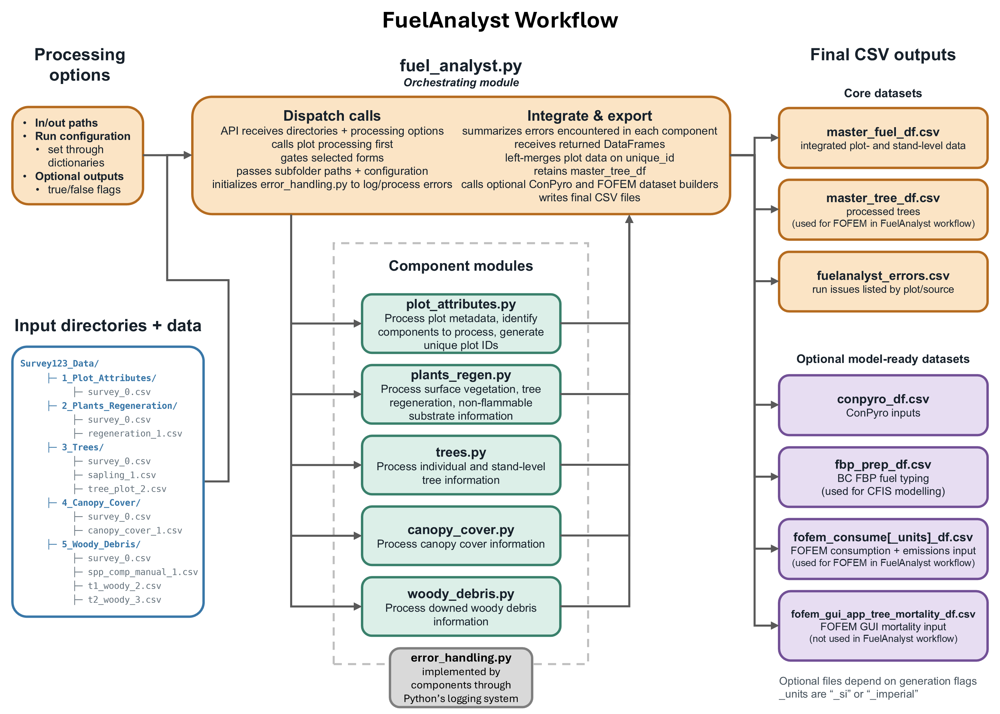
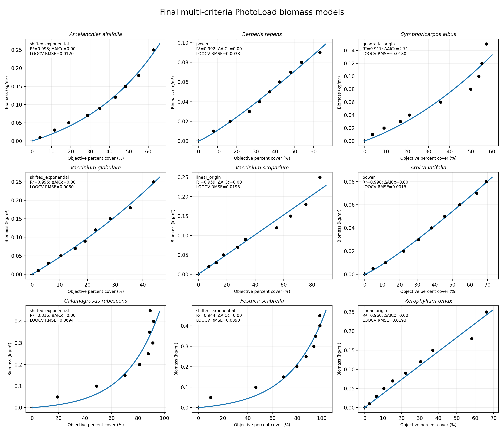
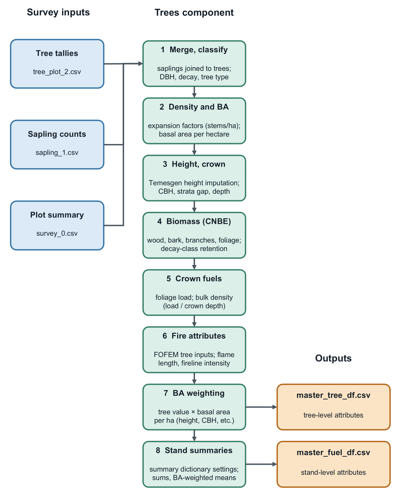
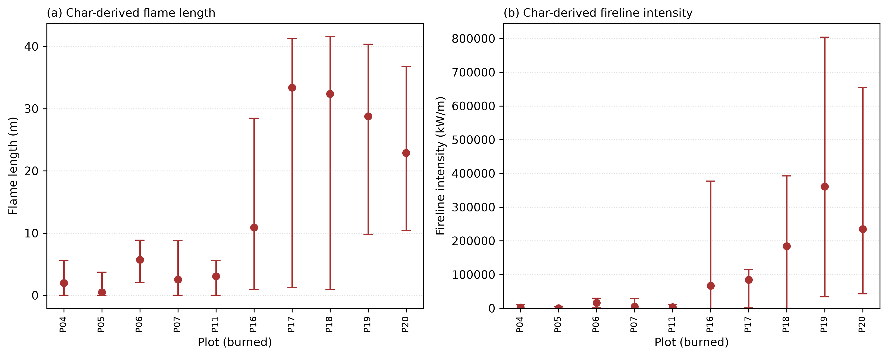
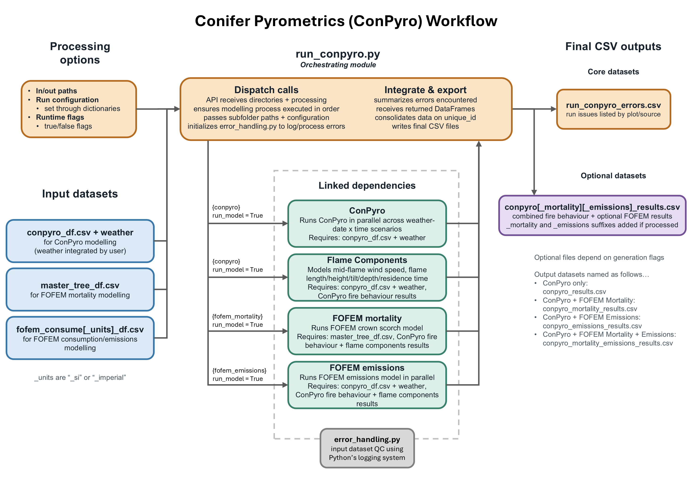
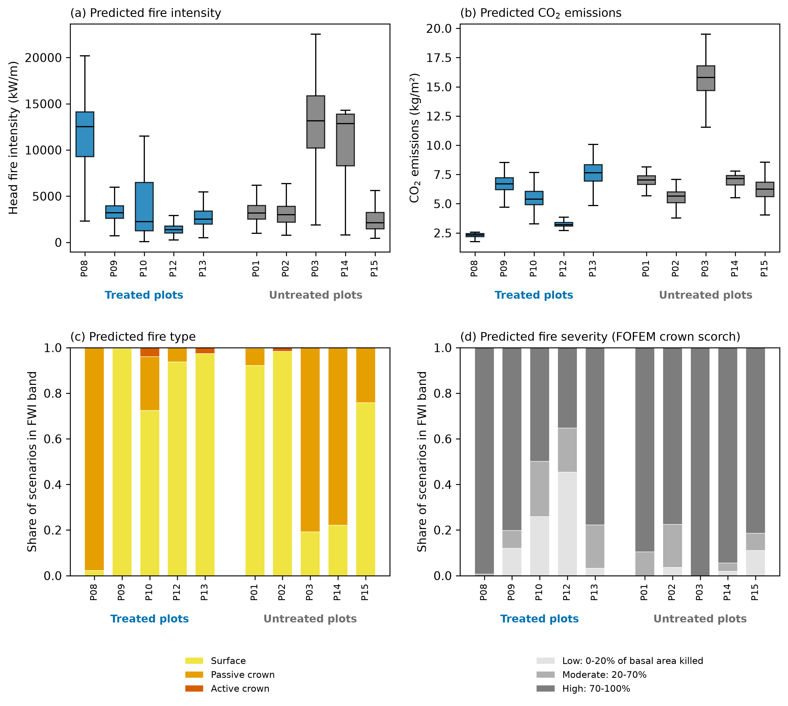

# FuelAnalyst technical reference

This is the technical reference for FuelAnalyst: every configuration setting and default (Section 2), the equations and output variables of each processing component (Section 3), and the ConPyro and FOFEM modelling workflow (Section 4). Sections, tables, equations, and figures are numbered within this reference, and numbers in square brackets refer to the [reference list](#references) at the end.

**Contents:** [1 Introduction](#1-introduction) | [2 Configuration dictionaries](#2-configuration-dictionaries) | [3 Variable descriptions](#3-fuelanalyst-variable-descriptions) | [4 ConPyro/FOFEM modelling workflow](#4-conpyrofofem-modelling-workflow) | [References](#references)

# 1. Introduction

This reference provides technical detail for FuelAnalyst, a Python package that converts Survey123 \[1\] forest fuel field survey data into stand structure, biomass, surface fuel, and crown fuel variables and prepares inputs for fire-behaviour and fire-effects models. The abbreviations used throughout are: diameter at breast height (DBH), basal area (BA), crown base height (CBH), dead crown base height (DCBH), fuel strata gap (FSG), canopy fuel load (CFL), canopy bulk density (CBD), Canadian National Biomass Equations (CNBE), quadratic mean diameter (QMD), Conifer Pyrometrics (ConPyro) \[2\], Crown Fire Initiation and Spread (CFIS) \[3\], British Columbia Forest Fire Behaviour Prediction (FBP), and First Order Fire Effects Model (FOFEM) \[4\]. FuelAnalyst is organized into modules. A module is a Python file that groups related functions. Each of five components (plot attributes, plants and regeneration, trees, canopy cover, and woody debris) is implemented as a component module, which is run through one orchestrating function that calls specialized functions in sequence (for example, process_trees() in the trees component module); in this reference, a component is its component module. The orchestrating module, fuel_analyst.py, runs the component modules and merges their results, and the separate fire-modelling module, run_conpyro.py, runs ConPyro, CFIS, and FOFEM. Section [2](#2-configuration-dictionaries) documents the four configuration dictionaries passed to fuel_analyst(), including all settings, their default values, and their effects on pipeline behaviour. Section [3](#3-fuelanalyst-variable-descriptions) provides complete variable descriptions for all outputs produced by each processing component, including the equations used to compute each variable and the citations for those equations. Section [3](#3-fuelanalyst-variable-descriptions) also documents the input variable mappings used to prepare ConPyro and FOFEM input files. Section [4](#4-conpyrofofem-modelling-workflow) describes run_conpyro(), FuelAnalyst's separate fire-modelling entry point that runs ConPyro and FOFEM using the prepared inputs, and documents its configuration dictionary.



**Figure 1.** FuelAnalyst workflow. Input data and processing options (left) are passed to the orchestrating fuel_analyst.py module (center), which runs the selected component modules and generates core datasets and optional model-ready datasets (right) for fire behaviour and fire effects modelling. API, application programming interface; FBP, Canadian Forest Fire Behaviour Prediction System.

# 2. Configuration Dictionaries

## 2.1 Overview

FuelAnalyst is run through the function fuel_analyst() of the orchestrating module fuel_analyst.py, which reads the Survey123 form folders of a project (plot attributes, plants and regeneration, trees, canopy cover, and woody debris), calculates plot-level and stand-level fuel variables, and writes master_fuel_df.csv, master_tree_df.csv, and fuelanalyst_errors.csv. Four configuration dictionaries control which variables are generated and how they are computed: the stand summary dictionary (stand_summary_params, [2.2](#22-stand-summary-dictionary)), the woody debris dictionary (woody_debris_params, [2.3](#23-woody-debris-dictionary)), the ConPyro dictionary (conpyro_params, [2.4](#24-conpyro-dictionary)), and the FOFEM consumption dictionary (fofem_consume_params, [2.5](#25-fofem-consumption-dictionary)). Each dictionary is an optional argument of fuel_analyst(), and the default is used when none is supplied. The ConPyro and FOFEM consumption dictionaries take effect only when the matching output is requested (gen_conpyro_df or gen_fofem_consume_df is True), in which case their stand entries and woody debris classes are added to the stand summary and woody debris dictionaries. A supplied dictionary replaces the default entirely. The stand summary dictionary may hold any subset of the default entries, but the other three dictionaries must keep every top-level key of their default, so users should modify a copy of the default rather than pass a partial dictionary.

The default settings are designed to produce a broad set of output variables. Users can pass a modified dictionary to restrict output to a specific subset of variables, reduce computation time, or tailor outputs to a particular downstream application. Modifying a dictionary does not affect the underlying equations; it controls which combinations of attributes, summaries, and size classes are computed and written to the output CSV files.

Problems found while processing are reported instead of stopping the run, so that a problem in one plot does not stop the calculation of the others. The component modules log warnings and errors, tagged with the unique_id of the affected plot, and fuel_analyst() writes them to fuelanalyst_errors.csv. The report has one row per affected plot (with its treatment_area, treatment_unit, treatment_type, and plot_id), one column per reporting source (for example, Plants and Regeneration, Trees, or Woody Debris), and numbered messages that include their severity. A General Error row holds issues that are not tied to a plot, and plots with no issues are omitted. A configuration error, such as an invalid summary_permutation, stops the run after the report is written. run_conpyro() reports its own issues in the same way ([4.4](#44-outputs-and-error-reporting)).

### 2.1.1 Input file formats

fuel_analyst() reads each Survey123 form from its own folder (1_Plot_Attributes, 2_Plants_Regeneration, 3_Trees, 4_Canopy_Cover, and 5_Woody_Debris) and detects the format of each form's tables, so a run can use a different format for each form. Eight formats are supported. CSV, Parquet, Feather, and GeoJSON hold one file per table, named after the table (survey_0.csv, survey_0.parquet, survey_0.feather, survey_0.geojson; a GeoJSON parent table holds point features and its repeat tables hold features without geometry); Parquet and Feather need the optional pyarrow package. Excel (.xlsx or .xlsm), GeoPackage (.gpkg), SQLite (.sqlite, .sqlite3, or .db), and file geodatabase (an unzipped .gdb folder) hold every table of a form in one file or folder, with one sheet, layer, or table per table. CSV, Excel, and file geodatabase are the downloads that ArcGIS Survey123 and ArcGIS Online provide; the other formats suit data that were cleaned in other software. A container is matched to a table by the table name (survey_0) or by the name without its number (survey, the name an ArcGIS geodatabase gives its layers), ignoring case. Every format must use the Survey123 field names; only the container differs.

If a form folder holds more than one format, one is used, in this order: CSV, Parquet, Feather, GeoJSON, Excel, GeoPackage, SQLite, and file geodatabase, and the run prints the formats it found. A SQLite file that holds GeoPackage tables is read as a GeoPackage, and a table found in two files of the same kind is an error. Zipped downloads must be unzipped.

Tables from every format are converted to read like their CSV. Columns get the data types a CSV read would give, and missing values are handled in the same way. Dates are read as dates (a time-zone-aware date keeps its UTC clock time), and SQLite and GeoJSON date text is parsed. From a geodatabase or GeoPackage, the object ID becomes ObjectID (an ObjectID field takes precedence over the row ID), globalid and parentglobalid become GlobalID and ParentGlobalID in lower case without braces, and point geometry becomes the x and y columns in WGS84 degrees (a layer in another coordinate system is reprojected) unless the layer already has those fields. The output files have the same structure for every input format. The datasets that FuelAnalyst writes are always CSV files, and this document refers to all datasets as CSVs.

## 2.2 Stand Summary Dictionary

The stand summary dictionary controls stand-level aggregation of tree attributes. Each entry in the dictionary corresponds to one tree-level attribute. The key is the attribute name and the value is a sub-dictionary specifying how that attribute is summarized across the trees in a plot. Output column names are constructed programmatically from the attribute name, units, summary type, DBH size class, and metric using the pattern: stand\_{attribute}\_{units}\_{summary}\_{class}\_{metric}. The size-class part appears only for size-class outputs, and the word total is omitted. For example, stand_dens_tpha_live_sum is the summed live tree density per hectare across all DBH classes, and stand_dens_tpha_live_dbh0-5_sum is the same quantity for live trees in the 0-5 cm DBH class.

Each entry can contain the keys att_source (the tree attribute to summarize, listed in Table 1; the entry name is used when it is omitted), override_field_name (default False; if True, the output column is named exactly as the entry key, as in [2.4.1](#241-stand-attributes)), summary (the tree groups, [2.2.2](#222-summary-options)), summary_permutation ([2.2.3](#223-summary-permutations); default "all"), metrics ([2.2.4](#224-metrics)), units (a label added to the column name), and classes ([2.2.5](#225-dbh-size-classes)). In the unit labels, tpha is trees per hectare, m2pha is square metres per hectare, kgpm2 is kilograms per square metre, kgpm3 is kilograms per cubic metre, m is metres, and kWpm is kilowatts per metre.

### 2.2.1 Attribute sources

The attributes that can be included in the stand summary dictionary are listed in Table 1. Each attribute corresponds to a tree-level column computed earlier in the processing chain.

**Table 1.** Attributes available in the stand summary dictionary.

| **Attribute key** | **Tree-level source column** | **Description** | **Units (fixed)** |
|----|----|----|----|
| dens | tree_dens_ha | Tree density | tpha |
| ba | tree_ba_ha | Basal area | m2pha |
| ht | tree_ht | Tree height (measured, or modelled where missing) | m |
| cbh | tree_cbh | Crown base height (live) | m |
| dcbh | tree_dcbh | Dead crown base height | m |
| fsg | tree_fsg | Fuel strata gap | m |
| cfl | tree_cfl_cnbe_ha | Canopy fuel load (= foliage CNBE) | kgpm2 |
| cbd | tree_cfl_cnbe_ha and tree_crwn_dpth_wtd | Canopy bulk density (canopy fuel load divided by BA-weighted crown depth) | kgpm3 |
| foliage | tree_foliage_cnbe_ha | Foliage biomass (CNBE) | kgpm2 |
| branches | tree_branches_cnbe_ha | Branch biomass (CNBE) | kgpm2 |
| wood | tree_wood_cnbe_ha | Wood biomass (CNBE) | kgpm2 |
| bark | tree_bark_cnbe_ha | Bark biomass (CNBE) | kgpm2 |
| flame_length | tree_flame_length | Tree-level flame length | m |
| fire_intensity | tree_fire_intensity | Tree-level fire line intensity | kWpm |
| foliage_fofem | tree_foliage_fofem | Foliage fuel load prepared for FOFEM (default FOFEM consumption dictionary only) | kgpm2 |
| branches_fofem | tree_branches_fofem | Branch fuel load prepared for FOFEM (default FOFEM consumption dictionary only) | kgpm2 |

The units value is a label that is added to the output column names; it does not convert the values, and the default dictionaries fix it to the units shown. The foliage_fofem and branches_fofem entries are configured through the FOFEM consumption dictionary ([2.5](#25-fofem-consumption-dictionary)), are sum-only, and omit att_source, so their dictionary key is used. An attribute key that is not listed here must match an existing tree\_\<key\> column in the master tree table; otherwise the trees component raises a KeyError when it groups the trees.

### 2.2.2 Summary options

The summary field lists the tree groups to summarize. Each option is a test on the tree status and tree type recorded in the master tree table. When several options are listed, summary_permutation decides how they are combined ([2.2.3](#223-summary-permutations)). The options are listed in Table 2.

**Table 2.** Summary options and the trees each one includes.

| **Summary option** | **Trees included** | **Test on the master tree table** |
|----|----|----|
| total | All trees (live and dead, conifer and broadleaf) | None (every tree record) |
| live | Live trees only | tree_status = "L" |
| dead | Dead trees only | tree_status = "D" |
| conifer | Conifer trees (live and dead) | tree_type = "conifer" |
| broadleaf | Broadleaf trees (live and dead) | tree_type = "broadleaf" |

The total option is never joined to another option; it summarizes all trees on its own, and its output names omit the word total. Joined names such as live_conifer apply both tests at once.

The default summary lists are total, live, dead, conifer, and broadleaf for dens, ba, ht, dcbh, and fsg; total, live, conifer, and broadleaf for cbh; live and conifer for cfl and cbd; live, conifer, and broadleaf for foliage; live, dead, conifer, and broadleaf for branches, wood, and bark; and total only, with summary_permutation "exact", for flame_length and fire_intensity. All other defaults use summary_permutation "all".

FuelAnalyst does not restrict which attributes can be requested for which option. Several per-tree attributes are only calculated for some trees, so a request can return missing or zero values for the other trees. The trees for which each group of attributes has values are listed in Table 3.

**Table 3.** Tree groups for which each group of attributes has values.

| **Attributes** | **Calculated for** | **Result for other trees** |
|----|----|----|
| dens, ba, ht, dcbh | Live and dead trees | No restriction |
| flame_length, fire_intensity | Trees of burned plots only (a valid tree with no recorded bark char height is 0) | Missing for the trees of unburned plots, so the plot-level minimum, maximum, and mean are missing for those plots |
| wood, bark, branches | Live and dead trees (dead trees after decay-class retention, [3.3.6](#336-tree-biomass-canadian-national-biomass-equations-cnbe)) | No restriction |
| foliage | Live trees, and dead trees only in the early decay classes that still retain foliage ([3.3.6](#336-tree-biomass-canadian-national-biomass-equations-cnbe)) | Zero for dead trees in later decay classes |
| cbh, fsg, cfl, cbd | Live trees only | Missing or zero for dead trees, so a total summary of cfl equals the live summary |

### 2.2.3 Summary permutations

The summary field lists the tree groups to summarize, and summary_permutation controls which of those groups become separate output summaries. A joined name such as live_conifer means live AND conifer. In "combined" mode, listing both statuses (live and dead) means any status, and listing both tree types (conifer and broadleaf) means any tree type. These settings are applied when the trees component calculates stand-level attributes, and the default stand summary dictionary sets them for each attribute. The three modes are described in Table 4.

**Table 4.** Behaviour of the three summary_permutation modes.

| **Permutation** | **Behaviour** |
|----|----|
| all | Creates every valid individual group and every valid pair of a status with a tree type, joined by AND. Live is never paired with dead, and conifer is never paired with broadleaf. Outputs keep the order in which the groups were listed. |
| exact | Creates one output for each listed group and no joined groups. |
| combined | Creates a single output in which all listed groups are joined by AND. The total group is not an option and is removed if provided. A complete status pair is read as any status, and a complete type pair is read as any tree type. |

To show how the three modes differ, consider a plot with four trees. The tree numbers let the examples show which tree records each summary selects. The four trees are listed in Table 5.

**Table 5.** Example plot with four trees, used to illustrate the summary permutations.

| **Tree** | **Status** | **Type**  |
|:--------:|:----------:|:---------:|
|    1     |    Live    |  Conifer  |
|    2     |    Live    | Broadleaf |
|    3     |    Dead    |  Conifer  |
|    4     |    Dead    | Broadleaf |

All 15 nonempty combinations of the four groups live, dead, conifer, and broadleaf are covered in Table 6. Each cell lists the output summary names, each followed by the trees it selects. The names are the summary suffixes; the full output column name also contains the attribute, its units, and the metric, for example stand_dens_tpha_live_conifer_sum.

**Table 6.** Output summaries and the trees they select, for all 15 combinations of the four tree groups under each permutation mode.

| **summary input list** | **"all": outputs → matching trees** | **"exact": outputs → matching trees** | **"combined": output → matching trees** |
|----|----|----|----|
| live | live → 1, 2 | live → 1, 2 | live → 1, 2 |
| dead | dead → 3, 4 | dead → 3, 4 | dead → 3, 4 |
| conifer | conifer → 1, 3 | conifer → 1, 3 | conifer → 1, 3 |
| broadleaf | broadleaf → 2, 4 | broadleaf → 2, 4 | broadleaf → 2, 4 |
| live, dead | live → 1, 2; dead → 3, 4 | live → 1, 2; dead → 3, 4 | total → 1, 2, 3, 4 |
| live, conifer | live → 1, 2; conifer → 1, 3; live_conifer → 1 | live → 1, 2; conifer → 1, 3 | live_conifer → 1 |
| live, broadleaf | live → 1, 2; broadleaf → 2, 4; live_broadleaf → 2 | live → 1, 2; broadleaf → 2, 4 | live_broadleaf → 2 |
| dead, conifer | dead → 3, 4; conifer → 1, 3; dead_conifer → 3 | dead → 3, 4; conifer → 1, 3 | dead_conifer → 3 |
| dead, broadleaf | dead → 3, 4; broadleaf → 2, 4; dead_broadleaf → 4 | dead → 3, 4; broadleaf → 2, 4 | dead_broadleaf → 4 |
| conifer, broadleaf | conifer → 1, 3; broadleaf → 2, 4 | conifer → 1, 3; broadleaf → 2, 4 | total → 1, 2, 3, 4 |
| live, dead, conifer | live → 1, 2; dead → 3, 4; conifer → 1, 3; live_conifer → 1; dead_conifer → 3 | live → 1, 2; dead → 3, 4; conifer → 1, 3 | conifer → 1, 3 |
| live, dead, broadleaf | live → 1, 2; dead → 3, 4; broadleaf → 2, 4; live_broadleaf → 2; dead_broadleaf → 4 | live → 1, 2; dead → 3, 4; broadleaf → 2, 4 | broadleaf → 2, 4 |
| live, conifer, broadleaf | live → 1, 2; conifer → 1, 3; broadleaf → 2, 4; live_conifer → 1; live_broadleaf → 2 | live → 1, 2; conifer → 1, 3; broadleaf → 2, 4 | live → 1, 2 |
| dead, conifer, broadleaf | dead → 3, 4; conifer → 1, 3; broadleaf → 2, 4; dead_conifer → 3; dead_broadleaf → 4 | dead → 3, 4; conifer → 1, 3; broadleaf → 2, 4 | dead → 3, 4 |
| live, dead, conifer, broadleaf | live → 1, 2; dead → 3, 4; conifer → 1, 3; broadleaf → 2, 4; live_conifer → 1; live_broadleaf → 2; dead_conifer → 3; dead_broadleaf → 4 | live → 1, 2; dead → 3, 4; conifer → 1, 3; broadleaf → 2, 4 | total → 1, 2, 3, 4 |

The examples in Table 6 assume the listed input order. Where two filters remain, the output suffix follows that order; for example, \["conifer", "live"\] produces conifer_live in "combined" mode. Several ConPyro defaults use \["live", "conifer"\] with "combined" to summarize live conifers in one output column.

#### 2.2.3.1 Adding total

The group total alone produces total → 1, 2, 3, 4 in both "all" and "exact" mode, and its full output name omits \_total (for example, stand_dens_tpha_sum). Adding total to any row of Table 6 adds total → 1, 2, 3, 4 to the "all" and "exact" outputs. In contrast, "combined" removes total before joining the remaining groups, so adding it leaves that row's combined result unchanged. If total is the only item in a "combined" list, FuelAnalyst records a Trees configuration error in fuelanalyst_errors.csv and raises a ValueError; use "all" or "exact" to include a total summary.

The default tree-density input is \["total", "live", "dead", "conifer", "broadleaf"\]. With "all", it produces total plus the eight valid outputs shown in the last row of Table 6. With "exact", it produces those five individual groups. With "combined", total is removed and the four remaining groups simplify to total → 1, 2, 3, 4.

#### 2.2.3.2 Complete status and type groups

In "combined" mode, live plus dead is read as all statuses, and conifer plus broadleaf is read as all tree types. Supplying \["live", "conifer", "dead", "conifer"\] therefore creates conifer → 1, 3, and supplying \["live", "broadleaf", "dead", "broadleaf"\] creates broadleaf → 2, 4. Supplying all four groups creates total → 1, 2, 3, 4. The repeated type names in these examples are removed during simplification. A list containing only total remains invalid for "combined"; specify at least one status or type group to obtain a combined summary.

### 2.2.4 Metrics

The metrics field lists the summary statistics computed for each attribute and subset. Which metrics an attribute accepts depends on the attribute, as listed in Table 7. FuelAnalyst enforces the fixed metrics and records a warning when a dictionary requests something else.

**Table 7.** Metrics accepted by each attribute.

| **Metric** | **Description** | **Attributes** |
|----|----|----|
| sum | Sum across the trees in the subset (per ha) | dens, ba, cfl, foliage, branches, wood, bark, foliage_fofem, branches_fofem (sum is the only metric these attributes accept) |
| mean | BA-weighted mean ([3.3.10](#3310-basal-area-weighting-and-stand-level-summaries)): the sum of tree value × BA/ha divided by the sum of BA/ha across the subset | ht, cbh, dcbh, fsg, flame_length, fire_intensity |
| min | Minimum per-tree value in the subset | ht, cbh, dcbh, fsg, flame_length, fire_intensity |
| max | Maximum per-tree value in the subset | ht, cbh, dcbh, fsg, flame_length, fire_intensity |

#### 2.2.4.1 Fixed metrics

The rule uses each entry's resolved att_source (or the entry name when att_source is omitted). The attributes dens, ba, cfl, foliage, branches, wood, bark, foliage_fofem, and branches_fofem are sum-only, and cbd has an empty metric list. If a dictionary requests other metrics for these attributes, FuelAnalyst replaces them with the fixed value and records a warning. For example, the default cfl entry produces only \_sum columns, not \_min, \_max, or \_mean. In entries that are not subject to a fixed rule, a metric name that is not sum, mean, min, or max produces no output column.

#### 2.2.4.2 Canopy bulk density

The cbd attribute ignores metrics. The output name has no metric suffix, and the stand-level value is the subset's canopy fuel load divided by the BA-weighted mean crown depth of the same trees.

#### 2.2.4.3 ConPyro and FOFEM entries

The ConPyro and FOFEM stand entries are configured through conpyro_params and fofem_consume_params. A same-named key supplied in stand_summary_params is replaced when those entries are merged. The six single-column ConPyro entries for height, canopy base height, and fuel strata gap (conpyro_ht\_\*, conpyro_cbh\_\*, and conpyro_fsg) each write one output column, so they accept exactly one of min, max, or mean (default mean). A metric listed more than once counts once, so \["max", "max"\] is read as \["max"\] without a warning. No metric, several different metrics, or an unknown metric is replaced with \["mean"\] and a warning is recorded. The fixed-metric rule above takes precedence over this single-column rule.

#### 2.2.4.4 Missing tree values

In a BA-weighted mean, only the trees that have a value for the attribute carry weight: the denominator is the BA/ha of those trees, so a tree with a missing value (for example, a dead tree with no cbh) does not dilute the mean. Where no tree has a value, or no tree matches a summary and class, the output is missing and not 0 (for example, flame_length and fire_intensity for unburned plots, and fsg where no tree has a fuel bed height; Table 3). The default metrics are sum for the sum-only attributes, max and mean for ht, and min, max, and mean for cbh, dcbh, fsg, flame_length, and fire_intensity.

**Warnings.** These configuration warnings are not tied to a plot, so they appear under General Error in fuelanalyst_errors.csv.

### 2.2.5 DBH size classes

The classes field defines DBH breakpoints (cm) used to partition trees into size classes before aggregation. A class includes its lower bound and excludes its upper bound. For example, classes: {"dbh": \[0, 5, float("inf")\]} produces two classes: trees with DBH of 0 cm or more and less than 5 cm, and trees with DBH of 5 cm or more. Class columns are named with the class label before the metric: dbh{lower}-{upper} (for example, dbh5-7.5), or dbh{lower}plus for the open-ended class (for example, dbh12.5plus), as in stand_ba_m2pha_live_dbh12.5plus_sum. Every summary is also written for all trees without a class label. The default breakpoints are 0, 5, 7.5, 12.5, and infinity (four classes) for dens and ba; 0, 5, and infinity (two classes) for ht, cbh, dcbh, fsg, cfl, and cbd; and 0 and infinity (one class, labelled dbh0plus) for foliage, branches, wood, and bark. flame_length and fire_intensity have no classes. Omitting classes gives only the all-tree summary, and setting classes to {"dbh": \[0, float("inf")\]} collapses all trees into a single class.

### 2.2.6 Tree sampling configuration

The optional `tree_sampling_params` argument to `fuel_analyst()` is separate from stand-summary reporting classes. `default_tree_sampling_dict` is defined with all defaults in `components/_default_configs.py` and remains publicly importable from `fuel_analyst.fuel_analyst`. Components deep-copy it before use:

```python
{
    'dbh_thresholds_cm': {'small_tree_min': 5.0, 'large_tree_min': 12.5},
    'protocol_column': None,
    'protocol_overrides': {},
}
```

For a single NFI dataset, use `{'dbh_thresholds_cm': {'large_tree_min': 9.0}}`. Partial settings inherit defaults. For mixed data, configure a Trees parent protocol column and register all labels, for example `protocol_column='sampling_protocol'` with `protocol_overrides={'CWC': {}, 'NFI': {'large_tree_min': 9.0}}`. An empty override explicitly recognizes the label and inherits base thresholds. Trees form version `2026.11.06` includes a hidden `sampling_protocol` question defaulting to `CWC`. Users or adapters add the column to older exports when needed and set the correct labels for imported non-CWC records. The default `protocol_column=None` remains unchanged. A column in Plot Attributes alone is insufficient.

Measured-tree intervals are lower-inclusive: DBH below `small_tree_min` selects the sapling radius, DBH from that cutoff to below `large_tree_min` selects the small-tree radius, and DBH at or above `large_tree_min` selects the large-tree radius. A record merged from the sapling table always uses its sapling radius, even when DBH was estimated. Its count multiplies the factor once. Radius factors remain `10000 / round(pi * radius**2, 0)` with existing radius validation. NFI's two-class design requires the small-tree and sapling radii both to be 3.99 m; its large-tree radius is 11.28 m. Sampling configuration does not enforce minimum height or change reported DBH classes.

Thresholds accept finite Python and NumPy real scalars, including `np.float64` and `np.int64`, but reject booleans (including `np.bool_`), strings, complex numbers and missing/infinite values. Require `0 <= small_tree_min < large_tree_min` in the base and every effective override. Unknown dictionary keys are errors. Protocol selection requires a nonblank column name and nonempty dictionary of registered, nonblank string labels. Matching is exact and case-sensitive; labels are not trimmed. For example, `NFI ` and `nfi` do not match a registered `NFI` label. Settings and nested overrides are deep-copied; repeated calls cannot alter their defaults.

DBH is rounded to one decimal before selection; threshold values are not rounded. The effective cutoff is the smallest 0.1 cm value at or above the supplied threshold (9.05 therefore acts as 9.1). Original stand-summary class boundaries and BC tree classifications are independent of these sampling thresholds.

Dictionary errors raise `TreeSamplingError` and are written to `fuelanalyst_errors.csv`. Protocol-column/label errors do not raise. Labels are required only for unique, nonblank, unambiguous parents referenced by surviving required tree or sapling records after species exclusions. An invalid measurement does not waive a parent's label requirement; unused parents and zero/no-sapling groups producing no merged record require no label. Missing entire columns mark all eligible plots invalid; an empty eligible set produces no label errors.

The configured protocol column is preserved as literal text during input reading and format normalization. Labels such as `001`, `NA`, `NULL` and `NaN` retain their spelling; case and whitespace are not changed. This applies only to the configured column: other fields retain their normal numeric and missing-value inference. Empty cells and genuine missing values still fail protocol validation for eligible plots. A value already stored as a numeric cell cannot recover leading zeros that are no longer in the source.

A plot with an invalid protocol has missing density, expansion and per-area tree quantities, missing stand summaries, and one Trees error with plot identity. Diagnostic tree rows are retained. The existing tree-exclusion marker keeps the plot out of FOFEM consumption and mortality inputs and leaves ConPyro tree inputs missing and ineligible. FBP preparation retains plot identity without a species ranking. Independently measured plant, canopy and woody values remain available. Existing non-protocol measurement-error handling is unchanged.

### Missing canopy cover and ConPyro eligibility

ConPyro `stand_density` is an L/M/H class derived from the configured canopy-cover field, not a trees-per-hectare value. Missing source cover leaves this class empty, even if live trees are present. FuelAnalyst records a plot-specific warning in the ConPyro Attributes column of `fuelanalyst_errors.csv`, identifying the source field. A measured 0% remains valid low-density cover and does not trigger this warning.

The exporter still fills missing numeric `canopy_cover` with zero; that exported zero does not prove zero was observed. The ConPyro runner skips missing stand classes and explains the separate roles of canopy cover and live species composition. Recover or explicitly estimate the source measurement, then regenerate the ConPyro input CSV and weather merge. These diagnostic changes do not alter classifications, missing-value defaults or model eligibility.

### Tree presence flags

The Trees parent fields `tree_large_present`, `tree_small_present` and `sapling_present` explicitly mark sampling classes absent when set to `N` (case-insensitive, surrounding whitespace ignored). Missing, blank or unrecognized values preserve legacy processing and do not establish absence. Direct-tree classes use the configured, per-protocol DBH thresholds after the existing 0.1 cm rounding; aggregated saplings use their source-table flag regardless of DBH.

Absent-class repeat records are skipped before species validation and modelling. Conflicts produce a plot-specific Trees warning naming the source table and record IDs. When both direct-tree flags are `N`, direct records are skipped even if DBH or protocol information is missing. Ambiguous parent identities cannot authorize skipping records. A repeat table may be omitted only when every retained parent unambiguously marks its corresponding classes absent; otherwise the existing missing-table error remains.

With all three flags `N`, density, basal-area and biomass/canopy-load sums are zero, including requested size-class sums. Heights, CBH and other undefined means/extrema remain missing; no synthetic individual trees or mortality rows are created. Radius warnings are suppressed for explicitly absent classes. Blank flags with no records retain missing sums. Existing exclusion rules still leave results missing for invalid plots; downstream model-specific missing-value defaults are unchanged.

## 2.3 Woody Debris Dictionary

The woody debris dictionary controls transect parameters and the three concurrent debris measurement protocols. Each protocol can be enabled or disabled independently. The dictionary has three top-level keys: protocol_transect_params, woody_debris_classes (one sub-dictionary per protocol, named canadian, us, and modified), and measure_vs_tally_qmd_comparison.

### 2.3.1 Protocol and transect parameters

The protocol_transect_params sub-dictionary assigns a transect length to each individually measured piece according to its diameter. The size classes start at 0 cm, each bound in size_classes is the inclusive upper limit of one class, and transect_lengths has one value per class (Table 8).

**Table 8.** Transect length settings (protocol_transect_params) for individually measured woody debris pieces.

| **Setting** | **Default** | **Description** |
|----|----|----|
| size_classes | \[0.5, 7, 30, inf\] | Upper diameter bounds (cm) of the size classes used to assign a transect length to each measured piece |
| transect_lengths | \[4, 10, 20, 30\] | Transect length (m) for each size class, one value per bound; multiplied by the number of transects and corrected for slope |

With the defaults, a measured piece of 0.5 cm or less is sampled along 4 m of transect, a piece over 0.5 and up to 7 cm along 10 m, a piece over 7 and up to 30 cm along 20 m, and a piece over 30 cm along 30 m.

### 2.3.2 Woody debris class protocols

Three protocols can be processed simultaneously from the same field measurements. Each protocol defines its own diameter classes, transect lengths, and output requests (Table 9).

**Table 9.** Default settings of the three woody debris class protocols.

| **Setting** | **Canadian (default)** | **US (default)** | **Modified (default)** |
|----|----|----|----|
| process_classes | True | True | True |
| class_extension | "can" | "us" | "mod" |
| diameter_cutoffs | \[0.5, 1, 3, 5, 7\] | \[0.635, 2.54, 7.62\] | \[0.5, 1, 2, 3, 4, 5, 6, 7\] |
| transect_lengths | \[4, 10, 10, 10, 10, 30\] | \[4, 10, 10, 30\] | \[4, 10, 10, 10, 10, 10, 10, 10, 30\] |
| output_request | "default": \[0, 0.5, 1, 3, 5, 7, inf\]; "lt7cm": \[0, 7\] | "default": \[0, 0.635, 2.54, 7.62, inf\]; "coarse": \[7.62, inf\] | "default": \[0, 0.5, 1, 2, 3, 4, 5, 6, 7, inf\] |

diameter_cutoffs are the upper bounds (cm) of the diameter classes of the protocol. Only the first class, pieces with a diameter of diameter_cutoffs\[0\] or less, is tallied by count in the field (within the first and last 2 m of each transect). All larger pieces are measured individually, and each measured piece is given the sampling length of protocol_transect_params ([2.3.1](#231-protocol-and-transect-parameters)) that matches its own diameter. In the defaults, transect_lengths has one length (m) for each cutoff plus a final length for pieces larger than the last cutoff, so it has one more value than diameter_cutoffs.

Each output_request is a list of requests, and each request has three parts: an extension that names the output, a filter dictionary, and a list of output diameter cutoffs (cm). The first cutoff is the lower limit and each later cutoff is the upper limit of one output class, with the lower limit excluded and the upper limit included. The last cutoff can be inf, which gives an open-ended class named gt followed by the lower limit. The filter dictionary maps a column of the merged woody debris table to a condition string that starts with one of \<=, \>=, \<, \>, ==, or != followed by a number (for example, "\>=5"); an empty dictionary applies no filter, and any other condition raises a ValueError. Each output class is written to a column named woody_kgpm2\_{class_extension}\_{request extension}\_{upper limit}, with decimal points replaced by underscores (for example, woody_kgpm2_can_default_0_5 and woody_kgpm2_can_default_gt7), in kg/m2.

The tallied fuel is added to every output class whose range holds the tallied size class, whatever the position of its request in the list. If the first cutoff of diameter_cutoffs equals an upper output limit, the output class equals the tallied value; if the first cutoff lies inside an output class (above its lower limit and below its upper limit), the tallied value is added to the measured pieces of that class, and a plot with only one of the two keeps it. A class above the tallied size class does not include it. A request with a filter, such as the sound and rotten decay-class requests of the FOFEM classes ([2.5.2](#252-woody-debris-classes-sound-vs-rotten)), receives the tally only when it is the first request, because the tally has no decay class and would otherwise be counted twice.

The US protocol uses diameter classes compatible with FOFEM input conventions (0.635, 2.54, and 7.62 cm correspond to 0.25, 1.0, and 3.0 inches). The "coarse" output request restricts the output to pieces with diameter \> 7.62 cm. The Canadian protocol "lt7cm" output covers pieces with a diameter of 7 cm or less (fine woody debris), including the tallied finest class.

### 2.3.3 measure_vs_tally_qmd_comparison option

When measure_vs_tally_qmd_comparison is set to True (the default), FuelAnalyst computes a secondary set of QMD and biomass estimates using directly measured piece diameters (where available) in place of tallied counts. This produces a parallel set of output columns prefixed with "compare_woody\_" that allow comparison of the Van Wagner tally-based estimates against directly measured biomass. This is useful for assessing the accuracy of the QMD estimation method in a given inventory. The comparison is not calculated for the woody classes defined in the FOFEM consumption dictionary ([2.5](#25-fofem-consumption-dictionary)). Setting this option to False suppresses the comparison columns and removes any comparison columns that were already present in the table, which reduces output file size.

## 2.4 ConPyro Dictionary

The ConPyro dictionary controls the stand attributes, vegetative fuel loads, canopy cover variables, and woody debris class that are assembled into the ConPyro input file (conpyro_df.csv). ConPyro input column names are fixed; each entry in the dictionary specifies how to compute the value for that column from the master fuel DataFrame. The dictionary is used only when gen_conpyro_df is True, which also requires all five Survey123 forms; fuel_analyst() then writes conpyro_df.csv and fbp_prep_df.csv (a plot table prepared for fuel typing). The dictionary does not control the plot coordinates, elevation, slope, aspect, stand type (derived from the species composition), conifer percentage, or the duff and litter fuel loads of conpyro_df.csv; the columns are described in [3.6.1](#361-conpyro-input-variables-and-stand-type-classification). The stand density class is derived from the selected canopy cover estimate ([2.4.3](#243-canopy-cover-attribute-selection)): L for 0 to 45 percent, M for above 45 to 60 percent, and H for above 60 to 100 percent, and it is empty where the cover value is missing.

### 2.4.1 Stand attributes

The stand_attributes sub-dictionary maps ConPyro input column names to the corresponding FuelAnalyst attribute, summary, and size class. Each entry produces exactly one output column. The column names are fixed by the ConPyro input specification and cannot be changed. Every entry sets override_field_name to True, so its column in the master fuel table is named exactly as the entry key, without the stand\_ prefix or the units, summary, and metric suffixes described in [2.2](#22-stand-summary-dictionary). In conpyro_df.csv the conpyro\_ prefix is dropped (for example, cfl_ovrstry). The entries are listed in Table 10.

**Table 10.** Default ConPyro stand attribute entries and their source attributes.

| **ConPyro column** | **Source attribute** | **Summary** | **DBH class (cm)** | **Metric** | **User-adjustable settings** |
|----|----|----|----|----|----|
| conpyro_cfl_ovrstry | cfl | live + conifer (combined) | 0 to inf (all trees) | sum | None |
| conpyro_cbd_ovrstry | cbd | live + conifer (combined) | 0 to inf (all trees) | none | None |
| conpyro_cfl_midstry | cfl | live + conifer (combined) | 0 to 0 (no trees) | sum | None |
| conpyro_cbd_midstry | cbd | live + conifer (combined) | 0 to 0 (no trees) | none | None |
| conpyro_dead_branch_fl_midstry | branches | dead (combined) | 0 to 0 (no trees) | sum | None |
| conpyro_ht_ovrstry_live | ht | live + conifer (combined) | 0 to inf (all trees) | mean | metric: one of min, max, or mean |
| conpyro_ht_midstry_live | ht | live + conifer (combined) | 0 to 0 (no trees) | mean | metric: one of min, max, or mean |
| conpyro_ht_midstry_dead | ht | dead (combined) | 0 to 0 (disabled) | mean | metric: one of min, max, or mean |
| conpyro_cbh_ovrstry | cbh | live + conifer (combined) | 0 to inf (all trees) | mean | summary (cbh options below); metric: one of min, max, or mean |
| conpyro_cbh_midstry | cbh | live + conifer (combined) | 0 to 0 (no trees) | mean | summary (cbh options below); metric: one of min, max, or mean |
| conpyro_fsg | cbh | live + conifer (combined) | 0 to inf (all trees) | mean | att_source: cbh or fsg; summary; metric: one of min, max, or mean |

#### 2.4.1.1 Midstory entries

The midstory entries use the DBH class \[0, 0\]. A class includes its lower bound and excludes its upper bound, so \[0, 0\] selects no trees and the midstory stratum is excluded. Their stand values are therefore empty. In conpyro_df.csv, the midstory canopy fuel load, canopy bulk density, and dead branch fuel load are set to 0, and the midstory heights and canopy base height stay empty.

#### 2.4.1.2 Metric rule

The six entries for height, canopy base height, and fuel strata gap (conpyro_ht\_\*, conpyro_cbh\_\*, and conpyro_fsg) each write one column, so they accept exactly one metric, min, max, or mean, with mean as the default. A metric listed more than once counts once. No metric, several different metrics, or an unknown metric is replaced with mean and a warning is recorded ([2.2.4](#224-metrics)). The canopy fuel load and dead branch entries are fixed to sum, and the canopy bulk density entries have no metric.

#### 2.4.1.3 Summary options for canopy base height and fuel strata gap

For the canopy base height entries, the default summary is \["live", "conifer"\]. Other options are \["live"\] or \["total", "live"\] (all live trees) and \["live", "broadleaf"\] (live broadleaf trees). For conpyro_fsg, the default is att_source "cbh" with the summary \["live", "conifer"\]; with att_source "fsg", the summary can be \["live", "dead"\] (all trees), \["live"\], \["dead"\], \["conifer"\], \["broadleaf"\], \["live", "conifer"\], \["live", "broadleaf"\], \["dead", "conifer"\], or \["dead", "broadleaf"\]. All entries use summary_permutation "combined" ([2.2.3](#223-summary-permutations)), so a list containing only total is not valid. By default, the ConPyro fuel strata gap input (conpyro_fsg) is filled with the crown base height of live conifers (att_source "cbh"), the same value as conpyro_cbh_ovrstry, instead of the tree-level fuel strata gap; set att_source to "fsg" to use the tree-level fuel strata gap ([3.3.5](#335-crown-geometry-cbh-dcbh-crown-depth-and-fsg)).

### 2.4.2 Vegetative fuel loads

The vegetative_fuel_loads sub-dictionary maps each ConPyro fuel load (herbaceous, grass, and shrub) to a list of plant fuel fields from the plants and regeneration component. For each key, FuelAnalyst sums the {field}\_kgpm2 values of the listed fields, counts missing values as 0, and writes the result to conpyro\_{key}\_fuel_load. An empty list gives a fuel load of 0. The settings are listed in Table 11.

**Table 11.** Settings of the vegetative_fuel_loads sub-dictionary.

| **Setting** | **Default** | **Options** | **Description** |
|----|----|----|----|
| herbaceous | \["grass", "herb_forb"\] | \[\], \["grass"\], \["herb_forb"\], \["grass","herb_forb"\] | Herbaceous fuel components to include |
| grass | \["grass"\] | \[\], \["grass"\] | Grass fuel load inclusion |
| shrub | \["shrubs"\] | \[\], \["shrubs"\] | Shrub fuel load inclusion |

#### 2.4.2.1 Empty lists

An empty list does not restore the default: the fuel load is set to 0 for every plot. All three keys (herbaceous, grass, and shrub) must stay in the dictionary, so to leave a fuel load out, keep its key and set it to \[\]. Of the three loads, only the herbaceous load is passed to ConPyro, as its grass fuel load, and ConPyro uses it only in the surface fuel consumption of the grass fuel types O-1a and O-1b under the CFIS model ([4.2](#42-conpyro-fire-behaviour-modelling)). The grass and shrub loads are written to conpyro_df.csv but are not passed to ConPyro, so changing them changes that file only.

### 2.4.3 Canopy cover attribute selection

The canopy_cover_attribute setting (Table 12) selects which canopy cover estimate is passed to ConPyro.

**Table 12.** Canopy cover attribute selection setting.

| **Setting** | **Default** | **Options** | **Description** |
|----|----|----|----|
| canopy_cover_attribute | "cc" | "cc", "cc_cnfr", "cc_brdlf" | Which canopy cover estimate to pass to ConPyro: total, conifer-only, or broadleaf-only |

The selected estimate supplies both the canopy_cover value and the stand density class in conpyro_df.csv. A missing canopy cover value is set to 0 in the canopy_cover column.

### 2.4.4 Woody debris class for ConPyro

The woody_debris_classes sub-dictionary in the ConPyro dictionary defines a dedicated woody debris protocol for ConPyro input (extension "conpyro"), using Canadian diameter classes and producing only a single lt7cm output. This is separate from the stand woody debris protocols in the woody debris dictionary. The ConPyro input reads its woody fuel load from the column woody_kgpm2_conpyro_lt7cm_7 (missing values are set to 0), so the extension "conpyro", the "lt7cm" request, and its \[0, 7\] cutoffs must stay as they are, which is why this class cannot be changed without modifying the ConPyro input specification.

### 2.4.5 Surface model selection

The `sros_model` dictionary maps `forest` to 13, `grass_herbs` to 31, and `shrubs` to 31 by default.
Live-tree presence takes priority over dominant substrate. Confirmed treeless grass/herb and shrub plots use their
respective selections; unsupported substrates and incomplete tree observations remain unassigned. The shrub default
is a temporary O1b grass-model proxy. Model IDs and supported aliases can be changed independently by category.
See [Section 4.2](#42-conpyro-fire-behaviour-modelling) for classification, fuel-load and curing details.

## 2.5 FOFEM Consumption Dictionary

The FOFEM consumption dictionary controls how canopy fuels, woody debris, and fire environment parameters are assembled into the FOFEM fuel consumption input file (fofem_consume_si_df.csv or fofem_consume_imperial_df.csv, depending on fofem_processing_units). Canopy fuel inputs use biomass estimates from the CNBE; debris inputs use US-protocol diameter classes. The top-level keys are canopy_fuels, woody_debris_classes, region, season, moisture_regime, soil_heating, and fofem_processing_units. The dictionary is used only when gen_fofem_consume_df is True, which requires the trees, plants and regeneration, and woody debris forms. The columns of the consumption file are described in [3.6.3](#363-fofem-fuel-consumption-variables).

### 2.5.1 Canopy fuels

Two canopy fuel components are included: foliage (foliage_fofem) and branches (branches_fofem). Each is a stand summary entry with the summary total, the metric sum, the units kgpm2, and no DBH classes, and none of these settings is user-adjustable. The selection of trees is made at the tree level instead: foliage_fofem is the CNBE foliage biomass of live conifers only, and branches_fofem is the CNBE branch biomass of all conifers (live and dead) and of dead broadleaf trees. The stand sums are written to the consumption file as CrownFoliage and CrownBranch.

### 2.5.2 Woody debris classes (sound vs. rotten)

The woody debris classes sub-dictionary uses the US protocol (extension "fofem") with the diameter cutoffs \[0.635, 2.54, 7.62\] and the transect lengths \[4, 10, 10, 30\], as in the US protocol of [2.3.2](#232-woody-debris-class-protocols). Output is split into sound and rotten fractions using decay class thresholds (Table 13).

**Table 13.** Sound and rotten woody debris classes used for FOFEM.

| **Output** | **Filter**        | **Diameter classes (cm)**                     |
|------------|-------------------|-----------------------------------------------|
| sound      | woody_decay \<= 3 | 0, 0.635, 2.54, 7.62, 15.24, 22.86, 50.8, inf |
| rotten     | woody_decay \> 3  | 0, 0.635, 2.54, 7.62, 15.24, 22.86, 50.8, inf |

The output columns are named woody_kgpm2_fofem\_{sound or rotten}\_{upper limit} ([2.3.2](#232-woody-debris-class-protocols)). They fill the FOFEM woody fuel fields as shown in Table 14. The three smallest classes combine the sound and rotten fractions (a class with no pieces of one fraction counts as 0 for that fraction), and the larger classes keep them separate. The extension "fofem", the request names "sound" and "rotten", their filters, and the cutoffs must not be changed, because the consumption file reads columns named from them (for example, woody_kgpm2_fofem_sound_15_24); changing them causes a KeyError.

**Table 14.** Assignment of woody debris classes to FOFEM woody fuel fields.

| **FOFEM field**        | **Diameter class (cm)** | **Decay fraction** |
|------------------------|-------------------------|--------------------|
| wfl1Hour               | 0 to 0.635              | sound + rotten     |
| wfl10Hour              | \> 0.635 to 2.54        | sound + rotten     |
| wfl100Hour             | \> 2.54 to 7.62         | sound + rotten     |
| wfl3_6S, wfl3_6R       | \> 7.62 to 15.24        | sound, rotten      |
| wfl6_9S, wfl6_9R       | \> 15.24 to 22.86       | sound, rotten      |
| wfl9_20S, wfl9_20R     | \> 22.86 to 50.8        | sound, rotten      |
| wfl20plusS, wfl20plusR | \> 50.8                 | sound, rotten      |

The measured-versus-tallied comparison columns of [2.3.3](#233-measure_vs_tally_qmd_comparison-option) are not calculated for this class.

### 2.5.3 Region and season parameters

The region and season settings are listed in Table 15.

**Table 15.** Region and season settings of the FOFEM consumption dictionary.

| **Setting** | **Default** | **Options** |
|----|----|----|
| region | "InteriorWest" | "InteriorWest", "PacificWest", "NorthEast", "SouthEast" |
| season | "Summer" | "Spring", "Summer", "Fall", "Winter" |

FuelAnalyst writes the region and season to the consumption file unchanged and does not check them against the options listed in Table 15; FOFEM applies them when it runs.

### 2.5.4 Moisture regime

The moisture_regime setting is listed in Table 16.

**Table 16.** Moisture regime setting.

| **Setting**     | **Default** | **Options**                          |
|-----------------|-------------|--------------------------------------|
| moisture_regime | "Very Dry"  | "Wet", "Moderate", "Dry", "Very Dry" |

The regime sets four moisture contents (%) in the consumption file, as listed in Table 17. Any value other than the four regime names is replaced by "Very Dry" without a warning.

**Table 17.** Moisture contents set by each moisture regime.

| **Moisture regime** | **Duff (DuffMoisture)** | **10-hr (wfl10HourMoisture)** | **1000-hr (wfl1000HourMoisture)** | **Soil (SoilMoisture)** |
|----|----|----|----|----|
| Wet | 130 | 22 | 40 | 25 |
| Moderate | 75 | 16 | 30 | 15 |
| Dry | 40 | 10 | 15 | 10 |
| Very Dry | 20 | 6 | 10 | 5 |

When run_conpyro() runs the FOFEM emissions model, the duff, 10-hr, and 1000-hr moisture contents are replaced by values derived from each weather scenario ([4.3](#43-fofem-mortality-and-emissions-modelling)). Soil moisture is used only by the fof_gui emissions engine when soil heating is enabled, and it stays at the regime value.

### 2.5.5 Soil heating option

The use_soil_heating setting is listed in Table 18.

**Table 18.** Soil heating setting.

| **Setting** | **Default** | **Description** |
|----|----|----|
| use_soil_heating | False | If True, the SoilFamily field of the consumption file is read from the SoilFamily column of the plot-level table; if False, the field is set to "NA". FuelAnalyst does not create the SoilFamily column, so it must be supplied with the input data when this option is True. |

This setting only controls whether soil family values are written to the consumption file. The soil heating calculation itself is switched on separately with model_soil_heating in the FOFEM emissions settings of run_conpyro() (default False; 4).

### 2.5.6 Processing units

The fofem_processing_units setting is listed in Table 19.

**Table 19.** Processing units setting.

| **Setting** | **Default** | **Options** | **Description** |
|----|----|----|----|
| fofem_processing_units | "SI" | "SI", "Imperial" | Unit system of the fuel loads and duff depth in the consumption file |

With "SI", fuel loads are in kg/m2 and duff depth is in cm, and the file is named fofem_consume_si_df.csv. With "Imperial", fuel loads are multiplied by 4.46089561 to give US short tons/acre, duff depth is divided by 2.54 to give inches, and the file is named fofem_consume_imperial_df.csv. Only the fuel loads (Litter, Duff, Herbaceous, Shrub, CrownFoliage, CrownBranch, and the wfl fields) and DuffDepth are converted. The column names and their order are the same in both files, and region, season, cover group, fuel category, moisture contents, the equation overrides, and fuel_bed_depth_m (always metres) are never converted. The file name is the only record of the unit system, and it must match the emissions_units setting of run_conpyro() (default "SI"). A value other than "SI" or "Imperial" raises a ValueError, and "SI" is used if the key is absent.

# 3. FuelAnalyst Variable Descriptions

This section documents all variables produced by FuelAnalyst, organized by processing component. For each variable, the description, equation (where applicable), units, level of computation (tree, plot, or stand), and citation are provided. All stand-level variables are written to master_fuel_df.csv. Variables marked as fire model inputs are additionally written to conpyro_df.csv or fofem\_\*.csv output files.

## 3.1 Plot Attributes

Plot attribute variables are derived from the primary survey form (form folder 1_Plot_Attributes, input table survey_0.csv). They include spatial metadata, treatment descriptors, and per-plot flags that control downstream processing. Most plot variables are recorded values. The derived quantities are unique_id (built from recorded fields, as described below), plot_slope_pct, and plot_aspect, which is adjusted where the slope is zero. Fields that are not needed downstream (database identifiers, comments, the photo, witness tree, creation, and edit fields, the raw slope fields, and the form selection field) are removed. The variables are listed in Table 20 and are written to master_fuel_df.csv. The form selection field records which of the other four components have data for each plot. A component that no plot selects is not read. If a plot selects a component whose input folder is missing, the component is skipped instead of stopping the run: the affected plots keep empty values for it, and a warning is recorded for each plot in fuelanalyst_errors.csv.

**Table 20.** Plot attribute variables.

| **Variable** | **Description** | **Units** | **Level** |
|----|----|----|----|
| unique_id | Composite plot identifier: treatment_area, treatment_unit, treatment_type, plot_id, and survey year concatenated (see key construction note below) | \- | Plot |
| \_date | Survey date | \- | Plot |
| \_user | User who recorded the survey | \- | Plot |
| \_affiliation | Affiliation of the user who recorded the survey | \- | Plot |
| treatment_area | Treatment area identifier | \- | Plot |
| treatment_unit | Treatment unit or stratum identifier | \- | Plot |
| treatment_type | Treatment type or condition recorded for the plot (for example, burned, treated, or untreated) | \- | Plot |
| treatment_desc | Treatment description recorded for the plot | \- | Plot |
| plot_id | Plot identifier from survey form | \- | Plot |
| x, y | Plot coordinates as recorded on the survey form (longitude and latitude); FuelAnalyst does not transform them | deg | Plot |
| plot_elevation | Plot elevation | m | Plot |
| plot_slope | Raw field-recorded plot slope, in units given by plot_slope_units; stripped from master_fuel_df.csv before output (see plot_slope_pct) | % or deg | Plot |
| plot_slope_pct | Plot slope in percent. If the slope was recorded in degrees, it is converted as 100 \* tan(slope \* pi / 180) and rounded to one decimal. A slope unit other than "degrees" (including a missing unit) is treated as already in percent | % | Plot |
| plot_aspect | Plot aspect. Where the unrounded slope is exactly zero the aspect is undefined and is set to 270, the value ConPyro uses for flat ground; a small non-zero slope keeps its recorded aspect | deg | Plot |
| form_select | Field listing which of the four remaining Survey123 forms (plants, trees, cover, woody) apply to this plot; stripped from master_fuel_df.csv before output | \- | Plot |

### 3.1.1 Key construction and deduplication

The unique_id is built as treatment_area_treatment_unit_treatment_type_plot_id_year, all five raw field values joined by underscores. get_unique_id() then sorts rows by parsed survey date and applies drop_duplicates(subset='unique_id', keep='last'), so a row is only dropped when another row shares the identical value in all five fields, in which case the most recent of the two by survey date is kept. A survey date that cannot be parsed raises a ValueError. Since treatment_type is part of the key, a plot resampled under a different treatment_type (for example, a pre-fire and a post-fire visit to the same plot_id within the same year) produces a different unique_id and both records are retained; only a genuine re-entry of the same treatment_area, treatment_unit, treatment_type, plot_id, and year combination (such as a data correction) is collapsed to its most recent entry.

## 3.2 Surface Vegetation

Surface vegetation outputs are produced by the plants_regen component (form folder 2_Plants_Regeneration). The inputs are the plot-level table (survey_0.csv), which holds the ground cover recorded as pc_rock and pc_mineral_soil and, for up to five surface plant species per plot, the species code (pc_species_N, with pc_species_N_other and pc_species_N_other_group used when the code is OTHER), the percent cover (pc_species_N_pct), and the height in cm (pc_species_N_ht), and the regeneration table (regeneration_1.csv), which holds the live regeneration counts by species. The component first calculates the flammable ground fraction, then converts the recorded cover and height of each species to biomass ([3.2.1](#321-photoload-derived-ensemble-cover-to-biomass-equations)), then derives the plant biomass, cover, and fuel bed depth variables ([3.2.2](#322-surface-vegetation-output-variables)), the dominant substrate class ([3.2.3](#323-dominant-substrate-classification)), and the regeneration density. Outputs include biomass by functional group, fuel bed depth, the flammable ground fraction, the dominant substrate class, and regeneration density.

### 3.2.1 PhotoLoad-derived ensemble-cover to biomass equations

Surface vegetation fuel loads are computed from field-collected percent cover estimates using species-specific equations that convert percent cover to biomass. These equations were derived from the PhotoLoad photographic reference series \[5\], which provides nine reference photographs per species, each with a known aboveground fuel load (kg/m2) at a specified plant height. The original PhotoLoad protocol estimates percent cover for each reference photograph by analyst visual judgment; for this pipeline, percent cover was instead measured objectively from the photographs themselves using a reproducible image-classification workflow, described below. The resulting cover-biomass equations are an original contribution of this pipeline, not a reproduction of a previously published model.

#### 3.2.1.1 Objective cover classification

Each reference photograph was extracted from the source publication \[5\] with a deterministic procedure that isolated the 3x3 photograph grid on each page, removed the printed border and residual scan antialiasing, and removed the foam-board mounting edge using local contrast rather than a fixed brightness threshold, so that dark plant material reaching the image boundary was not mistakenly trimmed. RGB values were then converted to CIELAB coordinates, and a chroma-based Otsu threshold was calculated from the lowest-biomass photograph in each species' series and held constant across the remaining eight photographs, avoiding a threshold re-tuned to every biomass level. A common source mask combining this chroma threshold with connected colour- and lightness-based ridge detail formed the shared starting point for all nine species; species were then grouped into three morphology classes (broadleaf, fine-structure, and dense-mat) that received group-specific mask refinements.

Rather than selecting one refinement parameter, cover was calculated as the unweighted mean across a complete, evidence-derived parameter range for each morphology group. Broadleaf and fine-structure species were evaluated at every integer seeded-growth step from 1 through 30 pixels; dense-mat species (CARU, FESC) were evaluated at every structural ridge-rescue threshold from 0.000 through 0.220 in increments of 0.005. Both bounds were established quantitatively rather than chosen manually: 30 pixels was the largest growth step observed to still change any calibration mask before it stabilized, and 0.220 was the smallest threshold value, rounded up from the largest eligible ridge response observed (0.218704), at which no further pixels were rescued. Averaging cover across every mask in each range is algebraically equivalent to computing the mean per-pixel selection frequency across the full parameter sweep, removing the need to justify any single, subjectively chosen mask parameter.

Five candidate equation forms were fit to the nine cover-biomass observations for each species: linear through the origin (y = a \* x), power (y = a \* x^b), quadratic through the origin (y = a \* x + b \* x^2), saturating (y = a \* (1 - exp(-b \* x))), and shifted exponential (y = a \* (exp(b \* x) - 1)). Every equation form is constrained to predict zero biomass at zero cover; no synthetic (0, 0) observation was added to the data. All candidates were fitted by nonlinear least squares directly on the raw biomass scale, so that Akaike's information criterion (AIC), its small-sample correction (AICc), and the Bayesian information criterion (BIC) remained comparable across equation forms, and predictive stability was assessed by leave-one-out cross-validation (LOOCV) across the nine observations. Minimum AICc was treated as one line of evidence rather than an automatic selection rule: the final choice for each species considered physical plausibility, visual fit and residual pattern, LOOCV RMSE, the three information criteria (including the size of any difference between competing models), fitted RMSE and R2, and parsimony when models received comparable support. Eight of the nine species selections agreed with the minimum-AICc model; for SYAL, the quadratic-through-origin model was selected over the (linear) AICc minimum because it better represented the observed curvature and improved LOOCV RMSE, fitted RMSE, R2, and AIC, and its AICc disadvantage (delta AICc = 2.71) was not considered decisive evidence with only nine observations per species.

The fitted equations estimate biomass at the reference plant height of the corresponding PhotoLoad series. FuelAnalyst adjusts the base prediction linearly for the field-measured plant height H:

y_field = f(x) \* H / h_ref

where f(x) is the selected species equation (kg/m2), x is percent cover (0 to 100), H is the field-measured plant height (cm), and h_ref is the series-specific reference height (cm) given in Table 21. This adjustment preserves the zero-cover constraint and scales the predicted biomass in proportion to plant height. The fitted equations by species, with fit statistics, are given in Table 21.

Each species equation was fit to nine cover-biomass observations, one per reference photograph, using the objective ensemble cover described above rather than pooled analyst readings. R2 and RMSE are computed on the raw (untransformed) biomass scale for every form, so they are directly comparable across models. LOOCV RMSE summarizes the nine leave-one-out prediction residuals. Delta AICc is reported relative to the minimum-AICc model for that species and is zero for the eight species where the selected model was also the AICc minimum. CARU produced the weakest fit and the largest cross-validated error of the nine species, consistent with cover saturation in the highest-biomass dense-mat photographs; its estimates carry greater uncertainty than the other eight species.

**Note:** MARE was originally coded as BERE (Berberis repens) and updated to MARE (Mahonia repens) following the accepted taxonomic revision. The complete image-classification and model-fitting workflow is implemented in the FuelAnalyst repository (models/photoload; run via 'python models/photoload/run_pipeline.py') and reproduces all 81 reference objective-cover values against a versioned calibration dataset to within 2.84e-14 percentage points.

#### 3.2.1.2 Assignment of recorded species to the nine equations

Each species recorded in the field is assigned to one of the nine PhotoLoad series through the pl_code column of plant_photoload.csv. For example, most herbs and forbs use the ARLA equation, and most grasses and sedges use the FESC, CARU, or XETE equations. Biomass is calculated for up to the five species recorded for each plot, and a species recorded with zero cover or zero height is assigned 1% cover. A species recorded as OTHER is identified by the alternate code entered in pc_species_N_other. The form value NO_SPP (no further species) contributes zero biomass, and any cover or height recorded with it is ignored. Each species is assigned to a functional group (grass, herb and forb, shrub, or moss and lichen) from its label in plant_photoload.csv. Species without a series, including mosses, lichens, and tree species, contribute zero surface biomass, and a species code that is not in plant_photoload.csv adds no biomass to any functional group.

#### 3.2.1.3 Species that are not in plant_photoload.csv

When a recorded species code is not in plant_photoload.csv, the species adds no biomass to any functional group. fuel_analyst() prints a warning for each affected plot and records it, with the code, in the Plants and Regeneration column of fuelanalyst_errors.csv. Codes are case-sensitive, and the form value NO_SPP is not reported. A species recorded as OTHER whose name is not in plant_photoload.csv, or that has no name, is estimated when the crew also chose its functional group in pc_species_N_other_group (grass, herb and forb, shrub, or moss and lichen). The biomass of that species is the average, over all species of the group in plant_photoload.csv, of the equation of each species evaluated at the recorded cover and height, and the species counts in the chosen group. A warning that states the estimate is recorded in the same column of fuelanalyst_errors.csv. A group of mosses and lichens averages to zero. A species recorded as OTHER with neither a name in the file nor a functional group adds no biomass and is reported. To include a missing species, and so replace the estimate, add one row to plant_photoload.csv: a unique name that matches the entered code exactly; a label of the form "\[Group\] CODE - common name", in which the group (Herb/Forb, Grass, Shrub, or Moss/Lichen) sets the functional group; and a pl_code, which is one of the nine series above, or MOSS or TREE for zero biomass, taken from the closest listed species in growth form. The scientific name, an alternative series, other names, and notes are informational. The Survey123 form builds its species list from a copy of the same file, so that copy must be updated and the form republished. The full procedure for submitting a new species is in the section "Updating plant_photoload.csv and tree_parameters.csv" of docs/CONTRIBUTION_PROCEDURES.md in the FuelAnalyst repository.

**Table 21.** Fitted PhotoLoad equations by species, with fit statistics.

| **Code** | **Species** | **Functional group** | **h_ref (cm)** | **Selected model** | **Equation** | **R2** | **RMSE (kg/m2)** | **LOOCV RMSE (kg/m2)** | **Delta AICc** |
|----|----|----|----|----|----|----|----|----|----|
| AMAL | Amelanchier alnifolia (serviceberry) | Shrub | 35.56 | Shifted exponential | y = 0.0690181 \* (exp(0.0240242 \* x) - 1) | 0.9927 | 0.00625 | 0.01200 | 0.00 |
| MARE | Mahonia repens (Oregon grape; formerly Berberis repens) | Shrub | 10.16 | Power | y = 0.000733871 \* x^1.16779 | 0.9916 | 0.00237 | 0.00379 | 0.00 |
| SYAL | Symphoricarpos albus (snowberry) | Shrub | 35.56 | Quadratic (origin) | y = 0.00119555 \* x + 1.69686e-05 \* x^2 | 0.9174 | 0.01305 | 0.01801 | 2.71 |
| VAGL | Vaccinium globulare (huckleberry) | Shrub | 35.56 | Shifted exponential | y = 0.398329 \* (exp(0.0109776 \* x) - 1) | 0.9957 | 0.00480 | 0.00800 | 0.00 |
| VASC | Vaccinium scoparium (grouse whortleberry) | Shrub | 17.78 | Linear (origin) | y = 0.0025455 \* x | 0.9588 | 0.01454 | 0.01978 | 0.00 |
| ARLA | Arnica latifolia (arnica) | Forb | 30.48 | Power | y = 0.0005745 \* x^1.16228 | 0.9981 | 0.00110 | 0.00149 | 0.00 |
| CARU | Calamagrostis rubescens (pinegrass) | Grass | 20.30 | Shifted exponential | y = 0.0117766 \* (exp(0.0379728 \* x) - 1) | 0.8155 | 0.05545 | 0.06941 | 0.00 |
| FESC | Festuca scabrella (rough fescue) | Grass | 30.50 | Shifted exponential | y = 0.0161917 \* (exp(0.0330081 \* x) - 1) | 0.9444 | 0.03044 | 0.03896 | 0.00 |
| XETE | Xerophyllum tenax (bear grass) | Forb | 25.40 | Linear (origin) | y = 0.00366616 \* x | 0.9601 | 0.01459 | 0.01927 | 0.00 |



**Figure 2.** Objective-cover-to-biomass fits for all nine PhotoLoad species. Each panel shows the selected equation (model form and fit statistics given in Table 21) against the nine ensemble-cover observations for that species.

### 3.2.2 Surface vegetation output variables

The surface vegetation output variables are listed in Table 22.

**Table 22.** Surface vegetation output variables.

| **Variable** | **Description** | **Units** | **Level** |
|----|----|----|----|
| pc_nonflammable | Percent of the ground surface that is not flammable: pc_rock + pc_mineral_soil, with a missing value counted as 0 | % | Plot |
| pc_flammable | Percent of the ground surface that is flammable: 100 - pc_nonflammable. The value defaults to 100 (and pc_nonflammable to 0) when neither rock nor mineral soil cover was recorded or when pc_nonflammable falls outside 0 to 100, and it scales the duff and litter loads ([3.5.4](#354-duff-and-litter)) | % | Plot |
| fuel_bed_depth_m | Fuel bed depth: the mean of the recorded plant heights of the surface species (up to five per plot), weighted by percent cover. A species with missing cover, a missing or negative height, or no recorded species is skipped. A species recorded with 0% cover or a height of 0 is first assigned 1% cover ([3.2.1](#321-photoload-derived-ensemble-cover-to-biomass-equations)), so a height of 0 counts as 0 with 1% weight. The depth is missing when no species is usable. The FOFEM consumption file writes a missing depth as 0 ([3.6.3](#363-fofem-fuel-consumption-variables)) | m | Plot |
| bryoid_kgpm2 | Moss and lichen fuel load. The load is always 0 because no PhotoLoad cover-to-biomass equation exists for mosses or lichens; their cover is still recorded and used in the dominant substrate classification ([3.2.3](#323-dominant-substrate-classification)) | kg/m2 | Plot |
| grass_kgpm2 | Total grass fuel load (all species labelled grass in plant_photoload.csv) | kg/m2 | Plot |
| herb_forb_kgpm2 | Total forb/herb fuel load (all species labelled herb) | kg/m2 | Plot |
| shrubs_kgpm2 | Total shrub fuel load (all species labelled shrub) | kg/m2 | Plot |
| dom_substrate | Dominant substrate class ([3.2.3](#323-dominant-substrate-classification)) | \- | Plot |
| fofem_shrub_group | FOFEM shrub group for shrubland plots (dom_substrate SL or ST): "Sagebrush" if the summed percent cover of ARFR and ARTR exceeds 50%, otherwise "ShrubGroup"; empty for other substrates | \- | Plot |
| dens_regen_live_small_ha | Live regeneration density, small (\<= 30 cm). Counts are divided by the recorded plot proportion, summed for the plot, and scaled to stems per hectare for a 5.64 m radius plot | stems/ha | Plot |
| dens_regen_live_tall_ha | Live regeneration density, tall (30 cm to 1.3 m), scaled in the same way | stems/ha | Plot |

### 3.2.3 Dominant substrate classification

A dominant substrate class (dom_substrate) is assigned to each plot in two steps. First, a provisional class is set to the functional group with the greatest cover among bryoids (mosses and lichens), grasses, herbs and forbs, and shrubs, with ties broken in that order. A plot with no cover in any group therefore receives the bryoid class. Second, the rules in Table 23 are applied in the order listed, and the first rule that applies sets the class. The class codes are ST (tall shrubland), SL (low shrubland), BY (bryoids: mosses and lichens), HF (herbs and forbs), HG (herbs and graminoids), and HE (herbaceous, with no distinction between forbs and graminoids):

**Table 23.** Rules used to assign the dominant substrate class.

| **Order** | **Condition** | **dom_substrate** |
|----|----|----|
| 1 | Shrub cover \> 50% | ST if average shrub height \>= 2 m, otherwise SL |
| 2 | Bryoid cover \> 50% | BY (mosses and lichens are not distinguished) |
| 3 | Herb and forb cover \> 50% | HF |
| 4 | Grass cover \> 50% | HG |
| 5 | Herb and forb plus grass cover \> 50%, and herbs and forbs hold more than half of the combined cover | HF |
| 6 | Herb and forb plus grass cover \> 50%, and grasses hold more than half of the combined cover | HG |
| 7 | Herb and forb plus grass cover \> 50%, with exactly equal herb and forb and grass cover | HE |
| 8 | The provisional class is shrubs (shrub cover is the greatest, but not above 50%) | ST if average shrub height \>= 2 m, otherwise SL |
| 9 | None of the above | The provisional class (BY, HF, or HG) |

The average shrub height is the cover-weighted mean height of the recorded shrub species, converted from cm to m; a missing height gives SL. Bryoid cover is recorded and used for this classification, but no PhotoLoad equation exists for mosses or lichens, so bryoid biomass is not estimated.

## 3.3 Trees and Stand Structure

Tree and stand structure outputs are produced by the trees component (form folder 3_Trees). Two input tables are processed: individual trees (tree_plot_2.csv) and saplings (sapling_1.csv). The plot-level survey table (survey_0.csv) supplies the plot radii. The component calculates, for each tree record, the following in order, because each step uses the results of the earlier ones (for example, biomass needs the imputed height): input preparation and the merging of saplings into the tree table ([3.3.1](#331-input-preparation-and-merging-of-saplings)); classification by DBH, decay class, and tree type ([3.3.2](#332-classification-dbh-class-decay-class-and-tree-type)); density and basal area ([3.3.3](#333-density-and-basal-area)); height imputation ([3.3.4](#334-height-imputation-temesgen-model-2)); crown geometry ([3.3.5](#335-crown-geometry-cbh-dcbh-crown-depth-and-fsg)); biomass ([3.3.6](#336-tree-biomass-canadian-national-biomass-equations-cnbe)); crown fuels ([3.3.7](#337-crown-fuels-canopy-fuel-load-and-canopy-bulk-density)); FOFEM tree attributes ([3.3.8](#338-fofem-tree-attributes)); and fire behaviour attributes ([3.3.9](#339-fire-behaviour-attributes-flame-length-and-fire-line-intensity)). The tree attributes are then basal-area weighted and aggregated to stand-level summaries using the stand summary dictionary ([3.3.10](#3310-basal-area-weighting-and-stand-level-summaries)), and the stand species composition is recorded ([3.3.11](#3311-stand-composition)). The tree-level results are written to master_tree_df.csv, and the stand-level results are merged into master_fuel_df.csv.



**Figure 3.** Simplified calculation chain for the trees component. Tree-level inputs pass through a sequence of per-tree calculations and are then aggregated into stand-level attributes (Section 3.3). BA, basal area; CBH, canopy base height; CNBE, Canadian National Biomass Equations; DBH, diameter at breast height.

### 3.3.1 Input preparation and merging of saplings

#### 3.3.1.1 Plot expansion multipliers

Each plot has up to three circular plot radii, recorded in the field in metres to two decimal places: one for large trees (lgtree_plot_radius), one for small trees (smtree_plot_radius), and one for saplings (sapling_plot_radius). The plot area for each radius is pi times the radius squared, rounded to the nearest m2, and the per-hectare multiplier is 10000 divided by that area. A missing or non-positive radius gives a missing multiplier.

#### 3.3.1.2 Saplings

The sapling table holds live and dead sapling tallies by species for each plot. A plot with no saplings is recorded with the species code NO_SAPLINGS, and its counts are set to 0. A tally with a missing DBH is given the default DBH of 2.5 cm, the midpoint of the sapling size class, and a DBH of 0 is replaced by 0.1 cm. Missing sapling heights are filled with the modelled height (Section [3.3.4](#334-height-imputation-temesgen-model-2)). Each tally with a count above 0 is then converted to a tree record that carries the tallied count, with status L (live) and decay class 1 for live saplings, or status D (dead) and decay class 3 for dead saplings. The decay class is stored in the conifer or broadleaf decay field according to the species type (Section [3.3.2](#332-classification-dbh-class-decay-class-and-tree-type)). These records are appended to the individual tree table and are noted as merged from sapling data, so saplings and snags go through the same calculations as the individual trees.

#### 3.3.1.3 Rounding and validation

DBH, height, CBH, and DCBH are rounded to one decimal place, and bark char height and azimuth to two decimal places. A tree record whose DBH is missing, not a number, or not positive, whose plot cannot be identified, or whose count or plot radius is invalid is given a density of 0 and is listed in the run error report (fuelanalyst_errors.csv), so it contributes nothing to the stand-level sums.

### 3.3.2 Classification: DBH class, decay class, and tree type

Three classifications are assigned to each tree record. The DBH class (tree_dbh_class_bc) follows the BC classes: 1D for DBH of 30 cm or more, 1M for 12.5 cm to under 30 cm, 2 for 7.5 cm to under 12.5 cm, and 3 for under 7.5 cm. The decay class is a field-recorded rating of the condition of the tree, from 1 to 9 for conifers and from 1 to 6 for broadleaf trees, where higher values are more decayed. Classes 1 and 2 are live trees (healthy and declining), and class 3 is a recently dead tree. The decay class is recorded in a conifer field or a broadleaf field, and the two fields are summed into one decay class per tree, with a sum of 0 treated as missing. The tree type (conifer or broadleaf) is assigned from the species code using the species parameter table that is installed with FuelAnalyst. The type selects the decay-class thresholds and retention fractions (Section [3.3.6](#336-tree-biomass-canadian-national-biomass-equations-cnbe)) and the stand-level conifer and broadleaf summaries (Section [2.2](#22-stand-summary-dictionary)).

#### 3.3.2.1 Species that are not in tree_parameters.csv

Every tree and sapling species code must be in tree_parameters.csv, because the table supplies the tree type and the height, biomass, bark thickness, and specific gravity parameters. A sapling record is checked only when its live or dead count is above zero, and empty species entries and the form value NO_SAPLINGS are ignored; any other code, including NO_REGEN, is checked like a species. Before any tree calculation, fuel_analyst() checks the recorded codes (which are case-sensitive).

A plot that records a code that is not in the table cannot be calculated, so it is left out of the tree calculations and the run continues with the other plots. Every tree and sapling record of that plot is removed, so that the plot is never summarized from only some of its trees, and its tree results are empty (not zero) in the master table. The plot's canopy fuels were never calculated, so the plot is also left out of the model inputs instead of being given canopy fuels of 0: its stand type and stand density are empty in conpyro_df.csv, so run_conpyro() skips it ([4.2](#42-conpyro-fire-behaviour-modelling)), and it is omitted from the FOFEM consumption file ([3.6.3](#363-fofem-fuel-consumption-variables)). The error, with the code and the number of records in the tree or sapling table, is recorded for the plot in the Trees column of fuelanalyst_errors.csv. If a code is a typo, correct it in the input data.

To add a species, add one row to tree_parameters.csv: the code in Species, exactly as it is entered in the forms, and a unique numeric sppNumCD; TreeType (conifer or broadleaf), which is the only record of whether a species is a conifer and so also selects its decay-class table; the Temesgen Model 2 height-diameter coefficients (Section [3.3.4](#334-height-imputation-temesgen-model-2)); the twelve CNBE biomass coefficients (Section [3.3.6](#336-tree-biomass-canadian-national-biomass-equations-cnbe)); the FOFEM species code and bark thickness factor (Section [3.3.8](#338-fofem-tree-attributes)); the ConPyro stand type (D, P, or S); the specific gravity by size class; and the duff and litter bulk densities. The coefficients should come from a published equation for the species or its closest relative. The Survey123 forms list their species separately, so the code must also be added to the species choices of each form and to the tree type lookup of the Trees form, and the forms republished. The full procedure is in the section "Updating plant_photoload.csv and tree_parameters.csv" of docs/CONTRIBUTION_PROCEDURES.md in the FuelAnalyst repository.

### 3.3.3 Density and basal area

Individual tree density expansion factors convert tree records to per-hectare estimates based on plot area. Basal area per hectare is then derived from density and DBH.

Tree density per hectare (Eq. 1):

> **(1)** TPH = (10000 / plot_area) \* tree_count

where TPH is tree density in stems/ha, plot_area is in m2 (rounded to the nearest m2), and tree_count is the number of trees a record represents. Three plot radii are used, so the expansion factor depends on tree size: the large-tree radius for DBH of 12.5 cm or more, the small-tree radius for DBH from 5 to under 12.5 cm, and the sapling radius for DBH under 5 cm. Individual tree records have a count of one, and sapling records carry the tallied count. Records with invalid inputs receive a density of 0.

Basal area per hectare (Eq. 2):

> **(2)** BA_ha = (pi / 4) \* (DBH / 100)^2 \* TPH

where DBH is diameter at breast height in cm and the division by 100 converts cm to m. BA_ha is in m2/ha.

### 3.3.4 Height imputation: Temesgen Model 2

Heights are modelled with Temesgen and Gadow's Model 2 \[6\] in two ways. Missing heights of less-decayed trees, and of saplings, are filled with the modelled value. Separately, for trees with a decay class of 6 or higher (conifers) or 5 or higher (broadleaves), a modelled height is computed from DBH and used in place of the measured height in the biomass equations only. A highly decayed tree with a density above zero and no measured height is reported as a warning in the Trees column of fuelanalyst_errors.csv (decayed_tree_height_modeled), because its height was modelled from its DBH. A highly decayed tree with neither a height nor a DBH cannot be modelled, contributes no biomass, and is reported as an error (decayed_tree_not_modellable); one with a height but no DBH also contributes no biomass and is reported as an error (decayed_tree_dbh_missing). Each plot is reported once per issue, with the tree_id of every affected tree. The model is:

> **(3)** H = 1.3 + a \* (1 - exp(-b \* DBH^c))

where H is estimated total tree height (m), DBH is diameter at breast height (cm), 1.3 m is breast height, and a, b, c are parameters assigned by species group. This model was fitted for the interior Douglas-fir biogeoclimatic zone of British Columbia \[6\] and provides species-specific height-diameter relationships without requiring stand density inputs.

Temesgen Model 7 is also implemented in the code and takes stand density (stems/ha), basal area of larger trees (m2/ha), and total basal area (m2/ha) as additional inputs. Model 7 is not currently invoked because tree heights are imputed before stand-level density and basal area summaries are computed, making the required inputs unavailable at that processing step. The Model 7 code is retained for potential future implementation.

**Limitation:** The Temesgen models were fitted using permanent sample plot data from the interior Douglas-fir (IDF) biogeoclimatic zone of British Columbia (49 degrees to 52 degrees 30 minutes N latitude) \[6\]. They do not capture species-specific or site-specific height variation across other biogeoclimatic zones or stand conditions. For inventories outside the IDF zone, the Temesgen equations should be replaced with appropriate regional or species-site-specific height models.

### 3.3.5 Crown geometry (CBH, DCBH, crown depth, and FSG)

Crown base height (CBH, m) and dead crown base height (DCBH, m) are field-measured per tree; a live-tree CBH entered as 99 is treated as missing, and a note is added to the tree record. Crown depth (m) is the difference between total tree height (after the imputation in Section [3.3.4](#334-height-imputation-temesgen-model-2)) and CBH. Crown depth is defined only for live trees whose height exceeds CBH, and is missing otherwise. Stand-level CBH, DCBH, and crown depth are BA-weighted means (Section [3.3.10](#3310-basal-area-weighting-and-stand-level-summaries)).

Fuel strata gap (FSG) is the vertical distance between the top of the surface fuel bed and the base of the tree crown. FSG is computed at the individual tree level for live trees only. FSG is NaN for dead trees and for trees without a fuel bed height. For live trees the rules below are applied in the order listed, and a live tree that matches none of them (for example, CBH equal to DCBH, or a missing CBH or DCBH) receives an FSG of 0:

If CBH \< DCBH and (CBH - fuel_bed_height) \> 0: FSG = CBH - fuel_bed_height

If DCBH \< CBH and (DCBH - fuel_bed_height) \> 0: FSG = DCBH - fuel_bed_height

If fuel_bed_height \> CBH or fuel_bed_height \> DCBH: FSG = 0

where fuel_bed_height is the surface fuel bed height (m) recorded with the tree record in the field data. Stand-level FSG is the BA-weighted mean of the tree-level FSG values that exist (Section [3.3.10](#3310-basal-area-weighting-and-stand-level-summaries)), and is missing where no tree has a fuel bed height.

### 3.3.6 Tree biomass: Canadian National Biomass Equations (CNBE)

Individual tree component biomass (foliage, branches, wood, bark) is estimated using the Canadian National Biomass Equations \[7,8\], from the tree density (Section [3.3.3](#333-density-and-basal-area)), the imputed height (Section [3.3.4](#334-height-imputation-temesgen-model-2)), and the decay class and species type (Section [3.3.2](#332-classification-dbh-class-decay-class-and-tree-type)). The general allometric form for each component is (Eq. 4):

> **(4)** biomass_component (kg/tree) = rho_decay_component \* B1 \* DBH^B2 \* H^B3

where B1, B2, B3 are species- and component-specific allometric parameters from \[7,8\], DBH is diameter at breast height (cm), H is tree height (m), and rho_decay_component is a fixed retention fraction that depends on both the tree's decay class and the specific component being estimated (wood, bark, branches, or foliage): it is not a single per-tree scalar, since bark, branch, and foliage biomass are typically lost to decay well before wood biomass is. Live trees (decay class 1 or 2) retain the full allometric prediction for every component (rho_decay_component = 1). At decay class 3 the foliage fraction falls to zero, and at class 4 wood, bark, and branches begin to be reduced, well before decay class reaches the threshold used to substitute modelled height (decay class 6 or higher for conifers, 5 or higher for broadleaves; Section [3.3.4](#334-height-imputation-temesgen-model-2)). A tree must have a decay class greater than zero (recorded, or assigned as 1 for live saplings and 3 for dead saplings) to receive any biomass. Multiplying the per-tree estimate by TPH gives kg/ha, and dividing by 10000 gives kg/m2.

The decay-class retention fractions by component (rho_decay_component in Eq. 4) are given in Tables 24 (conifers) and 25 (broadleaf trees).

**Table 24.** Decay-class retention fractions for conifers.

| **Decay class (conifer)** | **Wood** | **Bark** | **Branches** | **Foliage** |
|---------------------------|----------|----------|--------------|-------------|
| 1                         | 1.00     | 1.00     | 1.00         | 1.00        |
| 2                         | 1.00     | 1.00     | 1.00         | 1.00        |
| 3                         | 1.00     | 1.00     | 1.00         | 0.00        |
| 4                         | 0.95     | 0.75     | 0.50         | 0.00        |
| 5                         | 0.80     | 0.50     | 0.00         | 0.00        |
| 6                         | 0.66     | 0.25     | 0.00         | 0.00        |
| 7                         | 0.50     | 0.10     | 0.00         | 0.00        |
| 8                         | 0.33     | 0.05     | 0.00         | 0.00        |
| 9                         | 0.05     | 0.00     | 0.00         | 0.00        |

**Table 25.** Decay-class retention fractions for broadleaf trees.

| **Decay class (broadleaf)** | **Wood** | **Bark** | **Branches** | **Foliage** |
|-----------------------------|----------|----------|--------------|-------------|
| 1                           | 1.00     | 1.00     | 1.00         | 1.00        |
| 2                           | 1.00     | 1.00     | 1.00         | 1.00        |
| 3                           | 1.00     | 1.00     | 1.00         | 0.00        |
| 4                           | 0.95     | 0.75     | 0.50         | 0.00        |
| 5                           | 0.66     | 0.25     | 0.00         | 0.00        |
| 6                           | 0.05     | 0.00     | 0.00         | 0.00        |

Two separate decay-class thresholds apply within Eq. 4 because they address different problems. The retention fractions in Tables 24 and 25 account for the biomass lost as a tree decays, so they begin to reduce components early: foliage at decay class 3, and wood, bark, and branches at class 4. The height substitution addresses measurement reliability instead. In heavily decayed snags the measured height no longer represents the original tree, so at decay class 6 or higher for conifers and 5 or higher for broadleaves, FuelAnalyst replaces it with a height modelled from DBH (Section [3.3.4](#334-height-imputation-temesgen-model-2)) as a placeholder for the original stem. These two thresholds mark the same stage of decay in the two tables, with identical retention fractions (wood 0.66, bark 0.25, branches 0, and foliage 0). The retention fractions are then applied to the result for each component, so modelled height changes which height enters the equation, while the retention fraction separately scales that equation's output.

The biomass component outputs (per ha, in kg/m2) are listed in Table 26.

**Table 26.** Biomass component output variables.

| **Variable prefix**   | **Component**   | **Citation** |
|-----------------------|-----------------|--------------|
| tree_foliage_cnbe_ha  | Foliage biomass | \[7,8\]      |
| tree_branches_cnbe_ha | Branch biomass  | \[7,8\]      |
| tree_wood_cnbe_ha     | Wood biomass    | \[7,8\]      |
| tree_bark_cnbe_ha     | Bark biomass    | \[7,8\]      |

### 3.3.7 Crown fuels (canopy fuel load and canopy bulk density)

Crown fuel attributes are calculated for each live tree from the tree foliage biomass (Section [3.3.6](#336-tree-biomass-canadian-national-biomass-equations-cnbe)) and the crown depth (Section [3.3.5](#335-crown-geometry-cbh-dcbh-crown-depth-and-fsg)).

Canopy fuel load (CFL) is set equal to tree foliage biomass from the CNBE (there is no separate CFL allometric equation):

> **(5)** CFL_ha (kg/m2) = tree_foliage_cnbe_ha

Canopy bulk density (CBD) at the individual tree level is computed as CFL divided by crown depth:

> **(6)** CBD_ha (kg/m3) = CFL_ha / crown_depth

where crown_depth is the crown depth (m) defined in Section [3.3.5](#335-crown-geometry-cbh-dcbh-crown-depth-and-fsg). CFL and CBD are calculated only for live trees with valid DBH, height, and crown depth; all other trees have a value of 0. Stand-level CBD is the stand canopy fuel load (the sum of tree-level CFL for the summary subset) divided by the BA-weighted mean crown depth of the same trees (see Sections [2.2.4](#224-metrics) and [3.3.10](#3310-basal-area-weighting-and-stand-level-summaries)).

### 3.3.8 FOFEM tree attributes

Three attributes that FOFEM needs are added to each tree record. First, the species code is mapped to the FOFEM species code (spp_fofem in master_tree_df.csv) using the species parameter table. Second, bark thickness (bark_thick in master_tree_df.csv) is the DBH multiplied by a species-specific bark thickness factor from the same table, and is set only where the tree density is valid. Third, the FOFEM foliage and branch biomass fields are taken from the CNBE biomass (Section [3.3.6](#336-tree-biomass-canadian-national-biomass-equations-cnbe)): foliage biomass is assigned to live conifers only, and branch biomass to all conifers and to dead broadleaf trees. The variables written to the FOFEM input files are described in Section [3.6](#36-fire-model-input-variables).

### 3.3.9 Fire behaviour attributes (flame length and fire line intensity)

Flame length and fire line intensity are estimated at the individual tree level from field-measured bark char height, which records how high fire-caused bark damage reached on the stem. A field entry of 444, or an entry equal to the tree's own measured height, indicates that bark char reached full tree height (crown fire condition). The char height is then replaced with the tree height before flame length is computed. Flame length and fire line intensity are calculated only for the trees of burned plots (a treatment_type of burned, ignoring case and spaces; the Survey123 form restricts the field to untreated, treated, and burned). The trees of other plots are left missing, and a valid tree of a burned plot with no bark char height (one with a basal area) is recorded as 0. A bark char height recorded on a plot that is not burned is not used, and the plot is listed in the error report (char_height_on_unburned_plot).

Flame length is derived by inverting the FOFEM bark char height equation (Eq. 7):

> **(7)** FL (m) = bark_char_ht \* 1.8

Fire line intensity is then estimated from flame length. For trees where bark char did not reach full height (surface fire condition), either the Thomas \[9\] or Byram \[10\] model is used, depending on the user-specified surface_fire_intensity_model argument to fuel_analyst(). If the argument is neither "Thomas" nor "Byram", a warning is logged and Byram, the default, is used:

Thomas \[9\] surface fire intensity (Eq. 8):

> **(8)** I (kW/m) = (FL / 0.02670)^(3/2)

Byram \[10\] surface fire intensity (Eq. 9):

> **(9)** I (kW/m) = (FL / 0.0775)^(1/0.46)

For trees where bark char reached full height (crown fire condition), the Butler et al. \[11\] crown fire flame length model is used (Eq. 10):

> **(10)** I (kW/m) = (FL / 0.01750)^(3/2)

Stand-level flame length and fire line intensity are BA-weighted means of tree-level values (Section [3.3.10](#3310-basal-area-weighting-and-stand-level-summaries)).



**Figure 4.** Estimated flame length and fireline intensity for the ten burned plots of the example dataset. Values are back-calculated from measured bark char height, independent of any weather-driven fire behaviour model.

### 3.3.10 Basal-area weighting and stand-level summaries

Before aggregation, each tree attribute that is averaged at the stand level (height, CBH, DCBH, FSG, crown depth, flame length, and fire line intensity) is multiplied by the tree's per-hectare basal area, giving a basal-area-weighted tree value. These weighted values are summed over the trees in each summary subset to give the stand-level results. The subsets and metrics (sum, mean, minimum, or maximum) are set by the stand summary dictionary (Section [2.2](#22-stand-summary-dictionary)).

Stand-level summation variables (density, basal area, biomass) are computed as simple sums of the per-tree per-hectare values across all trees in the relevant subset within a plot.

Stand-level mean variables (height, CBH, DCBH, FSG, crown depth, flame length, fire intensity) are computed as basal-area-weighted means, so that larger-diameter trees contribute proportionally to the stand average (Eq. 11):

> **(11)** stand_att_mean = sum(tree_att \* tree_BA_ha) / sum(tree_BA_ha)

where tree_att is the individual tree attribute value and tree_BA_ha is the per-hectare basal area of that tree (m2/ha). The denominator is the summed basal area of the trees in the summary subset that have a value for the attribute, so a tree with a missing value (for example, a dead tree with no CBH) does not dilute the mean, and a plot where no tree has a value gets a missing mean. Arithmetic means are not used for any of these attributes. The minimum and maximum metrics use the unweighted per-tree values, and canopy bulk density follows the separate path described in Section [3.3.7](#337-crown-fuels-canopy-fuel-load-and-canopy-bulk-density).

### 3.3.11 Stand composition

Stand species composition is recorded as a formatted string of species code and percent pairs (for example, "SP1:40.0, SP2:30.0"), listing up to the six species with the largest share of stand basal area, with the percent rounded to one decimal. The variables are listed in Table 27.

**Table 27.** Stand composition output variables.

| **Variable** | **Description** | **Level** |
|----|----|----|
| stand_spp_comp_live | Species composition of live trees by percent of basal area | Stand |
| stand_spp_comp_woody | Species composition of all woody stems (live and dead) by percent of basal area | Stand |
| SPECIES_CD_1 to SPECIES_CD_6, SPECIES_PCT_1 to SPECIES_PCT_6 | Species code and percent of live basal area for each of the six leading species | Stand |
| PROJ_HEIGHT_1 to PROJ_HEIGHT_6 | Maximum height of each of the six leading species; written only when the ConPyro input table is requested | Stand |
| stand_pct_cnfr_live, stand_pct_brdlf_live | Percent of live basal area in conifers and in broadleaves | Stand |

## 3.4 Canopy Cover

Canopy cover outputs are produced by the canopy_cover component (form folder 4_Canopy_Cover). Canopy cover is estimated using a line-intercept method along two perpendicular transects per plot. Points are recorded at 2 m intervals from 2 m to 30 m along each transect (15 points per transect), classified as conifer (cnfr), broadleaf (brdlf), mixed canopy (cnfr_brdlf), or excluded (exclude); any other value is treated as no canopy (open sky). Excluded points (e.g., obstructed by equipment) are removed from the denominator, and a transect with all 15 points excluded has missing cover. The inputs are the plot table (survey_0.csv) and the transect table (canopy_cover_1.csv), which holds one record per transect with the transect number (1 or 2) and the 15 point codes. The outputs are the plot-level cc, cc_cnfr, and cc_brdlf (Table 28), as percentages.

For each transect, total canopy cover CC is computed as (Eq. 12), where cnfr, brdlf, and cnfr_brdlf are the numbers of points coded conifer, broadleaf, and mixed on the transect, and n_excluded is the number of points coded exclude:

> **(12)** CC (%) = 100 \* (cnfr + brdlf + cnfr_brdlf) / (15 - n_excluded)

Conifer cover counts the points coded conifer or mixed, and broadleaf cover counts the points coded broadleaf or mixed, so a mixed point contributes to both and the two values can sum to more than total cover. The plot-level value is the mean of the usable records for transects 1 and 2. A plot with only one usable transect keeps that transect's measured cover. A transect that was not recorded, or whose points were all excluded, receives no weight and is not counted as zero cover, whereas a recorded cover of 0 counts as 0. When a transect has more than one eligible record, each record has the same weight, because duplicates are not removed. A plot with no usable record has missing canopy cover. The canopy cover variables are listed in Table 28.

**Table 28.** Canopy cover output variables.

| **Variable** | **Description** | **Units** | **Level** |
|----|----|----|----|
| cc | Total canopy cover (points coded conifer, broadleaf, or mixed) | % | Plot |
| cc_cnfr | Conifer canopy cover (conifer and mixed points) | % | Plot |
| cc_brdlf | Broadleaf canopy cover (broadleaf and mixed points) | % | Plot |

## 3.5 Woody Debris

Woody debris outputs are produced by the woody_debris component (form folder 5_Woody_Debris). Two transects are measured per plot using the planar intercept method \[12\]. Pieces in the finest size class (up to 0.5 cm for the Canadian and modified classes, and up to 0.635 cm for the US classes) are tallied by count within the first and last 2 m of each transect. All larger pieces are measured individually, with default sampling lengths of 10 m (0.5 to 7 cm), 20 m (7 to 30 cm), and 30 m (over 30 cm). Volume and mass are computed using equations from Van Wagner \[13,14\]. The inputs are the plot table (survey_0.csv), the two transect tables (t1_woody_2.csv and t2_woody_3.csv), the optional manual species composition table (spp_comp_manual_1.csv), and the species parameter table installed with FuelAnalyst (tree_parameters.csv). Piece diameters are recorded in mm and converted to cm. The component works through slope correction ([3.5.1](#351-slope-correction)), the volume and mass of each piece ([3.5.2](#352-planar-intercept-method-volume-and-mass)), the QMD of tallied pieces ([3.5.3](#353-quadratic-mean-diameter-van-wagner-method-and-delisle--woodard-fallback)), duff and litter ([3.5.4](#354-duff-and-litter)), specific gravity (SG, [3.5.5](#355-species-specific-specific-gravity)), and the plot-level output classes ([3.5.6](#356-plot-level-woody-debris-output-classes)). Results are calculated separately for each woody debris protocol (Canadian, US, and modified; Section [2.3.2](#232-woody-debris-class-protocols)) and are written as woody_kgpm2\_\* columns in kg/m2, together with the duff and litter variables of Table 29.

### 3.5.1 Slope correction

Transect length is corrected for slope before computing fuel loads. Slope is recorded for each transect, in degrees or percent. A slope in degrees is first converted to percent (Eq. 13), and each transect then has its own correction factor (Eq. 14):

> **(13)** slope_pct = 100 \* tan(slope_deg \* pi / 180)
>
> **(14)** C_s = sqrt(1 + (slope_pct / 100)^2)

where slope_deg is the slope in degrees (a slope recorded in percent is used as it is), slope_pct is the transect slope in percent, and C_s is the slope correction factor. C_s is the exact ratio of the slope distance to its horizontal projection, 1 / cos(alpha) = sqrt(1 + tan^2(alpha)), where tan(alpha) = slope_pct / 100; for example, C_s is 1.41 on a 100 percent slope. The corrected length of each transect is L_c = L / C_s, where L is the nominal transect length (m), and the corrected lengths of the two transects are summed. The plot-level slope factor is the total nominal length (the number of transects times the 4 m reference length) divided by the sum of the corrected 4 m lengths, and the total transect length of each size class is divided by this plot-level factor.

### 3.5.2 Planar intercept method: volume and mass

Woody debris volume per hectare is computed for each piece using the Van Wagner \[13,14\] estimator (Eq. 15):

> **(15)** V (m3/ha) = (pi^2 / (8 \* L_c)) \* d^2

where L_c is the slope-corrected transect length (m) and d is piece diameter (cm). Mass per unit area is then (Eq. 16):

> **(16)** M (kg/m2) = SG \* V / 10

where SG is the specific gravity of the piece (dimensionless; Section [3.5.5](#355-species-specific-specific-gravity)), V is in m3/ha, and the division by 10 converts from t/ha to kg/m2. Volume and mass are summed across all pieces within each diameter class and woody debris protocol (Section [2.3.2](#232-woody-debris-class-protocols)) to produce plot-level fuel loads. For the tallied finest size class, the same estimator is applied to the tallied count, using the quadratic mean diameter of that class (Section [3.5.3](#353-quadratic-mean-diameter-van-wagner-method-and-delisle--woodard-fallback)) and the slope-corrected length of the tallied segments (4 m per transect by default, summed over the transects). The slope correction enters only through L_c, so the mass of tallied pieces, including the optional measured-versus-tallied comparison masses ([2.3.3](#233-measure_vs_tally_qmd_comparison-option)), is not corrected for slope a second time.

### 3.5.3 Quadratic mean diameter: Van Wagner method and Delisle & Woodard fallback

For tallied pieces (counts rather than individual measurements), the QMD of the tallied size class is required to apply the Van Wagner volume estimator. QMD is estimated from the distribution of adjusted piece frequencies across diameter classes, which combines the measured and tallied counts and is scaled by transect length and class width, using the Van Wagner \[13,14\] log-linear regression method:

The slope b of the log-adjusted frequency vs. log mid-class diameter relationship is estimated by linear regression across the available diameter classes. QMD for each class is then (Eq. 17):

> **(17)** QMD = sqrt( ((b+1)(D_u^(b+3) - D_l^(b+3))) / ((b+3)(D_u^(b+1) - D_l^(b+1))) )

where D_u and D_l are the upper and lower diameter bounds of the class (cm) and b is the regression slope. For the first class, D_l is fixed at 0.1 cm, and a fitted slope of exactly -1 or -3 is increased by 0.01 to avoid division by zero. When insufficient tally data are available to fit the regression (fewer than two diameter classes with non-zero counts), QMD falls back to the Delisle and Woodard \[15\] polynomial approximation (Eq. 18):

> **(18)** QMD (cm) = 0.0537 \* x^2 + 0.4583 \* x + 0.0977

where x is the upper diameter bound of the class (cm). The Delisle and Woodard polynomial was fit to typical Canadian fuel size class values and is calibrated for classes between approximately 0.5 and 7 cm. For the standard class bounds of 0.5, 1, 3, 5, and 7 cm, the fallback uses the tabulated Delisle and Woodard mean values (0.3155, 0.68975, 1.80575, 3.87075, and 5.8905 cm). For the bounds 0.635, 2, 2.5, 2.54, 4, 6, 7.5, and 7.62 cm it uses the polynomial, and any other bound returns no value. A class with a tallied count of 0 receives no QMD, so its tallied volume and mass are missing rather than 0. Only the QMD of the finest class enters the output mass; the QMD of the larger classes is used only for the measured-versus-tallied comparison columns (Section [2.3.3](#233-measure_vs_tally_qmd_comparison-option)).

### 3.5.4 Duff and litter

Duff and litter fuel loads are computed from depth measurements and species-specific bulk density values. Depth (cm) is measured at two positions along each transect (the 75 and 225 positions recorded on the form, four positions for two transects) and averaged, ignoring missing values. Bulk density (kg/m3) is the sum, over species, of the species-specific Duff_BD or Litter_BD value from tree_parameters.csv multiplied by the species percent composition; species missing from the table use the UNK values. Each plot's species composition comes from the source declared on the form. If that source has no data for the plot, the first available of live and dead tree composition, measured woody debris composition along the transects (weighted by piece diameter), and manual entry is used. Fuel load is (Eq. 19):

> **(19)** FFL (kg/m2) = BD (kg/m3) \* depth (cm) / 100

where /100 converts depth from cm to m. The fuel load is scaled by pc_flammable / 100 ([3.2.2](#322-surface-vegetation-output-variables)) to exclude non-flammable ground cover, and a plot without a pc_flammable value is treated as 100 percent flammable. FOFEM uses the resulting loading and the measured depth, not the bulk density. The duff and litter output variables are listed in Table 29.

**Table 29.** Duff and litter output variables.

| **Variable** | **Description** | **Units** | **Level** |
|----|----|----|----|
| stand_duff_depth_cm | Mean duff depth | cm | Plot |
| stand_litter_depth_cm | Mean litter depth | cm | Plot |
| ffl_duff_kgpm2 | Duff fuel load | kg/m2 | Plot |
| ffl_litter_kgpm2 | Litter fuel load | kg/m2 | Plot |
| spp_comp_type_declared | Species composition source declared on the form (the source actually used can differ if the declared source had no data for the plot) | \- | Plot |

### 3.5.5 Species-specific specific gravity

Species-specific specific gravity (SG) values are used to convert debris volume to mass. Measured pieces take their specific gravity from tree_parameters.csv using their own recorded species. The SG\_\* columns are breakpoints along one size trend (0.5, 0.635, 1, 2, 2.54, 3, 4, 5, 6, 7, and 7.62 cm, then the open-ended SG_7.62+), and a piece takes the first column whose breakpoint is at or above its diameter: greater than the previous breakpoint and up to its own. A 0.45 cm piece uses SG_0.5, a 4.8 cm piece uses SG_5, a 7.6 cm piece uses SG_7.62, and a 20 cm piece uses SG_7.62+, so specific gravity depends on the size of the piece and not on the protocol. A piece with a decay class above 3 is assigned the DECAYED values regardless of species, and a species missing from the table uses the UNK values. Tallied pieces use a plot-level SG formed by weighting each species' value by its percent composition, drawn from the resolved composition source described in [3.5.4](#354-duff-and-litter), and the column is chosen in the same way from the upper cutoff of the tally class (for example, SG_0.5 for a class ending at 0.5 cm and SG_0.635 for one ending at 0.635 cm). Plot-level weighted-mean SG columns (for example, woody_sg_0_5cm and woody_sg_0_635cm) are written to the woody debris component's intermediate survey_0.csv but are not carried into the merged plot output.

### 3.5.6 Plot-level woody debris output classes

For each enabled protocol and each output request (Section [2.3.2](#232-woody-debris-class-protocols)), the mass of the individually measured pieces whose diameter is above the lower cutoff and up to the upper cutoff, and that pass the filter of the request, is summed by plot. The tallied mass of the finest class is then added to every output class whose range holds the tallied size class, whatever the position of its request. If the first diameter cutoff of the protocol equals the upper limit of the output class, the output class takes the tallied mass. If that cutoff lies above the lower limit and below the upper limit of the output class, the tallied mass is added to the measured mass, and a plot with only one of the two keeps it. A class above the tallied size class, such as coarse in the default US protocol, does not include it, and the lt7cm class of the default Canadian protocol does. A request filtered on decay class receives the tally only when it is the first request, so the sound and rotten classes of the FOFEM protocol do not both count it. A plot with a tallied count of 0 in the finest class has missing tallied mass, because no QMD is available for the class (Section [3.5.3](#353-quadratic-mean-diameter-van-wagner-method-and-delisle--woodard-fallback)). The output columns are named woody_kgpm2\_{class_extension}\_{request extension}\_{upper limit} (Section [2.3.2](#232-woody-debris-class-protocols)), in kg/m2.

## 3.6 Fire Model Input Variables

This section documents the three input tables that fuel_analyst() builds for the fire models. Their inputs are the merged plot-level table (the results of the plot attributes, surface vegetation, trees, canopy cover, and woody debris components, [3.1](#31-plot-attributes) to [3.5](#35-woody-debris)) and the tree-level table master_tree_df.csv ([3.3](#33-trees-and-stand-structure)). Their outputs are the ConPyro input file (conpyro_df.csv, [3.6.1](#361-conpyro-input-variables-and-stand-type-classification)), the FOFEM tree mortality file (fofem_gui_app_tree_mortality_df.csv, [3.6.2](#362-fofem-tree-mortality-variables)), and the FOFEM consumption file (fofem_consume_si_df.csv or fofem_consume_imperial_df.csv, [3.6.3](#363-fofem-fuel-consumption-variables)). Unit conversions are given in [3.6.4](#364-unit-conversions-si-to-us). Each file is written only when its generation option is enabled.

### 3.6.1 ConPyro input variables and stand type classification

The ConPyro input file (conpyro_df.csv) contains one row per plot and is ready for direct use in ConPyro without additional formatting. The stand attributes, vegetative fuel loads, and canopy cover are controlled by the ConPyro dictionary (Section [2.4](#24-conpyro-dictionary)). The columns are written in the order shown in Table 30, and missing values are set to 0 only where the table says so.

#### 3.6.1.1 Stand type classification

The stand type is based on the tree types of the species listed in SPECIES_CD_1 to SPECIES_CD_6. If the listed species include both conifer and broadleaf types, the stand type is MW (mixedwood). Otherwise it is the ConPyro stand type that the species parameter table assigns to the leading species, SPECIES_CD_1: D for deciduous (broadleaf), P for pine, or S for spruce. A plot with no species code, or whose leading species has no ConPyro stand type in the table, has an empty stand type. A plot with a species code in SPECIES_CD_1 to SPECIES_CD_6 that is not in the species parameter table also has an empty stand type, and the code is recorded for the plot in the ConPyro Attributes column of fuelanalyst_errors.csv; the run continues, and run_conpyro() skips plots without a stand type.

**Table 30.** Columns of the ConPyro input file (conpyro_df.csv).

| **ConPyro column** | **Source** | **Description** | **Units** | **If missing** |
|----|----|----|----|----|
| unique_id | plot_attributes | Plot identifier | \- | \- |
| plot_id | plot_attributes | Plot number as recorded in the survey | \- | \- |
| lat | plot_attributes (y) | Plot latitude | degrees | Stays missing |
| long | plot_attributes (x) | Plot longitude | degrees | Stays missing |
| elevation | plot_attributes (plot_elevation) | Plot elevation | as recorded | Stays missing |
| slope | plot_attributes (plot_slope_pct) | Plot slope | % | Stays missing |
| aspect | plot_attributes (plot_aspect) | Plot aspect; set to 270 where slope is 0 | degrees | Stays missing |
| stand_density | canopy cover ([2.4.3](#243-canopy-cover-attribute-selection)) | Stand density class from canopy cover: L (0 to 45%), M (above 45 to 60%), or H (above 60 to 100%) | \- | Empty |
| stand_type | species composition | ConPyro stand type (see below) | \- | Empty |
| fbp_fuel_type | fbp_fuel_type (optional) | BC Forest Fire Behaviour Prediction fuel type; left empty here and filled when FBP fuel typing is run | \- | Empty |
| pct_cnfr | trees | Conifer share of live basal area | % | 0 |
| canopy_cover | canopy_cover ([2.4.3](#243-canopy-cover-attribute-selection)) | Canopy cover estimate selected by canopy_cover_attribute | % | 0 |
| cfl_ovrstry | stand attribute ([2.4.1](#241-stand-attributes)) | Overstory canopy fuel load | kg/m2 | 0 |
| cbd_ovrstry | stand attribute ([2.4.1](#241-stand-attributes)) | Overstory canopy bulk density | kg/m3 | 0 |
| cfl_midstry | stand attribute ([2.4.1](#241-stand-attributes)) | Midstory canopy fuel load | kg/m2 | 0 |
| cbd_midstry | stand attribute ([2.4.1](#241-stand-attributes)) | Midstory canopy bulk density | kg/m3 | 0 |
| dead_branch_fl_midstry | stand attribute ([2.4.1](#241-stand-attributes)) | Midstory dead branch fuel load | kg/m2 | 0 |
| ht_ovrstry_live | stand attribute ([2.4.1](#241-stand-attributes)) | Overstory live tree height | m | Stays missing |
| ht_midstry_live | stand attribute ([2.4.1](#241-stand-attributes)) | Midstory live tree height | m | Stays missing |
| ht_midstry_dead | stand attribute ([2.4.1](#241-stand-attributes)) | Midstory dead tree height | m | Stays missing |
| cbh_ovrstry | stand attribute ([2.4.1](#241-stand-attributes)) | Overstory canopy base height | m | Stays missing |
| cbh_midstry | stand attribute ([2.4.1](#241-stand-attributes)) | Midstory canopy base height | m | Stays missing |
| fsg | stand attribute ([2.4.1](#241-stand-attributes)) | Fuel strata gap input (by default the crown base height of live conifers, [2.4.1](#241-stand-attributes)) | m | Stays missing |
| duff_fuel_load | woody_debris (ffl_duff_kgpm2) | Duff fuel load ([3.5.4](#354-duff-and-litter)) | kg/m2 | 0 |
| litter_fuel_load | woody_debris (ffl_litter_kgpm2) | Litter fuel load ([3.5.4](#354-duff-and-litter)) | kg/m2 | 0 |
| woody_fuel_load | woody_debris (woody_kgpm2_conpyro_lt7cm_7) | Woody debris of 7 cm or less ([2.4.4](#244-woody-debris-class-for-conpyro)) | kg/m2 | 0 |
| herbaceous_fuel_load | plants_regen ([2.4.2](#242-vegetative-fuel-loads)) | Herbaceous fuel load | kg/m2 | 0 |
| grass_fuel_load | plants_regen ([2.4.2](#242-vegetative-fuel-loads)) | Grass fuel load | kg/m2 | 0 |
| shrub_fuel_load | plants_regen ([2.4.2](#242-vegetative-fuel-loads)) | Shrub fuel load | kg/m2 | 0 |

### 3.6.2 FOFEM tree mortality variables

The FOFEM tree mortality file (fofem_gui_app_tree_mortality_df.csv) is formatted as a FOFEM 6.9.4 batch tree (.tre) input and contains one row per live tree across all plots. Dead trees are excluded because they have no crown depth. The column names and their order match the FOFEM 6.9.4 format, so some names differ from similar fields elsewhere (PlotId without a leading \#, FlHt/ScHt, and FS). The file is a hand-off for the FOFEM application; FuelAnalyst's own mortality modelling in run_conpyro() reads master_tree_df.csv instead ([4.3](#43-fofem-mortality-and-emissions-modelling)). All values are in US units, with no metric option (see Section [3.6.4](#364-unit-conversions-si-to-us) for conversions). The columns are listed in Table 31.

**Table 31.** Columns of the FOFEM tree mortality file.

| **FOFEM column** | **Source** | **Description** | **Units** |
|----|----|----|----|
| PlotId | unique_id | Plot identifier | \- |
| MonStatus | treatment_type | Monitoring status | \- |
| MonOrder | year | Monitoring order | \- |
| TreeSpecies | spp_fofem | FOFEM species code | \- |
| TreeExpansionFactor | dens_live_ha / 2.47105 | Tree density expansion factor | trees/acre |
| Diameter | dbh / 2.54 | Diameter at breast height | inches |
| TreeHeight | ht \* 3.28084 | Tree height | feet |
| CrownBaseHeight | (ht - crown_depth) \* 3.28084 | Height to live crown base | feet |
| TreeStatus | decay_cnfr, decay_brdlf | Tree status code: 'H' (healthy) where either decay class is 1 (live, healthy), 'U' (unhealthy) where either is 2 (live, declining), and 'L' where the decay class is missing | \- |
| CrownClass | crown_class | Crown class (dominance position) | \- |
| CrownRatio | 100 \* crown_depth / ht | Live crown ratio | % |
| CharHeight | not populated | Bole char height; required input for the Bole Char (BOLCHR) mortality equation | feet |
| CrownScorchPercent | not populated | Crown damage/scorch percent; required input for the Crown-Cambium-Beetle (CRCABE) mortality equation | % |
| CrownScorchHeight | not populated | Crown scorch height; an FFI tree-file field associated with crown scorch inputs, distinct from FlHt/ScHt below | feet |
| CKR | not populated | Cambium Kill Rating (0-4); required input for the Crown-Cambium-Beetle (CRCABE) mortality equation | \- |
| BeetleDamage | not populated | Presence of beetle attack ('Y'/'N'); required input for the Crown-Cambium-Beetle (CRCABE) mortality equation | \- |
| EquationType | fixed: 'CRNSCH' | Mortality equation type. Options: Crown Scorch (CRNSCH) - requires DBH, height, crown ratio; Crown-Cambium-Beetle (CRCABE) - requires crown damage %, CKR, beetle damage; Bole Char (BOLCHR) - requires DBH and bole char height | \- |
| FlHt/ScHt | not populated | Flame length or scorch height actually experienced by the tree; drives the Crown Scorch (CRNSCH) mortality prediction | feet |
| FS | fixed: 'F' | Flag indicating whether the paired FlHt/ScHt value is Flame Length ('F') or Scorch Height ('S') | \- |
| Severity | not populated | Fire severity code ('L' = low severity, blank otherwise); used only for aspen mortality equations | \- |

### 3.6.3 FOFEM fuel consumption variables

The FOFEM consumption file (fofem_consume_si_df.csv by default, or fofem_consume_imperial_df.csv) contains one row per plot, formatted for the FOFEM fuel consumption module. A plot that was left out of the tree calculations because it records a tree species that is not in tree_parameters.csv ([3.3.2](#332-classification-dbh-class-decay-class-and-tree-type)) is omitted, since its canopy fuel loads were never calculated. With the default fofem_processing_units of "SI", fuel loads are in kg/m2 and duff depth is in cm. With "Imperial", the same fields are in US short tons/acre and inches (Section [2.5.6](#256-processing-units)). The column names and order are identical in both files, so the file name is the only record of the unit system. Missing fuel loads are set to 0, and the 1-hour, 10-hour, and 100-hour woody loads add the sound and rotten classes with a missing class counted as 0. Region, season, and moisture regime come from the FOFEM consumption dictionary (Section [2.5](#25-fofem-consumption-dictionary)). The columns are listed in Table 32.

The six \_ConsumEq columns map directly to the FOFEM batch input file's optional per-record equation-selection switch (litter, duff load, duff depth, mineral soil exposure, herb, and shrub consumption equations, in that order). FuelAnalyst leaves all six at -1, letting FOFEM select its own default equation for every plot.

**Table 32.** Columns of the FOFEM consumption file.

| **FOFEM column** | **Source** | **Description** | **Units (SI, Imperial)** |
|----|----|----|----|
| \#PlotId | unique_id | Plot identifier | \- |
| Litter | ffl_litter_kgpm2 | Litter fuel load | kg/m2, tons/acre |
| wfl1Hour | woody_kgpm2_fofem_sound_0_635 + \_rotten_0_635 | Woody debris \< 0.635 cm (1-hr) | kg/m2, tons/acre |
| wfl10Hour | woody_kgpm2_fofem_sound_2_54 + \_rotten_2_54 | Woody debris 0.635-2.54 cm (10-hr) | kg/m2, tons/acre |
| wfl10HourMoisture | moisture regime lookup | 10-hr fuel moisture | % |
| wfl100Hour | woody_kgpm2_fofem_sound_7_62 + \_rotten_7_62 | Woody debris 2.54-7.62 cm (100-hr) | kg/m2, tons/acre |
| wfl3_6S | woody_kgpm2_fofem_sound_15_24 | Sound woody debris 7.62-15.24 cm | kg/m2, tons/acre |
| wfl6_9S | woody_kgpm2_fofem_sound_22_86 | Sound woody debris 15.24-22.86 cm | kg/m2, tons/acre |
| wfl9_20S | woody_kgpm2_fofem_sound_50_8 | Sound woody debris 22.86-50.8 cm | kg/m2, tons/acre |
| wfl20plusS | woody_kgpm2_fofem_sound_gt50_8 | Sound woody debris \> 50.8 cm | kg/m2, tons/acre |
| wfl3_6R | woody_kgpm2_fofem_rotten_15_24 | Rotten woody debris 7.62-15.24 cm | kg/m2, tons/acre |
| wfl6_9R | woody_kgpm2_fofem_rotten_22_86 | Rotten woody debris 15.24-22.86 cm | kg/m2, tons/acre |
| wfl9_20R | woody_kgpm2_fofem_rotten_50_8 | Rotten woody debris 22.86-50.8 cm | kg/m2, tons/acre |
| wfl20plusR | woody_kgpm2_fofem_rotten_gt50_8 | Rotten woody debris \> 50.8 cm | kg/m2, tons/acre |
| wfl1000HourMoisture | moisture regime lookup | 1000-hr fuel moisture | % |
| Duff | ffl_duff_kgpm2 | Duff fuel load | kg/m2, tons/acre |
| DuffMoisture | moisture regime lookup | Duff moisture | % |
| DuffDepth | stand_duff_depth_cm | Duff depth | cm / inches |
| Herbaceous | herbs_kgpm2 | Herbaceous fuel load (grass plus herb and forb) | kg/m2, tons/acre |
| Shrub | shrubs_kgpm2 | Shrub fuel load | kg/m2, tons/acre |
| CrownFoliage | stand_foliage_fofem_kgpm2_sum | Canopy foliage fuel load | kg/m2, tons/acre |
| CrownBranch | stand_branches_fofem_kgpm2_sum | Canopy branch fuel load | kg/m2, tons/acre |
| PercentCrownBurned | fixed: 0 | Percent of crown burned; written as 0 here and replaced by 100 times the crown fraction burned (cfb) of each weather scenario when run_conpyro() models emissions ([4.3](#43-fofem-mortality-and-emissions-modelling)) | % |
| Region | FOFEM consumption dictionary ([2.5.3](#253-region-and-season-parameters)) | FOFEM geographic region | \- |
| CoverGroup | SPECIES_CD_1 and dom_substrate | FOFEM cover group: Ponderosa, BalBRWSpr, RedJacPin, or WhiPinHem from the leading species; otherwise the shrub group for shrubland or GrassGroup for herb and grass substrates; otherwise an empty value ("" in the file) | \- |
| Season | FOFEM consumption dictionary ([2.5.3](#253-region-and-season-parameters)) | Fire season (the pyfofem emissions engine replaces it with a season derived from the weather date, [4.3](#43-fofem-mortality-and-emissions-modelling)) | \- |
| FuelCategory | treatment_type | Natural for untreated or burned plots, Slash for treated plots, and Piles for any other treatment type | \- |
| SoilFamily | SoilFamily (if soil heating enabled) or 'NA' | Soil family classification ([2.5.5](#255-soil-heating-option)) | \- |
| SoilMoisture | moisture regime lookup | Soil moisture | % |
| LitterLoad_ConsumEq1 | fixed: -1 | Litter consumption equation override (-1 = FOFEM default) | \- |
| PctDuff_ConsumEq2 | fixed: -1 | Duff load consumption equation override (-1 = default) | \- |
| DuffDepth_ConsumEq3 | fixed: -1 | Duff depth consumption equation override (-1 = default) | \- |
| MSE_ConsumEq4 | fixed: -1 | Mineral soil exposure equation override (-1 = default) | \- |
| Herb_ConsumEq5 | fixed: -1 | Herbaceous consumption equation override (-1 = default) | \- |
| Shrub_ConsumEq6 | fixed: -1 | Shrub consumption equation override (-1 = default) | \- |
| remove_hereafter | fixed: NaN | Internal column-position marker; everything from this column onward is stripped before the file reaches FOFEM, not itself a FOFEM field | \- |
| fuel_bed_depth_m | fuel_bed_depth_m | Internal utility value carried alongside the FOFEM columns, removed before use; always in metres, rounded to 2 decimals, with a missing depth written as 0 | m |

### 3.6.4 Unit conversions (SI to US)

All FuelAnalyst internal calculations use SI units. Conversions to US customary units are applied only when the FOFEM files are assembled. The tree mortality file is always converted, because the FOFEM tree file format has no metric option. The consumption file is converted only when fofem_processing_units is "Imperial" (Section [2.5.6](#256-processing-units)). The conversion factors are listed in Table 33.

**Table 33.** Unit conversions applied when the FOFEM files are assembled.

| **Quantity** | **SI unit** | **US unit** | **Conversion factor** | **Applied to** |
|----|----|----|----|----|
| Fuel load | kg/m2 | tons/acre | \* 4.46089561 | Consumption file, Imperial only |
| Duff depth | cm | inches | / 2.54 | Consumption file, Imperial only |
| Tree density | trees/ha | trees/acre | / 2.47105 | Tree mortality file, always |
| DBH | cm | inches | / 2.54 | Tree mortality file, always |
| Height and crown base height | m | feet | \* 3.28084 | Tree mortality file, always |

# 4. ConPyro/FOFEM Modelling Workflow

## 4.1 Overview

run_conpyro() is FuelAnalyst's second top-level entry point, alongside fuel_analyst(). Where fuel_analyst() prepares model-ready input tables, run_conpyro() runs the fire and fuel-consumption models themselves, using those tables as input, and writes their results. The function runs three independently toggleable stages: ConPyro fire-behaviour modelling, FOFEM mortality modelling, and FOFEM emissions modelling. The outputs are the ConPyro, FOFEM mortality, and FOFEM emissions result tables and one combined results file, listed in [4.4](#44-outputs-and-error-reporting).

run_conpyro() takes three input CSV paths and one configuration dictionary. in_conpyro_csv_path is mandatory: FuelAnalyst's conpyro_df.csv, merged with fire-weather variables via the tools.extract_nrcan_wx and tools.merge_wx_data utilities (the required weather columns are listed in [4.2](#42-conpyro-fire-behaviour-modelling)). in_tree_csv_path (master_tree_df.csv) and in_fofem_consume_csv_path (fofem_consume_si_df.csv or fofem_consume_imperial_df.csv, whichever matches the emissions_units setting) are each required only when their corresponding modelling stage is enabled. The consumption file name must be one of these two unit-bearing names, or run_conpyro() stops with an error. With the default settings all three inputs are required, and the fofem extra must be installed. fire_modelling_params (default: default_fire_modelling_dict) sets num_workers alongside three sub-dictionaries, conpyro, fofem_mortality, and fofem_emissions, each carrying its own run_model boolean that independently gates that stage.

The stages run in a fixed order, and each depends on the results of the stages before it. ConPyro fire-behaviour modelling runs first, in parallel across the weather-date and time scenarios, and needs conpyro_df.csv with its weather columns. Flame Components modelling follows under the same conpyro run_model setting, needs the same inputs plus the ConPyro fire-behaviour results, and estimates mid-flame wind speed and the flame length, height, tilt, depth, and residence time. FOFEM mortality modelling runs the FOFEM crown scorch model from master_tree_df.csv together with the ConPyro fire-behaviour and flame component results. FOFEM emissions modelling runs in parallel and needs conpyro_df.csv with its weather columns, the FOFEM consumption file, and the ConPyro fire-behaviour and flame component results. A stage that is switched off is skipped, and the input that only it needs is then not required.

When at least one FOFEM stage runs, the results of every stage that ran are merged into one combined results file, sorted by plot ID and weather date, whose name records which stages executed ([4.4](#44-outputs-and-error-reporting)). Issues found during the run are logged through the same error_handling.py infrastructure that fuel_analyst() uses, and they are summarized in run_conpyro_errors.csv ([4.4](#44-outputs-and-error-reporting)).

The settings of default_fire_modelling_dict are listed in Table 34. Entries that are not listed there keep their defaults.

**Table 34.** Settings of default_fire_modelling_dict.

| **Setting** | **Default** | **Description** |
|----|----|----|
| num_workers | max(1, os.cpu_count() - 1) | Parallel worker processes for ConPyro and FOFEM emissions modelling |
| conpyro.run_model | True | Toggle ConPyro fire-behaviour modelling |
| conpyro.plot_id_col_name | "unique_id" | Column that identifies each plot |
| conpyro.input_params.cfo_model | 5 | Crown fire initiation model: 1 to 5, 10 (CFIS), or "use_csv" to read it from a column of the input table |
| conpyro.input_params.sros_model | "use_csv" | Read the assigned model from each input row; a scalar overrides all rows. Surface rate of spread model: 1 to 4, 9, 11, 12, 13, 16 to 21, 30 (O1a), 31 (O1b), the labels "9c", "11c", "18c", and "r20" (model 20), or "use_csv". Model 20 is the R wind heuristic (0.2 times the wind speed, m/min) and model 21 is the legacy gray-stage mountain pine beetle curve (it was model 20 before ConPyro 0.2.0). Models 16, 17, and 20 do not support terrain wind adjustment: set model_terrain_effects_on_wind to False to use them |
| conpyro.input_params.grass_curing | 60 | Finite curing percentage from 0 to 100, passed to ConPyro as gcf for O1 surface models. Applies to grass/herbs and the shrub proxy; forest models ignore it. Upstream normalizes zero curing to 0.1 percent |
| conpyro.input_params.cros_model | 1 | Crown rate of spread model: 1, 2, or "use_csv" |
| conpyro.input_params.wx_date | "use_csv" | Weather date, read from the wx_date column, or a YYYYMMDD integer |
| conpyro.input_params.fmc | None | Foliar moisture content (float, integer, or None); overrides the value derived from wx_date |
| conpyro.input_params.season | None | Season: None, "Sp", "Sp-Su", "T", "Su", "F", or "use_csv" |
| conpyro.input_params.time | None | Time of the weather observations as an HHMM integer, None, or "use_csv"; needed only for CFIS (cfo_model 10) |
| conpyro.input_params (other switches) | process_ladder False; smooth_ros True; model_terrain_effects_on_wind True; model_terrain_effects_on_ffmc True; suppress_messages True | ConPyro model switches passed through unchanged |
| conpyro.output_params.out_request | mc_sa, mc_dmc, fsg, cac, cfo_prob, sros, cros, hros, bros, sfc, cfc, tfc, sfi, cfi, hfi, cfb, fire_type | ConPyro outputs that are written; mc_sa and mc_dmc are needed for emissions modelling |
| fofem_mortality.run_model | True | Toggle FOFEM mortality modelling |
| fofem_mortality.plot_id_col_name, fofem_tree_id_col_name | "unique_id", "unique_id" | Plot and tree identifier columns for the mortality stage |
| fofem_emissions.run_model | True | Toggle FOFEM emissions modelling |
| fofem_emissions.plot_id_col_name | "unique_id" | Column that identifies each plot |
| fofem_emissions.model_select | "pyfofem" | Emissions engine: "pyfofem" (Python package) or "fof_gui" (the official FOFEM 6.9.4 batch executable, with legacy settings) |
| fofem_emissions.emissions_mode | "expanded" | Emission-factor mode of the pyfofem engine: "legacy", "default", or "expanded"; ignored by fof_gui. A custom dictionary that omits the key falls back to "legacy" |
| fofem_emissions.model_soil_heating | False | If True, runs the FOFEM soil-heating consumption model, which reads SoilFamily from the consumption file ([2.5.5](#255-soil-heating-option)) |
| fofem_emissions.emissions_units | "SI" | Unit system of the FOFEM consumption file and of the final emissions results: "SI" or "Imperial"; it must match the unit system in the consumption file name ([2.5.6](#256-processing-units)) |
| fofem_emissions.force_flame_res_time_limits | True | Clips flame residence time to the 10 to 200 s range accepted by the Burnup engine in pyFOFEM ([4.2](#42-conpyro-fire-behaviour-modelling)) |



**Figure 5.** ConPyro fire-modelling workflow. Model-ready datasets and run options (left) are passed to the fire-modelling module (center), which runs the selected fire behaviour, flame component, and FOFEM mortality and emissions models and writes combined results (right). API, application programming interface; QC, quality control.

## 4.2 ConPyro Fire-Behaviour Modelling

When conpyro\['run_model'\] is True, run_conpyro() first validates the weather inputs. The input table must already contain ws (open wind speed), wd (wind direction), ffmc, dmc, and bui (the Fine Fuel Moisture Code, Duff Moisture Code, and Buildup Index), plus a column for each ConPyro input setting that is set to "use_csv" (wx_date by default), and temp and rh when the CFIS model is selected. In practice temp and rh are always read, and the emissions stage also needs the drought code (dc). Before modelling, the function removes any plot with an empty stand_density or stand_type value (plots with no live overstory, or whose tree results or stand type are empty because a species code is not in tree_parameters.csv, which fuel_analyst() reports in fuelanalyst_errors.csv); these plots are not in the results, and each one is logged in the ConPyro Fire Behavior column of run_conpyro_errors.csv. The function then expands the input table into one task per weather-date and time combination and runs ConPyro (conpyro.ConPyro) once per task, in parallel across num_workers processes when more than one is requested (tqdm.contrib.concurrent.process_map, or a ProcessPoolExecutor fallback). Each ConPyro run returns fire-behaviour attributes (rate of spread, fire intensity, fire type (0 non-burning, 1 surface, 2 passive crown, and 3 active crown fire), and related metrics); run_conpyro() then derives the flame components in the following order, using the flame_components package. In-stand wind speed (instand_ws_mps, m/s) is calculated from ws, canopy_cover, ht_ovrstry_live, and fsg with the Albini and Baughman \[16\] equation. Flame length (flame_length_m) uses the Butler et al. \[11\] model plus the overstory height for crown fires (fire_type 3) and the Byram \[10\] model for surface and passive crown fires; non-burning rows retain missing flame quantities. Flame height uses the Nelson and Adkins \[17\] model. Flame tilt uses the Butler et al. \[11\] model for crown fires, standard geometry where the slope is 10 percent or less, and the Finney (Simard) sloped-ground model above 10 percent, and the flame height of crown fires is then recalculated from that tilt. Flame residence time (flame_res_time_sec) is calculated from hros, tfc, and instand_ws_mps, and flame depth from the residence time and the rate of spread, with the models implemented in flame_components. Each result is accompanied by a column that names the model used, such as flame_length_model. Results are written to fire_behavior/conpyro_results.csv. If conpyro\['run_model'\] is False, run_conpyro() instead loads an existing ConPyro results CSV from in_conpyro_csv_path, letting a user re-run only the FOFEM stages against previously modelled fire behaviour. In that case the weather validation and the removal of plots are skipped, and the results CSV must contain the columns that the later stages need (for emissions, hfi, flame_res_time_sec, instand_ws_mps, temp, mc_sa, mc_dmc, dc, and cfb). The ConPyro outputs named in this section are hros (head fire rate of spread), hfi (head fire intensity), tfc (total fuel consumption), cfb (crown fraction burned), mc_sa (surface fuel moisture content), and mc_dmc (duff moisture content).

When fofem_emissions.force_flame_res_time_limits is True (the default), flame residence time is clipped to 10 to 200 s, the range accepted by the Burnup engine in pyFOFEM. Clipped rows keep the original value in flame_res_time_sec_orig and are flagged in flame_res_time_comment, and the clipped value is also used to calculate flame depth. The setting is read from the emissions settings but acts in the ConPyro stage, so it only takes effect when conpyro\['run_model'\] is True.

The bundled engine is pinned to ConPyro commit `b5d98e873402b86037ef8a2229b76888fc1cfbb3` (upstream version `0.2.0`). A valid forest scenario with zero canopy bulk density now has zero crown-fire occurrence probability, crown fraction burned, crown consumption and crown intensity; its head ROS and intensity equal their surface counterparts. Positive-CBD default example outputs remain unchanged.

Upstream also treats zero, unknown and missing stands as non-fuel. In FuelAnalyst, missing `stand_type` rows are still excluded before the engine call, while a nonempty unrecognized label reaching the engine can produce zero physical fire outputs. Check stand codes when interpreting zeros. The wrapper preserves forest labels and numeric stand codes, including code 10 for open fuels, and forwards `grass_curing` as `gcf` for O1a/O1b models 30/31. Grass/herb and shrub-proxy classification uses observed tree presence and dominant substrate as described below. Non-burning (`fire_type=0`) rows retain the engine's zero physical fire outputs; their inapplicable flame quantities remain missing instead of being passed as active fires to FLAME. FOFEM mortality and both emissions backends also skip explicit `fire_type=0` scenarios, including when loading existing results. Each affected plot receives a warning in `run_conpyro_errors.csv`. Combined results retain non-burning rows with missing fire-effect values; if no burning scenarios remain, no backend is imported or run and no fire-effect result columns are added. For audits, `nonfuel_mask` and `inferred_nonfuel_mask` can be requested through `conpyro.output_params.out_request`.

### Surface-model assignment and grass inputs

`default_conpyro_dict['sros_model']` contains `forest: 13`, `grass_herbs: 31`, and `shrubs: 31`.
`conpyro_attributes.py` exports the selected `sros_model` and `surface_fuel_type` in `conpyro_df.csv`.
Any observed live tree, including counted saplings and trees outside configurable stand-summary classes, selects
`forest`. Fixed `conpyro_live_trees_present` and `conpyro_live_tree_density` fields in tree/plot outputs document this
assessment. Presence is independent of density: a live tree with an invalid plot radius is still present.

Without live trees, each sampling class must be observed or explicitly absent before surface classification can proceed.
Existing `dom_substrate` codes `HG`, `HF`, and `HE` select `grass_herbs`; `SL` and `ST` select `shrubs`.
Excluded plots, incomplete tree observations, bryoid-dominated plots and unclassified substrates receive no model,
with plot-specific warnings. They are not silently converted to grass. Trees excluded for species or protocol errors
remain excluded. The shrub default is an explicit, temporary O1b grass-model proxy until a shrub model is available.

For confirmed treeless grass/herb and shrub-proxy rows, the engine receives stand code 10 and zero live-canopy geometry.
Grass/herb fuel consumption uses `herbaceous_fuel_load` (grass plus herbs under the defaults); the shrub proxy uses
`herbaceous_fuel_load + shrub_fuel_load`. Forest fuel-load mapping stays unchanged. Original separate fuel-load columns
remain in the CSV. The existing FLAME wind routine handles zero canopy height using its documented 0.5 m fallback;
this is a modelling fallback, not a measured tree height. Flame and optional FOFEM stages retain their existing
validation and non-burning-row behavior.

`run_conpyro()` defaults to `sros_model='use_csv'`; scalar overrides are still available and the result records the
model actually selected. `grass_curing` defaults to 60 percent. A legacy custom settings dictionary omitting that key
also uses 60. This parameter is a constant for the run. The upstream curing policy maps 0 to 0.1 percent.
Older ConPyro/weather CSVs without `sros_model` must be regenerated through fuel processing and weather merging,
or run with an explicit scalar SROS setting. The standalone demo refreshes all plot attributes against committed
weather; the tutorial already rebuilds its weather merge. All-unclassified runs write empty fire results and a plot
error report instead of failing during concatenation.

### 4.2.1 Surface fuel consumption and FBP fuel types

Only the CFIS crown fire initiation model (cfo_model 10) uses the FBP fuel type, in its surface fuel consumption. The fbp_fuel_type column of conpyro_df.csv is empty until the optional tools.process_fbp_fuel_type() function fills it with the fuel type of each plot, using the British Columbia Wildfire Fuel Typing algorithm \[18,19\]. ConPyro receives the fuel types only when every plot of the same weather date and time has one. Otherwise CFIS calculates surface fuel consumption without a fuel type, like the other crown fire initiation models, which estimate forest floor consumption from the forest floor load and the Buildup Index with the equation of de Groot et al. \[20\] (Eq. 20):

> **(20)** FFC = 0.156 \* FFL + 0.015 \* BUI - 0.176

where FFC is the forest floor consumption (kg/m2), FFL is the forest floor load (the sum of the litter and duff loads, kg/m2), and BUI is the Buildup Index. FFC is not allowed to exceed FFL. When CFIS runs and a plot has no fuel type, run_conpyro() records a warning for the plot in the ConPyro Fire Behavior column of run_conpyro_errors.csv. A plot that has a fuel type but shares its weather date and time with a plot that has none is also recorded, because its fuel type is not used either. Neither case changes the calculation or stops the run.

## 4.3 FOFEM Mortality and Emissions Modelling

FOFEM mortality modelling (fofem_mortality\['run_model'\]) merges master_tree_df.csv's tree-level records with the per-scenario ConPyro fire-behaviour results to classify tree mortality and fire severity for eligible weather scenarios, using live trees only; results are merged back into the working DataFrame by plot ID and weather date. FOFEM emissions modelling (fofem_emissions\['run_model'\]) merges the FOFEM consumption file's plot-level fuel consumption values with the same fire-behaviour results, using either the pyfofem Python package (model_select: "pyfofem", the default) or the official FOFEM 6.9.4 batch executable, runfofem.exe (model_select: "fof_gui"). The fof_gui engine runs one plot-date row at a time with FOFEM's legacy emissions settings, converts the SI values to the Imperial units the executable requires and back, uses parallel workers only when num_workers is 4 or more, and ignores emissions_mode. A row whose in-stand wind speed is outside the 0 to 5 m/s range accepted by FOFEM Burnup, or that fails in the executable for any other reason, is returned with empty results and the message in a fofem_gui_error column. Both stages run independently of each other; a user can enable mortality only, emissions only, both, or neither.

Both FOFEM stages exclude explicit non-burning (`fire_type=0`) scenarios before importing or running their backend, including when reloading existing ConPyro results. These rows remain in combined results without calculated fire effects. A burning scenario sharing the same plot and date does not supply effects to a non-burning row. These skips are reported by plot in the ConPyro Fire Behavior column of `run_conpyro_errors.csv`.

Before emissions modelling, FuelAnalyst sets the 10-hour moisture content from the ConPyro mc_sa output, the duff moisture content from mc_dmc, and the 1000-hour moisture content from the drought code (dc) of each weather scenario. These normally replace the moisture regime values in the consumption file ([2.5.4](#254-moisture-regime)). Soil moisture is used only by the fof_gui engine when soil heating is enabled, and it stays at the regime value. The fire season is handled differently by the two engines. The pyfofem engine ignores the Season field of the consumption file and assigns a season to each scenario from its weather date: Spring from 15 April, Summer from 15 June, Fall from 15 September, and Winter from 15 November until 14 April. The fof_gui engine uses the Season value written to the consumption file ([2.5.3](#253-region-and-season-parameters)).

Mortality modelling uses the FOFEM crown scorch equation (CRNSCH) through pyfofem. Each live tree is modelled once per eligible weather scenario from its DBH, height, crown depth, and bark thickness and the fireline intensity (hfi), air temperature (temp), and in-stand wind speed (instand_ws_mps) of the scenario. A tree counts as dead when its mortality probability is above 0.5, and its basal area per hectare is added to the basal area killed (tree_dead_ba_crnsch_m2pha). The proportion of the live basal area of the stand that is killed (prop_dead_ba_crnsch) sets the fire severity class: low for 0 to 0.2, mod for above 0.2 to below 0.7, and high for 0.7 or more. The stand-level columns (basal area killed, proportion killed, and fire_severity) are merged into the combined results file, and the tree-level results stay in fofem_tree_mortality_results.csv. A plot-date row with a missing value in any of the required inputs (instand_ws_mps, canopy_cover, ht_ovrstry_live, fsg, ws, hfi, fire_type, or temp) is dropped from mortality modelling and listed in the error report.

ConPyro's grass path does not supply `mc_dmc`, so FuelAnalyst completes it from each grass/herb or shrub plot's weather
DMC using the existing conversion `20 + exp(-(DMC - 244.72) / 43.43)`. DMC is bounded to 10-200, matching ConPyro's
existing forest moisture path. The completed `mc_dmc` is written to fire results and used as `DuffMoisture` by both
emissions backends. Reloaded results with missing `mc_dmc` are repaired from their weather DMC as well. Existing
finite moisture values are preserved. There is no fallback to the consumption file's fixed moisture regime: rows
without usable `mc_dmc` or finite nonnegative weather DMC are skipped for grass/shrub emissions, with a plot warning;
the combined ConPyro row remains without calculated emissions. Forest moisture handling remains unchanged. Existing
Burnup limits still apply: low-intensity scenarios may return `BurnupError=10` (igniting intensity below the backend
minimum), even when ConPyro successfully models them. FuelAnalyst does not raise their predicted intensity to force
acceptance by Burnup.

## 4.4 Outputs and Error Reporting

ConPyro results are written to fire_behavior/conpyro_results.csv. FOFEM mortality writes fofem_mortality/fofem_tree_mortality_results.csv (tree level) and fofem_severity_results.csv (plot and weather-date level). FOFEM emissions writes fofem_emissions/fofem_emissions_results.csv. When at least one FOFEM stage runs, a combined results file, sorted by plot ID and weather date, is written to the output directory with \_mortality and/or \_emissions inserted in its name (conpyro_mortality_results.csv, conpyro_emissions_results.csv, or conpyro_mortality_emissions_results.csv). Each stage subfolder is emptied before the stage runs. If every scenario is explicitly non-burning, the stage creates no backend result files or fire-effect columns; the combined file still retains the ConPyro rows. Mixed inputs also write `conpyro_burning_scenarios.csv` in each enabled stage subfolder as the filtered backend input; the original ConPyro results file is unchanged.

The final emissions columns carry unit suffixes: fuel loads \_kgpm2 (SI) or \_tpac (Imperial), duff depths \_cm or \_in, smoke emissions \_gpm2 or \_lbpac, durations \_sec, mineral soil exposure \_pct, and soil temperatures \_degC. Mortality columns use \_m2pha (basal area killed) and \_prop (mortality probabilities), and the fire severity class (low, mod, high) has no suffix. The FOFEM tree file produced by fuel_analyst() is always in US units, regardless of any unit setting ([3.6.4](#364-unit-conversions-si-to-us)).

Like fuel_analyst(), run_conpyro() is wrapped in FuelAnalyst's centralized error_handling.run_guard decorator, which starts a fresh error-collecting logging session for the run and guarantees it is cleaned up even on failure. run_conpyro_errors.csv has one row per affected plot, one column per reporting source (ConPyro Fire Behavior, FOFEM Mortality, FOFEM Emissions, or FOFEM 6.9.4 Emissions), and a General Error row for run-level issues. The file is written only when the run completes. The ConPyro fire-behaviour stage logs the plots it removes for an empty stand_density or stand_type and the CFIS fuel type warnings, both described in [4.2](#42-conpyro-fire-behaviour-modelling). Issues raised inside the parallel worker processes of the pyfofem emissions engine (more than one worker) cannot reach the error report. The fof_gui engine instead reports each plot with failed runfofem.exe rows once per cause, with the number of failed weather scenarios and the first weather date, from the parent process, so the report is the same for any number of workers; the failed rows also keep their fofem_gui_error message in the results.



**Figure 6.** Predicted fire behaviour and fire effects for the ten unburned plots of the example dataset across each plot's 85th to 95th percentile Fire Weather Index band. Conifer Pyrometrics and FOFEM predictions are compared between treated (blue) and untreated (grey) plots. (a) Head fire intensity. (b) Total CO2 emissions, flaming plus smoldering (kg/m2), are shown as box plots of each plot's scenarios; boxes span the interquartile range, lines mark the median, and whiskers extend to 1.5 times the interquartile range. (c) The share of scenarios in each fire type per plot. (d) The share of scenarios in each fire severity class per plot, defined by the proportion of basal area killed according to the FOFEM crown scorch mortality model.

# References

\[1\] Esri. ArcGIS Survey123 \[software\]. Redlands (CA): Environmental Systems Research Institute. https://www.esri.com/en-us/arcgis/products/arcgis-survey123/overview.

\[2\] Perrakis DDB, Cruz MG, Alexander ME, Taylor SW, Beverly JL. Linking dynamic empirical fire spread models: introducing Canadian Conifer Pyrometrics. In: Proceedings of the 6th Fuels and Fire Behavior Conference; Albuquerque (NM), Sydney (NSW), and Marseille (France); 2020. p. 67-72. https://www.frames.gov/catalog/62104.

\[3\] Alexander ME, Cruz MG, Lopes AMG. CFIS: a software tool for simulating crown fire initiation and spread. For Ecol Manage. 2006; 234:133. https://doi.org/10.1016/j.foreco.2006.08.174.

\[4\] Lutes DC. FOFEM 6.9.4: First Order Fire Effects Model User Guide. Missoula (MT): USDA Forest Service, Rocky Mountain Research Station, Fire Modeling Institute; 2026. 96 p. https://research.fs.usda.gov/sites/default/files/2026-06/firelab-fofem_6.9.4_user_guide.pdf.

\[5\] Keane RE, Dickinson LJ. The photoload sampling technique: estimating surface fuel loadings from downward-looking photographs of synthetic fuelbeds. Gen Tech Rep RMRS-GTR-190. Fort Collins (CO): USDA Forest Service, Rocky Mountain Research Station; 2007. 44 p. https://doi.org/10.2737/RMRS-GTR-190.

\[6\] Temesgen H, Gadow KV. Generalized height-diameter models: an application for major tree species in complex stands of interior British Columbia. Eur J Forest Res. 2004;123(1):45-51. https://doi.org/10.1007/s10342-004-0020-z.

\[7\] Ung CH, Bernier P, Guo XJ. Canadian national biomass equations: new parameter estimates that include British Columbia data. Can J For Res. 2008;38(5):1123-1132. https://doi.org/10.1139/X07-224.

\[8\] Lambert MC, Ung CH, Raulier F. Canadian national tree aboveground biomass equations. Can J For Res. 2005;35(8):1996-2018. https://doi.org/10.1139/X05-112.

\[9\] Thomas PH. The size of flames from natural fires. Symp Int Combust. 1963;9(1):844-859. https://doi.org/10.1016/0082-0784(63)80091-0.

\[10\] Byram GM. Combustion of forest fuels. In: Davis KP, editor. Forest Fire: Control and Use. New York (NY): McGraw-Hill; 1959. p. 61-89.

\[11\] Butler BW, Finney MA, Andrews PL, Albini FA. A radiation-driven model for crown fire spread. Can J For Res. 2004; 34(8):1588-1599. https://doi.org/10.1139/X04-074.

\[12\] Brown JK. Handbook for Inventorying Downed Woody Material. Gen Tech Rep INT-16. Ogden (UT): USDA Forest Service, Intermountain Forest and Range Experiment Station; 1974. 24 p.

\[13\] Van Wagner CE. The line intersect method in forest fuel sampling. For Sci. 1968;14(1):20-26. https://doi.org/10.1093/forestscience/14.1.20.

\[14\] Van Wagner CE. Practical Aspects of the Line Intersect Method. Inf Rep PI-X-12. Chalk River (ON): Canadian Forestry Service, Petawawa National Forestry Institute; 1982.

\[15\] Delisle GP, Woodard PM. Constants for calculating fuel loads in Alberta. Forest Management Note No. 45. Edmonton (AB): Northern Forestry Centre, Canadian Forestry Service; 1988. 3 p.

\[16\] Albini FA, Baughman RG. Estimating windspeeds for predicting wildland fire behavior. Res Pap INT-221. Ogden (UT): USDA Forest Service, Intermountain Forest and Range Experiment Station; 1979. 17 p.

\[17\] Nelson RM, Adkins CW. Flame characteristics of wind-driven surface fires. Can J For Res. 1986;16(6):1293-1300.

\[18\] Greene GA. BC Wildfire Fuel Typing Algorithm (BCWFT2018) \[software\]. GitHub; 2023. https://github.com/gagreene/BC_CFFBPS_FuelTyping_Tool.

\[19\] Perrakis DDB, Eade G, Hicks D. British Columbia Wildfire Fuel Typing and Fuel Type Layer Description. Inf Rep BC-X-444. Victoria (BC): Natural Resources Canada, Canadian Forest Service, Pacific Forestry Centre; 2018. 56 p. https://publications.gc.ca/site/eng/9.857674/publication.html.

\[20\] de Groot WJ, Pritchard JM, Lynham TJ. Forest floor fuel consumption and carbon emissions in Canadian boreal forest fires. Can J For Res. 2009;39(2):367-382. https://doi.org/10.1139/X08-192.
